# Práctica 2: Lógica, programación y manejo de colecciones en n8n

**Asignatura:** Integración de Tecnologías y Servicios Informáticos (ITSI)
**Alumno:** Roberto Castillo — rct419@inlumine.ual.es  
**Enunciado:** https://ualitsi.github.io/n8n-002/

Workflow que se ejecuta cada minuto, pide 5 chistes de programación a JokeAPI, los separa en ítems individuales y los clasifica como seguros o no seguros según el campo `safe`.

---

## Cómo importar y ejecutar el workflow

1. Abrir la instancia de n8n en el navegador (por defecto, en local: http://localhost:5678).
2. **Create workflow → menú `…` → Import from File** y seleccionar [`workflows/Practica-2.json`](workflows/Practica-2.json).
3. Pulsar **Publish** para activar el workflow.
4. Esperar un minuto y abrir la pestaña **Executions**.

El workflow no necesita credenciales: la API utilizada es pública.

## 1. Workflow `Practica 2`

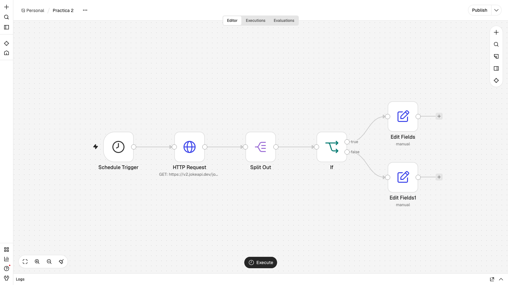

| # | Nodo | Tipo | Función |
|---|---|---|---|
| 1 | Schedule Trigger | Schedule Trigger | Inicia el workflow cada minuto |
| 2 | HTTP Request | HTTP Request | `GET https://v2.jokeapi.dev/joke/Programming?type=single&amount=5` |
| 3 | Split Out | Split Out | Separa el array `jokes` en 5 ítems, conservando el resto de campos |
| 4 | If | If | Comprueba si `{{ $json.jokes.safe }}` es verdadero |
| 5 | Edit Fields | Set | Rama `true`: `clasificacion = "Chiste seguro"` |
| 6 | Edit Fields1 | Set | Rama `false`: `clasificacion = "Chiste NO seguro"` |

La expresión del nodo If usa `$json.jokes.safe` porque, con **Include: All Other Fields**, Split Out mantiene cada chiste dentro del campo `jokes`.

El workflow exportado está en [`workflows/Practica-2.json`](workflows/Practica-2.json).

## 2. Ejecución

Con el workflow publicado, n8n lo ejecuta cada minuto sin intervención manual. En la ejecución de la captura, 4 chistes van por la rama `true` y 1 por la rama `false`. El reparto puede cambiar entre ejecuciones, porque depende de los chistes que devuelva la API.

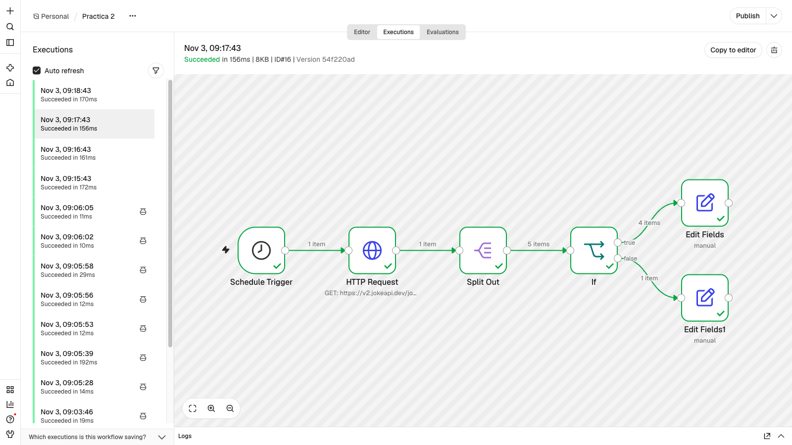

### Split Out

Convierte el único ítem que devuelve la API en 5 ítems.

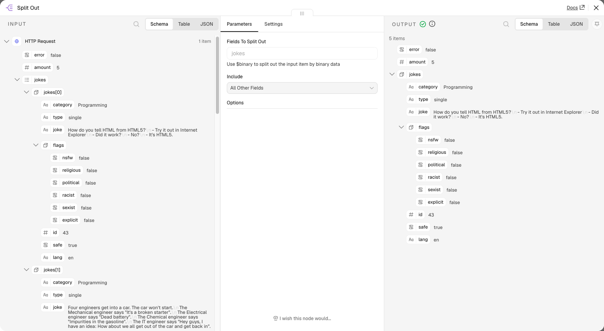

### If

Envía cada chiste a una rama según el valor de `safe`.

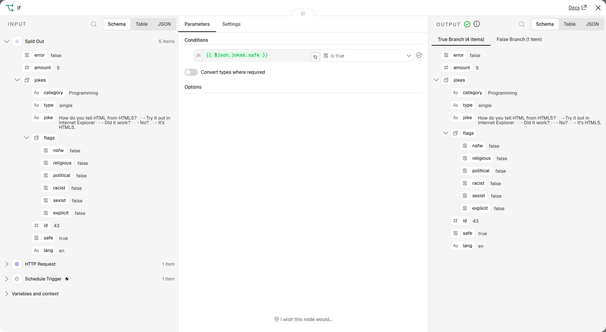

### Ramas

Las dos ramas crean el mismo campo, `clasificacion`, con un valor distinto:

```json
{ "clasificacion": "Chiste seguro" }
```

```json
{ "clasificacion": "Chiste NO seguro" }
```

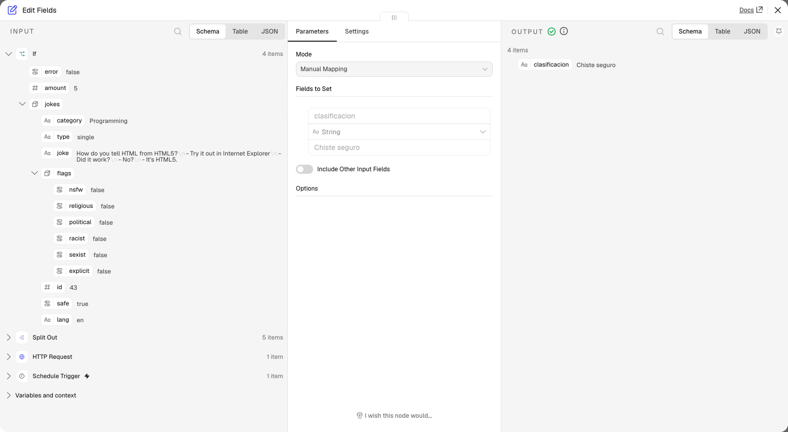

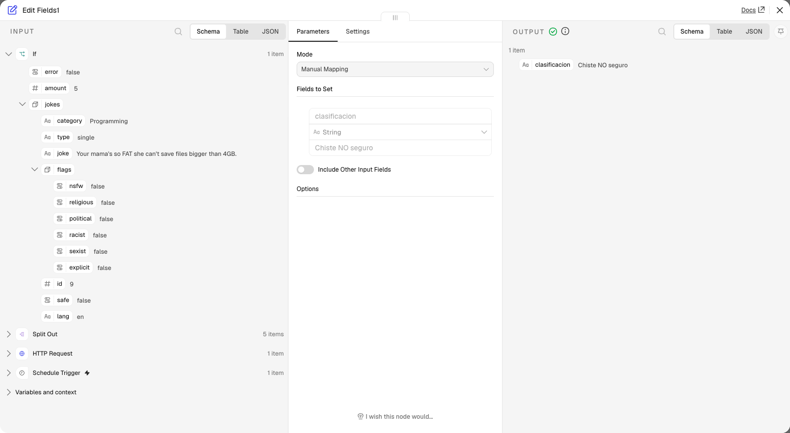

---

## 3. Ejercicios propuestos

Los cinco ejercicios propuestos del enunciado se resolvieron sobre la misma instancia de n8n. Ninguno necesita credenciales: todas las APIs son públicas. Cada uno tiene además su propio informe en PDF (`Practica-2.N-Roberto-Castillo.pdf`).

| Ejercicio | Workflow | JSON exportado |
|---|---|---|
| 1. Filtrado por categoría | `P2 Ejercicio 1 - Filtrado por categoria` | [`E1-Filtrado-por-categoria.json`](workflows/ejercicios/E1-Filtrado-por-categoria.json) |
| 2. Análisis de productos | `P2 Ejercicio 2 - Analisis de productos` | [`E2-Analisis-de-productos.json`](workflows/ejercicios/E2-Analisis-de-productos.json) |
| 3. Planificador de festivos | `P2 Ejercicio 3 - Planificador de festivos` | [`E3-Planificador-de-festivos.json`](workflows/ejercicios/E3-Planificador-de-festivos.json) |
| 4. Alerta de temperatura | `P2 Ejercicio 4 - Alerta de temperatura` | [`E4-Alerta-de-temperatura.json`](workflows/ejercicios/E4-Alerta-de-temperatura.json) |
| 5. Clasificación de usuarios por edad | `P2 Ejercicio 5 - Clasificacion de usuarios` | [`E5-Clasificacion-de-usuarios.json`](workflows/ejercicios/E5-Clasificacion-de-usuarios.json) |

### 3.1. Ejercicio 1: Filtrado por categoría

Parte del workflow guiado. JokeAPI admite varias categorías separadas por comas en la ruta, así que la URL del HTTP Request pasa a pedir `Programming` y `Misc` a la vez.

| # | Nodo | Configuración |
|---|---|---|
| 1 | Schedule Trigger | Cada minuto, como en el workflow guiado |
| 2 | HTTP Request | `GET https://v2.jokeapi.dev/joke/Programming,Misc?type=single&amount=5` |
| 3 | Split Out | **Fields To Split Out** = `jokes`, **Include** = `All Other Fields` |
| 4 | If | `{{ $json.jokes.category }}` (String) **is equal to** `Programming` |
| 5 | Programming | Rama `true`: `categoria` = `Programming`, `chiste` = `{{ $json.jokes.joke }}` |
| 6 | Misc | Rama `false`: `categoria` = `Misc`, `chiste` = `{{ $json.jokes.joke }}` |

En la ejecución, de los 5 chistes, 4 fueron de `Programming` y 1 de `Misc`.

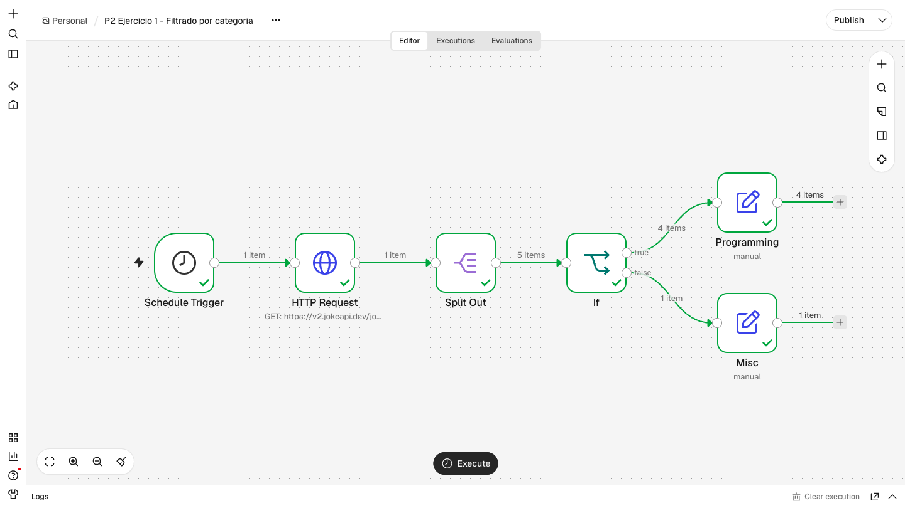

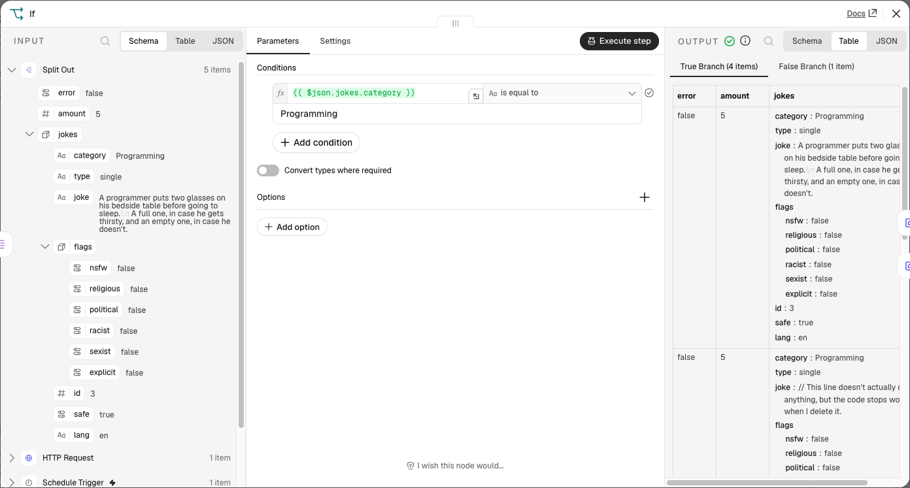

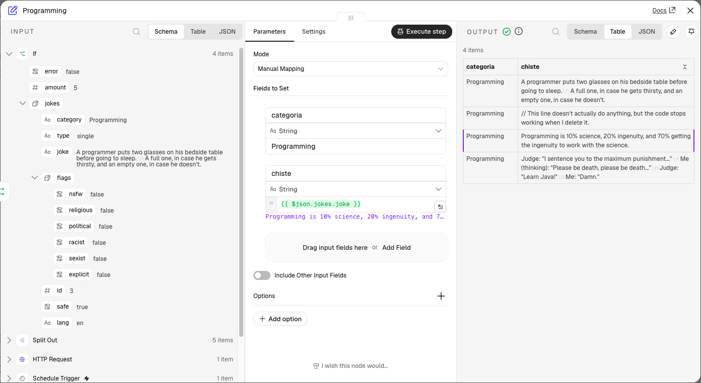

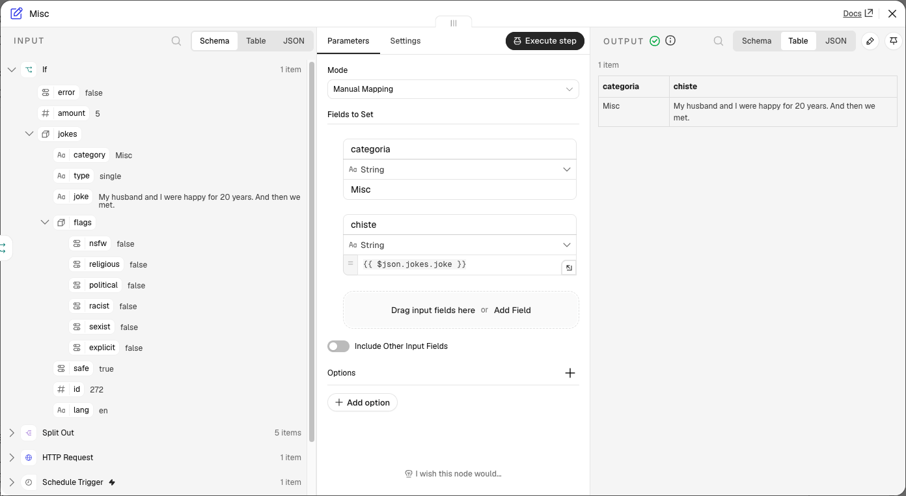

### 3.2. Ejercicio 2: Análisis de productos

| # | Nodo | Configuración |
|---|---|---|
| 1 | Schedule Trigger | Una vez al día (**Trigger Interval** = `Days`, a las 8:00) |
| 2 | HTTP Request | `GET https://fakestoreapi.com/products` |
| 3 | If | `{{ $json.price }}` (Number) **is greater than** `100` |
| 4 | Producto Premium | Rama `true`: `producto`, `precio` y `etiqueta` = `Producto Premium` |
| 5 | Producto Estandar | Rama `false`: `producto`, `precio` y `etiqueta` = `Producto Estándar` |

La Fake Store API devuelve directamente un array, y el nodo HTTP Request de n8n separa los arrays de la respuesta en un ítem por elemento. Por eso no hace falta un Split Out: el If ya recibe los 20 productos por separado. Además de `etiqueta`, los Edit Fields guardan el nombre y el precio del producto para que la salida sea legible.

En la ejecución, 8 productos superaron los 100 € y 12 quedaron por debajo.

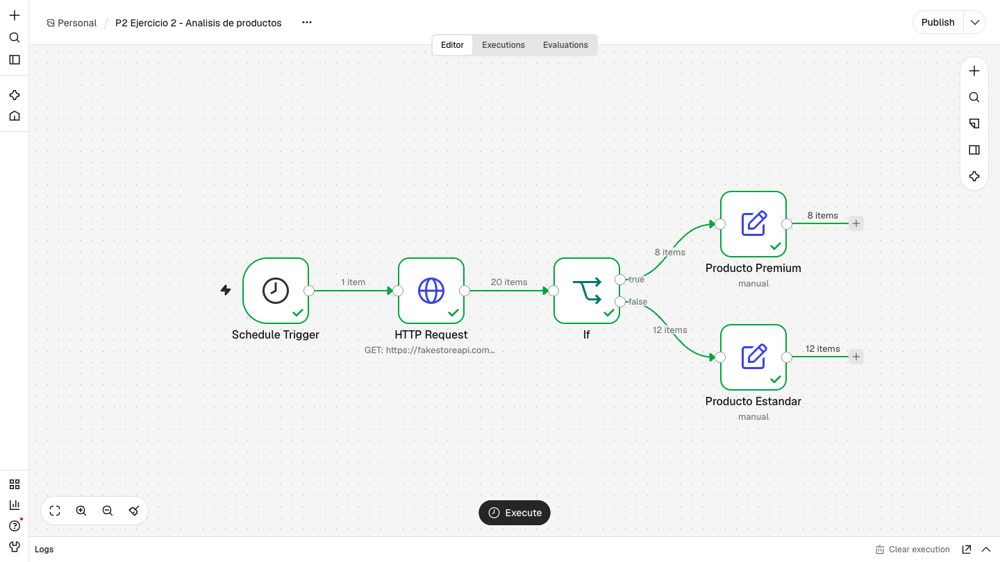

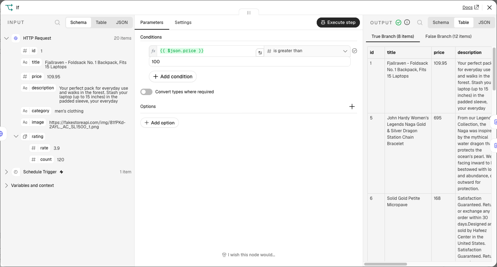

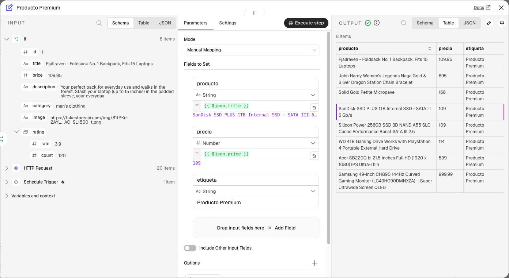

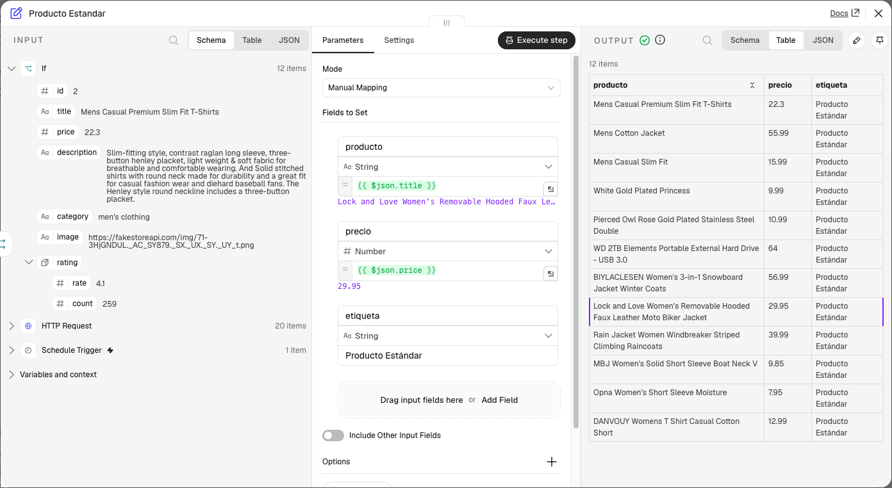

### 3.3. Ejercicio 3: Planificador de festivos

| # | Nodo | Configuración |
|---|---|---|
| 1 | Manual Trigger | — |
| 2 | Festivos 2027 | HTTP Request: `GET https://date.nager.at/api/v3/PublicHolidays/2027/ES` |
| 3 | Es nacional | If: `{{ $json.global }}` (Boolean) **is true** |
| 4 | Actividad aleatoria | HTTP Request (rama `true`): `GET https://bored-api.appbrewery.com/random` |
| 5 | Plan del festivo | Edit Fields: `name`, `date` y `activity` |

El enunciado pide los festivos de 2027, pero la URL de ejemplo apunta a 2025; se usó 2027 en la URL. Igual que en el ejercicio 2, el HTTP Request ya devuelve un ítem por festivo, así que no se añadió Split Out. La rama `false` no tiene ningún nodo.

En **Plan del festivo**, `name` y `date` se leen de `$('Es nacional').item.json`, porque después de la llamada a la Bored API `$json` contiene la actividad y no el festivo:

```
name     = {{ $('Es nacional').item.json.name }}
date     = {{ $('Es nacional').item.json.date }}
activity = {{ $json.activity }}
```

En la ejecución se obtuvieron 32 festivos; 10 son nacionales y recibieron una actividad, y los otros 22 son autonómicos.

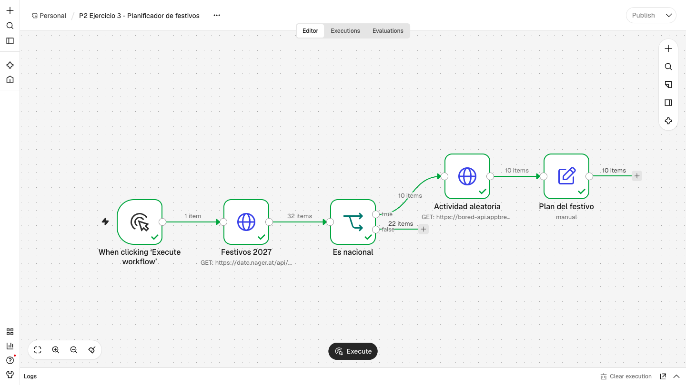

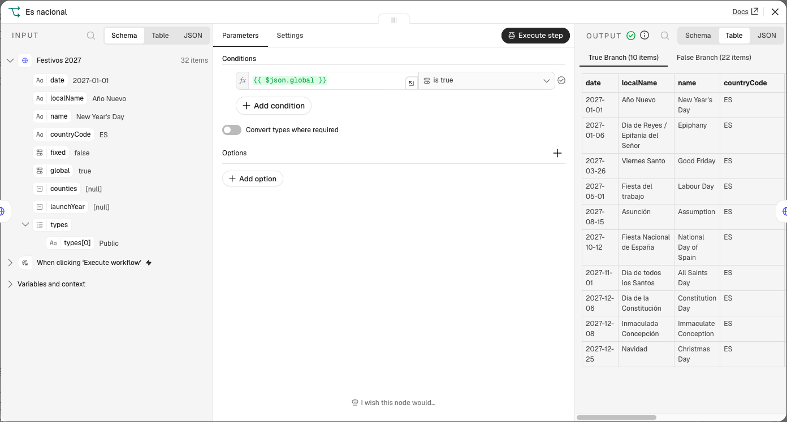

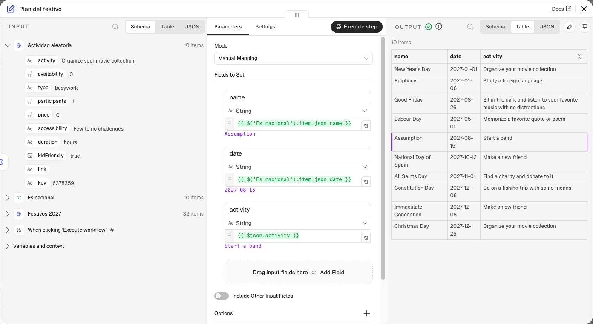

### 3.4. Ejercicio 4: Alerta de temperatura

| # | Nodo | Configuración |
|---|---|---|
| 1 | Schedule Trigger | Cada hora (**Trigger Interval** = `Hours`, `1`) |
| 2 | Temperatura Madrid | HTTP Request: `GET https://api.open-meteo.com/v1/forecast?latitude=40.4168&longitude=-3.7038&current=temperature_2m&timezone=auto` |
| 3 | Mayor de 30 | If: `{{ $json.current.temperature_2m }}` (Number) **is greater than** `30` |
| 4 | Alerta | Rama `true`: `estado` = `Alerta: calor extremo` y `temperatura` |
| 5 | Normal | Rama `false`: `estado` = `Temperatura normal` y `temperatura` |

En la ejecución la temperatura en Madrid era de 13 °C, así que el ítem fue a la rama `false`.

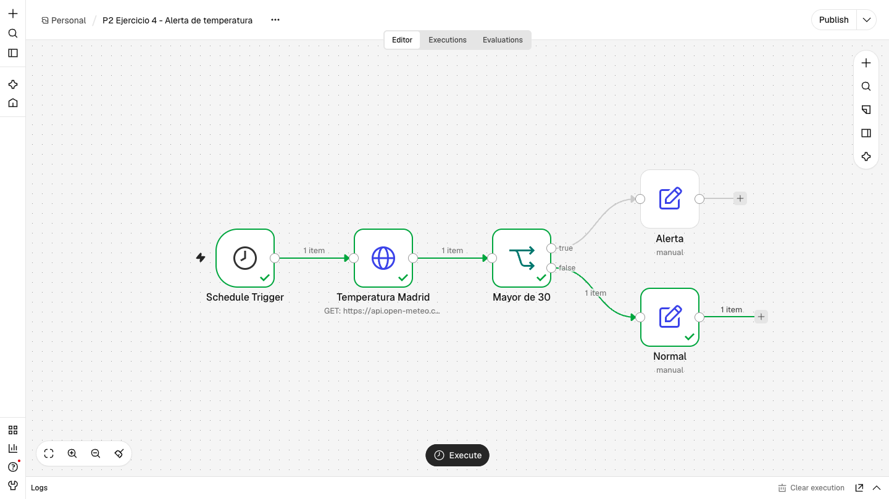

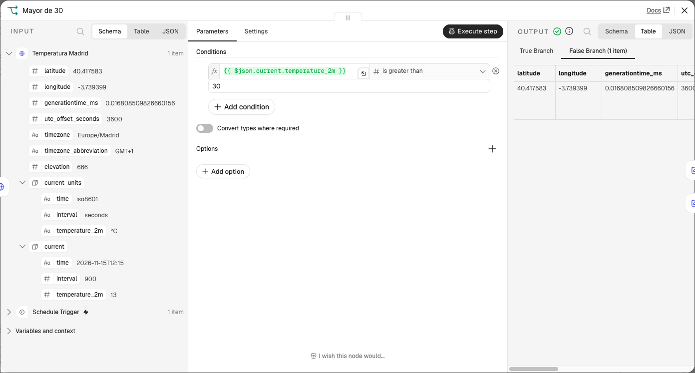

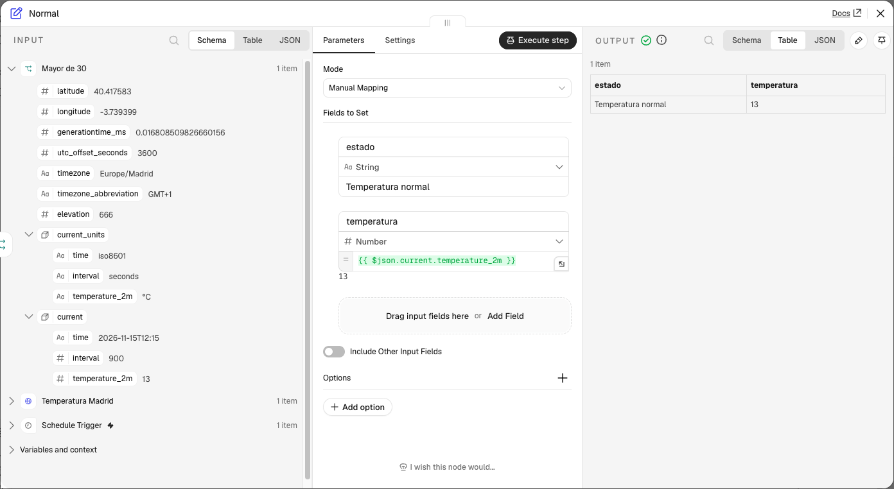

**Pregunta de reflexión.** Si la API devuelve un error, el HTTP Request falla y el workflow se detiene antes de llegar al If. Si devuelve `null` en `temperature_2m`, el If, con la validación de tipos estricta, da un error porque espera un número. Para evitarlo se puede activar **Convert types where required** en el If, añadir antes una condición `temperature_2m` **exists** combinada con AND, o activar en el HTTP Request **On Error: Continue** y tratar el error en una rama aparte.

### 3.5. Ejercicio 5: Clasificación de usuarios por edad

| # | Nodo | Configuración |
|---|---|---|
| 1 | Manual Trigger | — |
| 2 | HTTP Request | `GET https://randomuser.me/api/?results=10` |
| 3 | Split Out | **Fields To Split Out** = `results` |
| 4 | If | `{{ $json.dob.age }}` (Number) **is greater than** `50` |
| 5 | Mayor de 50 | Rama `true`: `grupo` = `Mayor de 50`, `nombre` y `edad` |
| 6 | Menor o igual de 50 | Rama `false`: `grupo` = `Menor o igual de 50`, `nombre` y `edad` |

El enunciado indica la expresión `{{ $json.result.dob.age }}`, pero con **Include** = `No Other Fields` el Split Out deja los campos de cada usuario en el primer nivel del ítem, así que la expresión correcta es `{{ $json.dob.age }}`.

En la ejecución, 4 de los 10 usuarios tenían más de 50 años y 6 tenían 50 o menos.

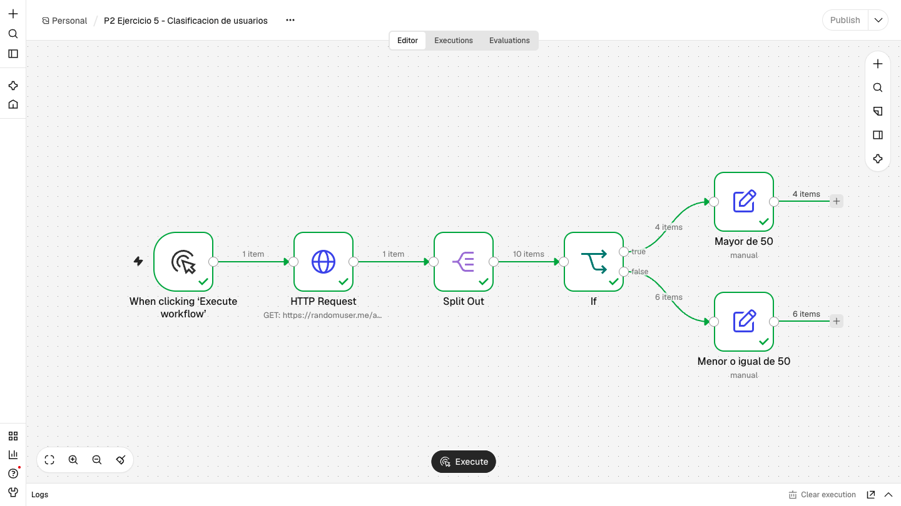

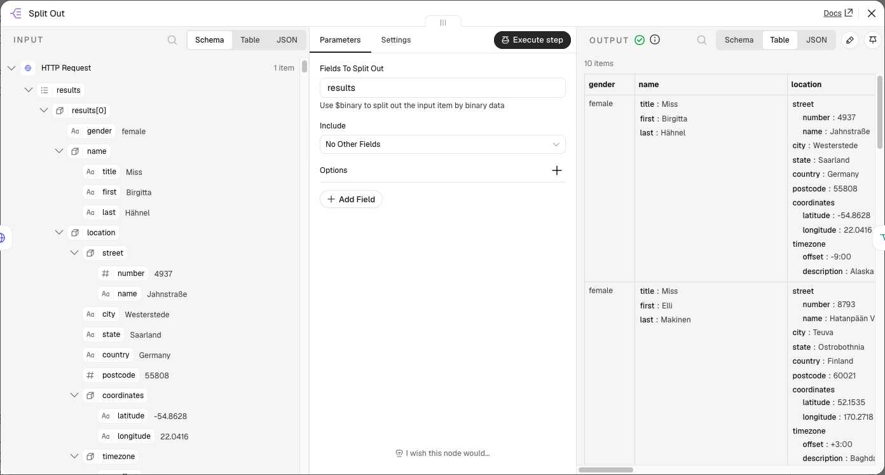

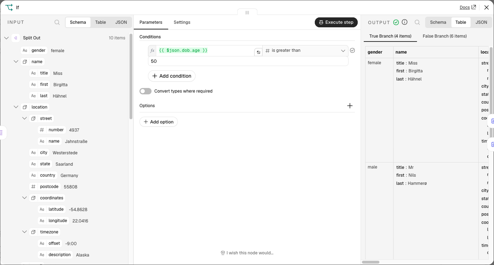

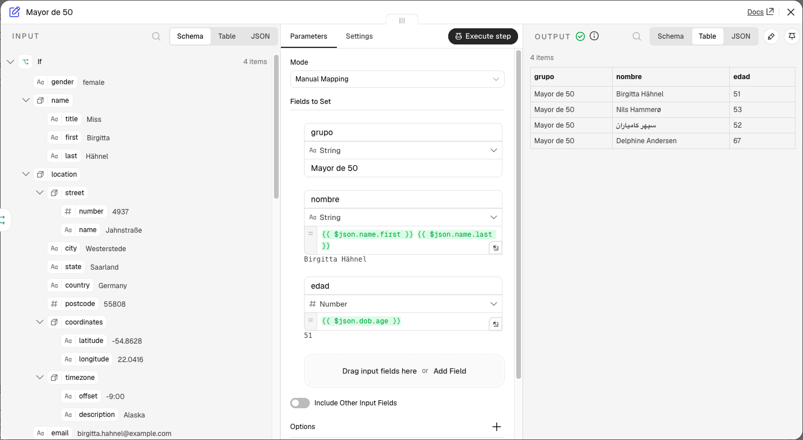

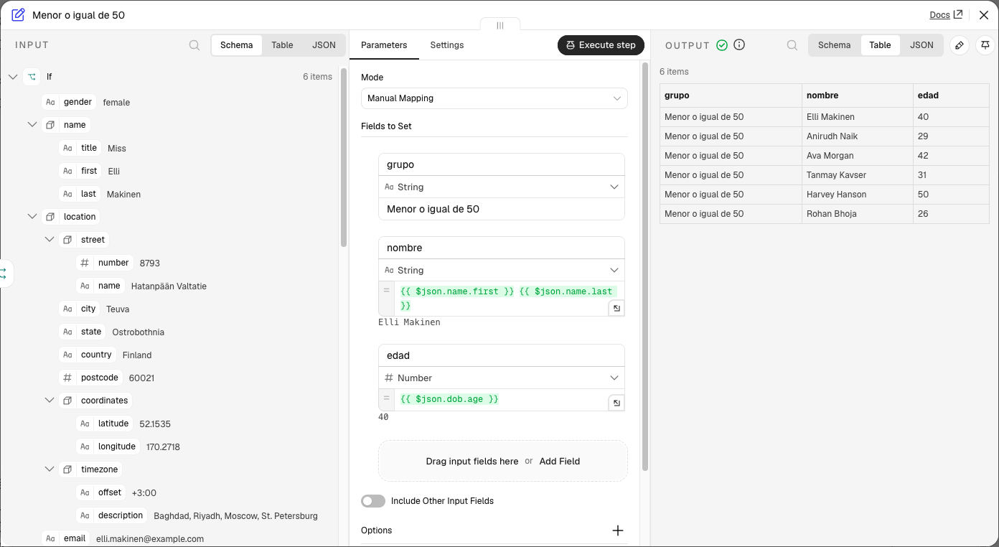

**Pregunta de reflexión.** El nombre se añadió con el campo `nombre` = `{{ $json.name.first }} {{ $json.name.last }}`. Si se quiere dentro del propio campo `grupo`, basta con escribir en su valor `{{ $json.name.first }} {{ $json.name.last }}: Mayor de 50`, ya que un campo puede mezclar texto fijo y expresiones.
