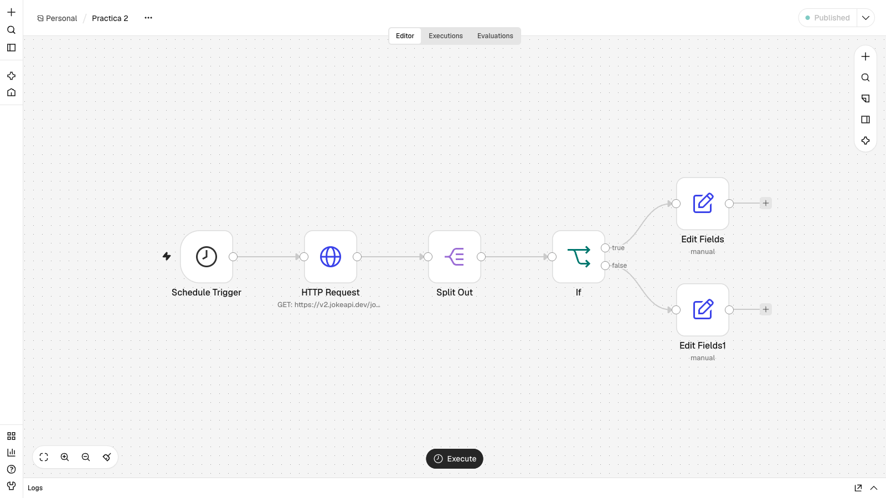
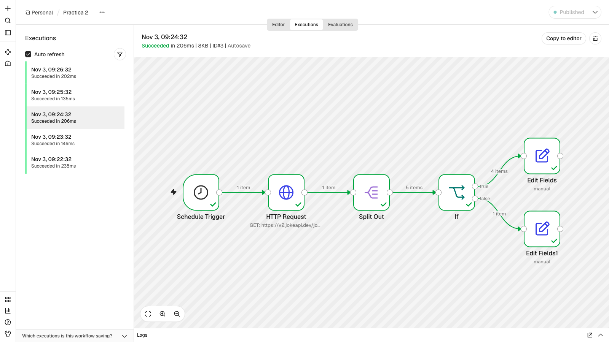
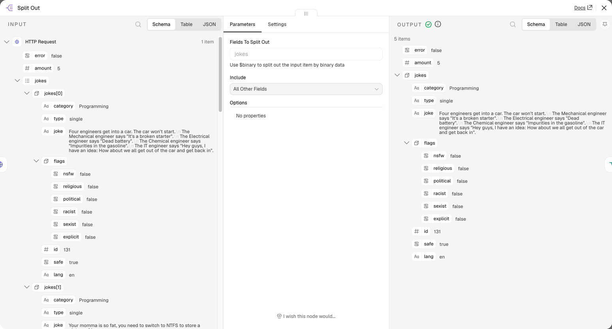
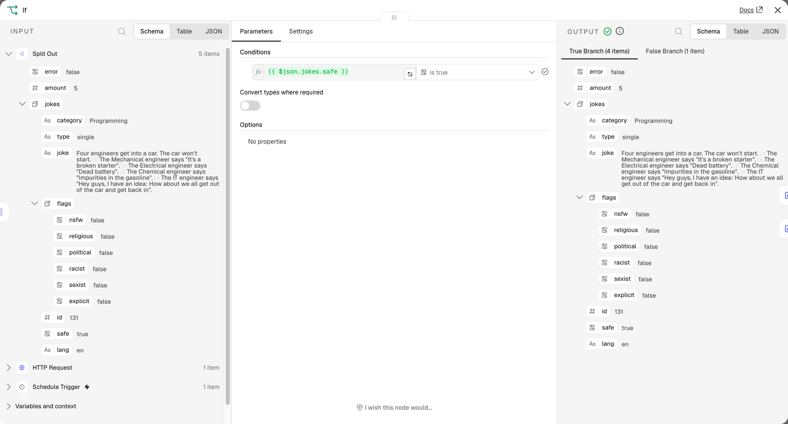
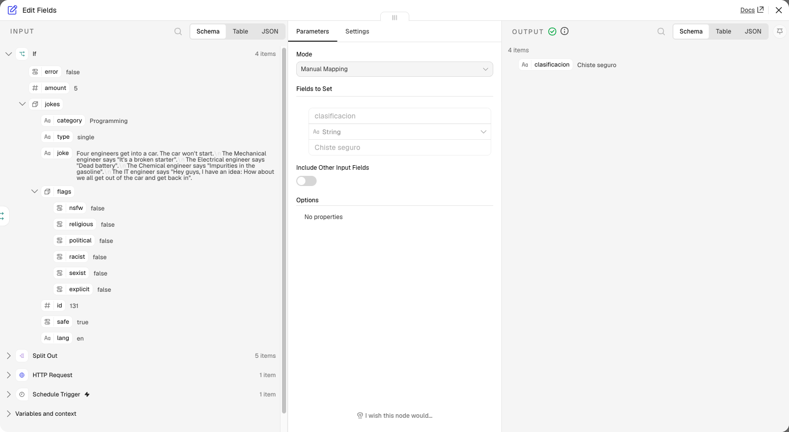
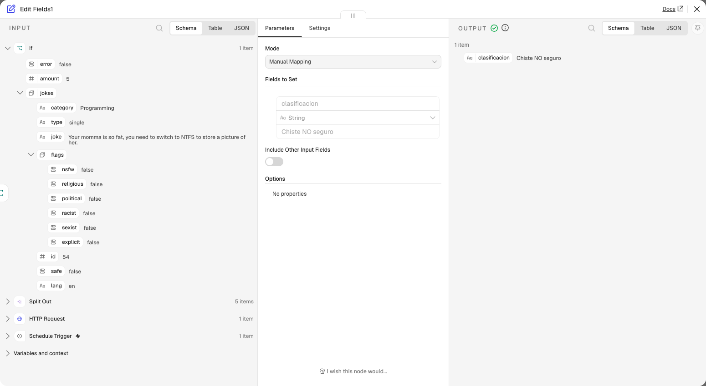

# Práctica 2: Lógica, programación y manejo de colecciones en n8n

**Asignatura:** Integración de Tecnologías y Servicios Informáticos (ITSI)
**Alumno:** Roberto Castillo — rct419@inlumine.ual.es

Workflow que se ejecuta cada minuto, pide 5 chistes de programación a JokeAPI, los separa en ítems individuales y los clasifica como seguros o no seguros según el campo `safe`.

---

## Cómo importar y ejecutar el workflow

1. Abrir la instancia de n8n en el navegador (por defecto, en local: http://localhost:5678).
2. **Create workflow → menú `…` → Import from File** y seleccionar [`workflows/Practica-2.json`](workflows/Practica-2.json).
3. Pulsar **Publish** para activar el workflow.
4. Esperar un minuto y abrir la pestaña **Executions**.

El workflow no necesita credenciales: la API utilizada es pública.

## 1. Workflow `Practica 2`



| # | Nodo | Tipo | Función |
|---|---|---|---|
| 1 | Schedule Trigger | Schedule Trigger | Inicia el workflow cada minuto |
| 2 | HTTP Request | HTTP Request | `GET https://v2.jokeapi.dev/joke/Programming?type=single&amount=5` |
| 3 | Split Out | Split Out | Separa el array `jokes` en 5 ítems, conservando el resto de campos |
| 4 | If | If | Comprueba si `{{ $json.jokes.safe }}` es verdadero |
| 5 | Edit Fields | Set | Rama `true`: `clasificacion = "Chiste seguro"` |
| 6 | Edit Fields1 | Set | Rama `false`: `clasificacion = "Chiste NO seguro"` |

La expresión del nodo If usa `$json.jokes.safe` porque, con **Include: All Other Fields**, Split Out mantiene cada chiste dentro del campo `jokes`.

El workflow exportado está en [`workflows/Practica-2.json`](workflows/Practica-2.json).

## 2. Ejecución

Con el workflow publicado, n8n lo ejecuta cada minuto sin intervención manual. En la ejecución de la captura, 4 chistes van por la rama `true` y 1 por la rama `false`. El reparto puede cambiar entre ejecuciones, porque depende de los chistes que devuelva la API.



### Split Out

Convierte el único ítem que devuelve la API en 5 ítems.



### If

Envía cada chiste a una rama según el valor de `safe`.



### Ramas

Las dos ramas crean el mismo campo, `clasificacion`, con un valor distinto:

```json
{ "clasificacion": "Chiste seguro" }
```

```json
{ "clasificacion": "Chiste NO seguro" }
```




