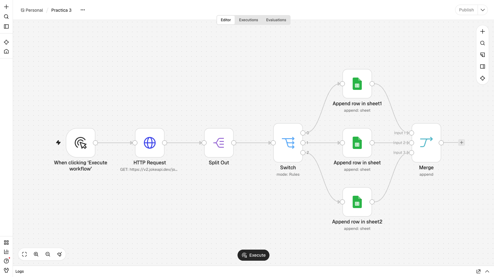
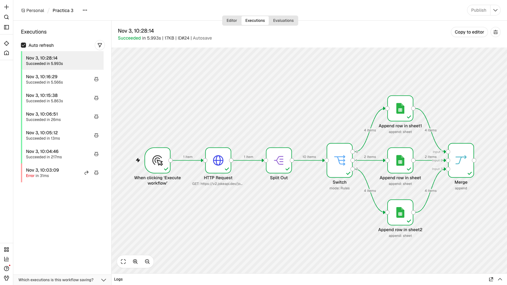
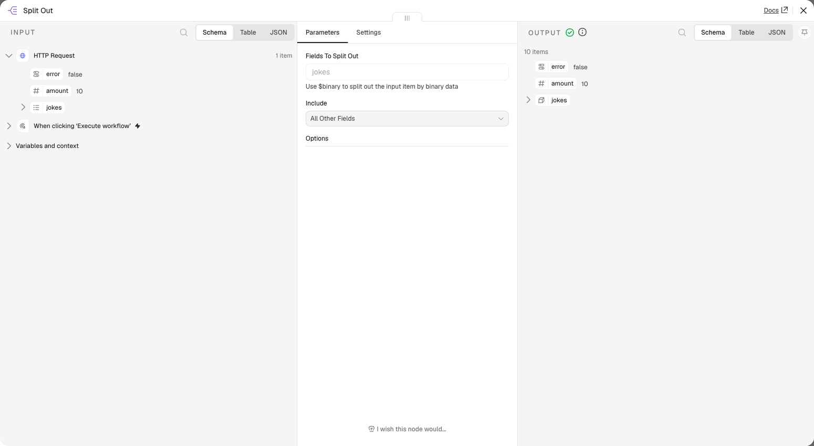
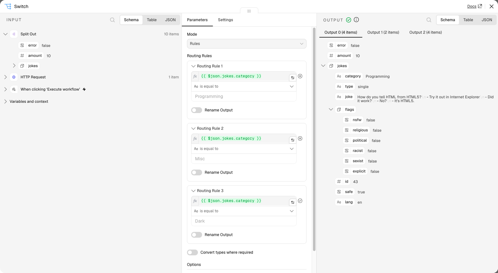
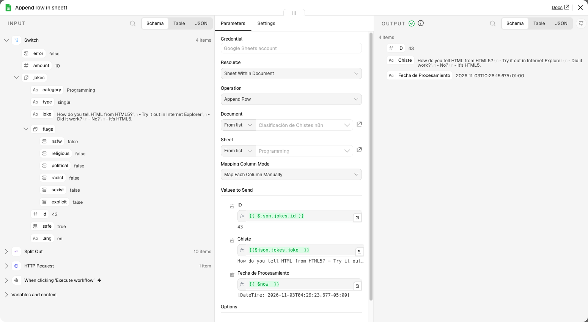
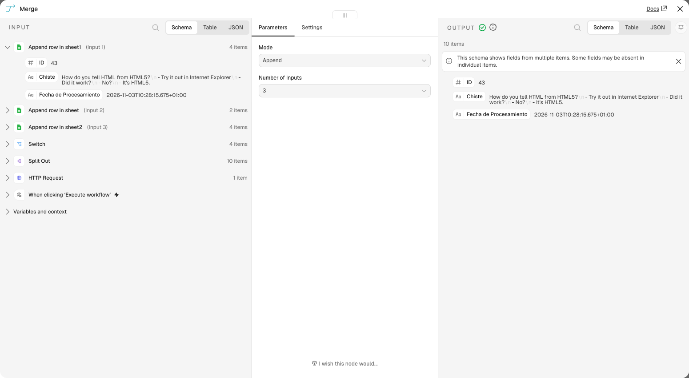
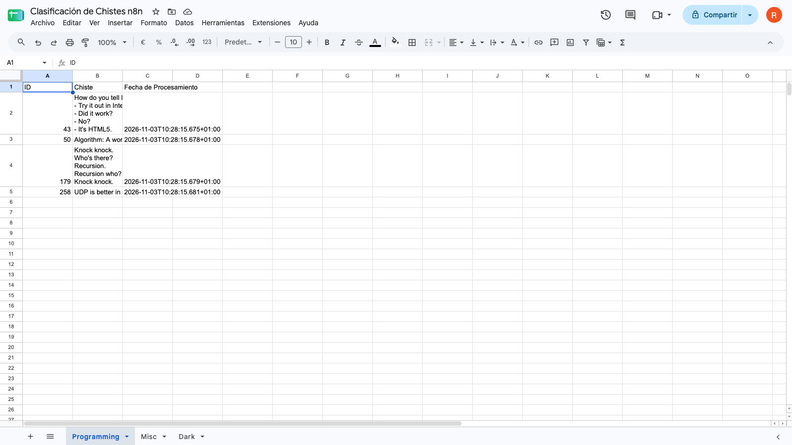
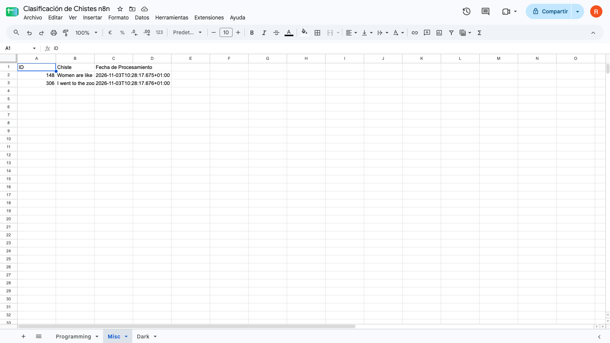
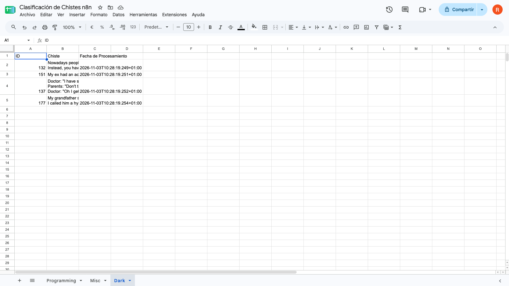

# Práctica 3: Enrutamiento avanzado, fusión de datos e integración con Google Sheets

**Asignatura:** Integración de Tecnologías y Servicios Informáticos (ITSI)
**Alumno:** Roberto Castillo — rct419@inlumine.ual.es

Workflow que pide 10 chistes a JokeAPI, los clasifica por categoría con un nodo Switch y escribe cada uno en su hoja de un documento de Google Sheets. Al final, un nodo Merge une las tres ramas.

---

## Cómo importar y ejecutar el workflow

1. Crear en Google Sheets un documento con las hojas `Programming`, `Misc` y `Dark`, y estas cabeceras en cada una: `ID`, `Chiste` y `Fecha de Procesamiento`.
2. Abrir la instancia de n8n en el navegador (por defecto, en local: http://localhost:5678).
3. **Create workflow → menú `…` → Import from File** y seleccionar [`workflows/Practica-3.json`](workflows/Practica-3.json).
4. En los tres nodos de Google Sheets, seleccionar una credencial propia de Google (OAuth 2.0), el documento y la hoja correspondiente.
5. Pulsar **Execute workflow**.

Las credenciales no se incluyen en el JSON exportado, por lo que cada instancia debe configurar la suya.

## 1. Workflow `Practica 3`



| # | Nodo | Tipo | Función |
|---|---|---|---|
| 1 | When clicking 'Execute workflow' | Manual Trigger | Inicia el workflow manualmente |
| 2 | HTTP Request | HTTP Request | `GET https://v2.jokeapi.dev/joke/Programming,Misc,Dark?type=single&amount=10` |
| 3 | Split Out | Split Out | Separa el array `jokes` en 10 ítems, conservando el resto de campos |
| 4 | Switch | Switch | Envía cada chiste a una salida según `{{ $json.jokes.category }}` |
| 5 | Append row in sheet1 | Google Sheets | Salida 0: añade la fila a la hoja `Programming` |
| 6 | Append row in sheet | Google Sheets | Salida 1: añade la fila a la hoja `Misc` |
| 7 | Append row in sheet2 | Google Sheets | Salida 2: añade la fila a la hoja `Dark` |
| 8 | Merge | Merge | Une las tres ramas en modo Append |

Los nodos usan `$json.jokes.category`, `$json.jokes.id` y `$json.jokes.joke` porque, con **Include: All Other Fields**, Split Out mantiene cada chiste dentro del campo `jokes`.

Columnas que escribe cada nodo de Google Sheets:

| Columna | Expresión |
|---|---|
| `ID` | `{{ $json.jokes.id }}` |
| `Chiste` | `{{ $json.jokes.joke }}` |
| `Fecha de Procesamiento` | `{{ $now }}` |

El workflow exportado está en [`workflows/Practica-3.json`](workflows/Practica-3.json).

## 2. Ejecución

En la ejecución de la captura, los 10 chistes se reparten en 4 de `Programming`, 2 de `Misc` y 4 de `Dark`. El reparto puede cambiar entre ejecuciones, porque depende de los chistes que devuelva la API.



### Split Out

Convierte el único ítem que devuelve la API en 10 ítems.



### Switch

Compara la categoría con tres reglas y crea una salida para cada una.



### Google Sheets

Añade una fila por chiste en la hoja correspondiente. Ejemplo de la salida del nodo de `Programming`:

```json
{
  "ID": 258,
  "Chiste": "UDP is better in the COVID era since it avoids unnecessary handshakes.",
  "Fecha de Procesamiento": "2026-11-03T10:28:15.681+01:00"
}
```



### Merge

Reúne las filas escritas por las tres ramas en una única salida de 10 ítems.



## 3. Resultado en Google Sheets

Cada chiste queda en la hoja de su categoría, con su `ID` y la fecha de procesamiento.

### Hoja `Programming`



### Hoja `Misc`



### Hoja `Dark`


