# Práctica 3: Enrutamiento avanzado, fusión de datos e integración con Google Sheets

**Asignatura:** Integración de Tecnologías y Servicios Informáticos (ITSI)
**Alumno:** Roberto Castillo — rct419@inlumine.ual.es  
**Enunciado:** https://ualitsi.github.io/n8n-003/

Workflow que pide 10 chistes a JokeAPI, los clasifica por categoría con un nodo Switch y escribe cada uno en su hoja de un documento de Google Sheets. Al final, un nodo Merge une las tres ramas.

---

## Cómo importar y ejecutar el workflow

1. Crear en Google Sheets un documento con las hojas `Programming`, `Misc` y `Dark`, y estas cabeceras en cada una: `ID`, `Chiste` y `Fecha de Procesamiento`.
2. Abrir la instancia de n8n en el navegador (por defecto, en local: http://localhost:5678).
3. **Create workflow → menú `…` → Import from File** y seleccionar [`workflows/Practica-3.json`](workflows/Practica-3.json).
4. En los tres nodos de Google Sheets, seleccionar una credencial propia de Google (OAuth 2.0), el documento y la hoja correspondiente.
5. Pulsar **Execute workflow**.

Las credenciales no se incluyen en el JSON exportado, por lo que cada instancia debe configurar la suya.

## 1. Workflow `Practica 3`

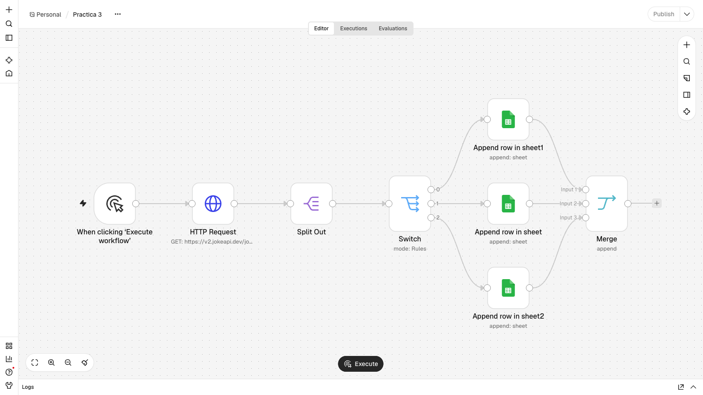

| # | Nodo | Tipo | Función |
|---|---|---|---|
| 1 | When clicking 'Execute workflow' | Manual Trigger | Inicia el workflow manualmente |
| 2 | HTTP Request | HTTP Request | `GET https://v2.jokeapi.dev/joke/Programming,Misc,Dark?type=single&amount=10` |
| 3 | Split Out | Split Out | Separa el array `jokes` en 10 ítems, conservando el resto de campos |
| 4 | Switch | Switch | Envía cada chiste a una salida según `{{ $json.jokes.category }}` |
| 5 | Append row in sheet1 | Google Sheets | Salida 0: añade la fila a la hoja `Programming` |
| 6 | Append row in sheet | Google Sheets | Salida 1: añade la fila a la hoja `Misc` |
| 7 | Append row in sheet2 | Google Sheets | Salida 2: añade la fila a la hoja `Dark` |
| 8 | Merge | Merge | Une las tres ramas en modo Append |

Los nodos usan `$json.jokes.category`, `$json.jokes.id` y `$json.jokes.joke` porque, con **Include: All Other Fields**, Split Out mantiene cada chiste dentro del campo `jokes`.

Columnas que escribe cada nodo de Google Sheets:

| Columna | Expresión |
|---|---|
| `ID` | `{{ $json.jokes.id }}` |
| `Chiste` | `{{ $json.jokes.joke }}` |
| `Fecha de Procesamiento` | `{{ $now }}` |

El workflow exportado está en [`workflows/Practica-3.json`](workflows/Practica-3.json).

## 2. Ejecución

En la ejecución de la captura, los 10 chistes se reparten en 4 de `Programming`, 2 de `Misc` y 4 de `Dark`. El reparto puede cambiar entre ejecuciones, porque depende de los chistes que devuelva la API.

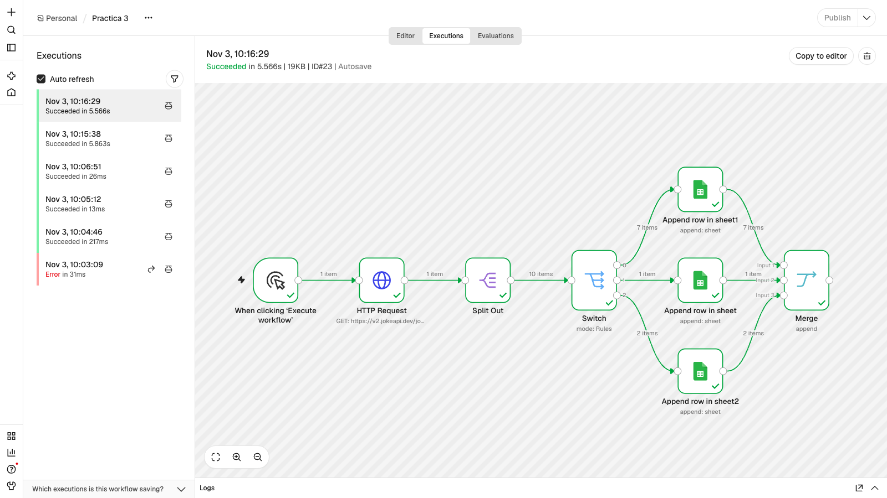

### Split Out

Convierte el único ítem que devuelve la API en 10 ítems.

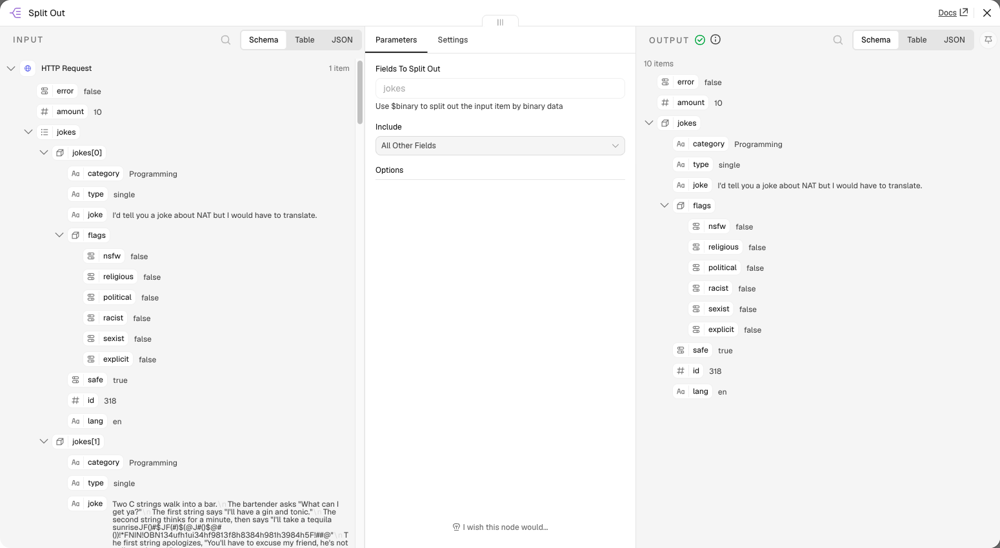

### Switch

Compara la categoría con tres reglas y crea una salida para cada una.

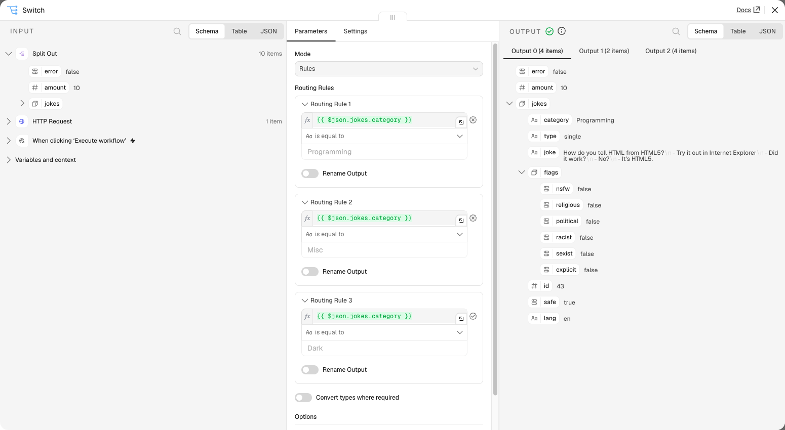

### Google Sheets

Añade una fila por chiste en la hoja correspondiente. Ejemplo de la salida del nodo de `Programming`:

```json
{
  "ID": 258,
  "Chiste": "UDP is better in the COVID era since it avoids unnecessary handshakes.",
  "Fecha de Procesamiento": "2026-11-03T10:28:15.681+01:00"
}
```

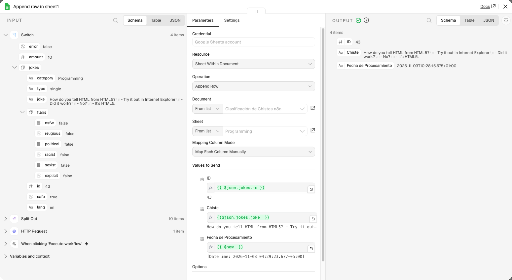

### Merge

Reúne las filas escritas por las tres ramas en una única salida de 10 ítems.

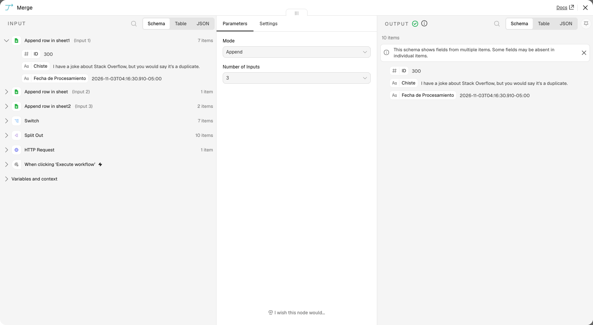

## 3. Resultado en Google Sheets

Cada chiste queda en la hoja de su categoría, con su `ID` y la fecha de procesamiento.

### Hoja `Programming`

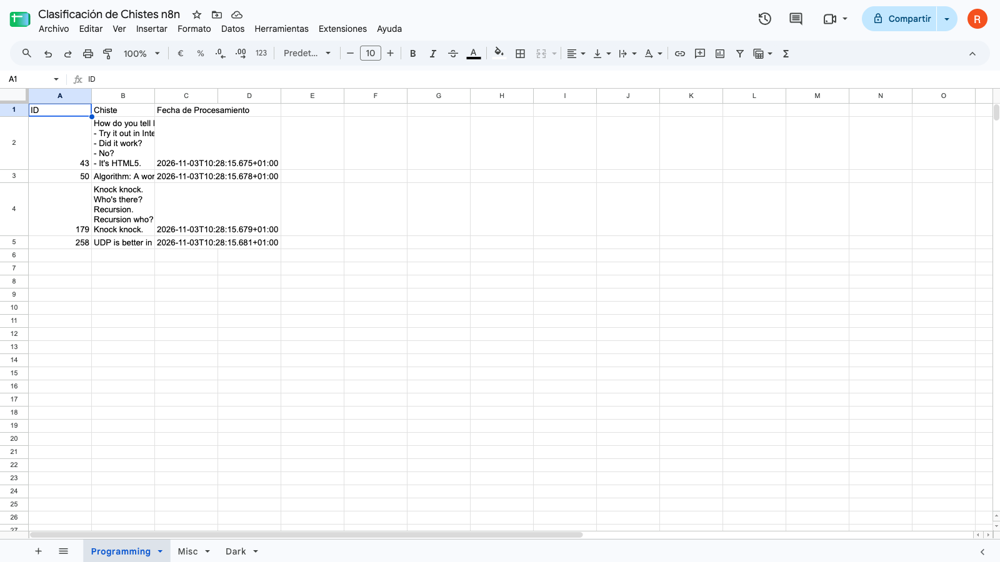

### Hoja `Misc`

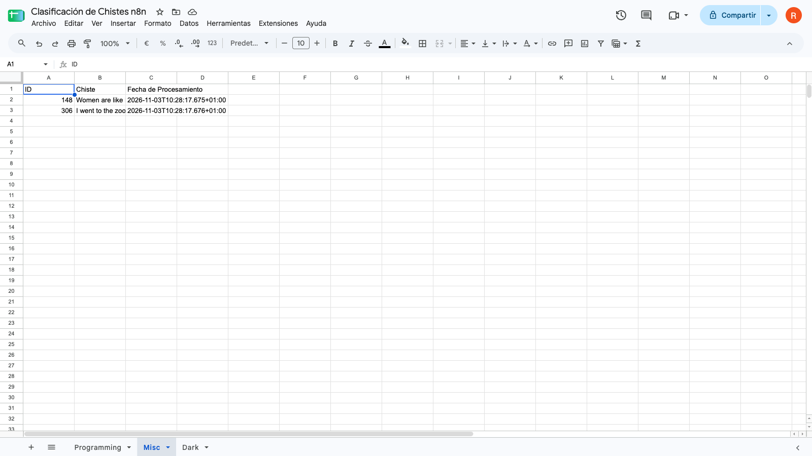

### Hoja `Dark`

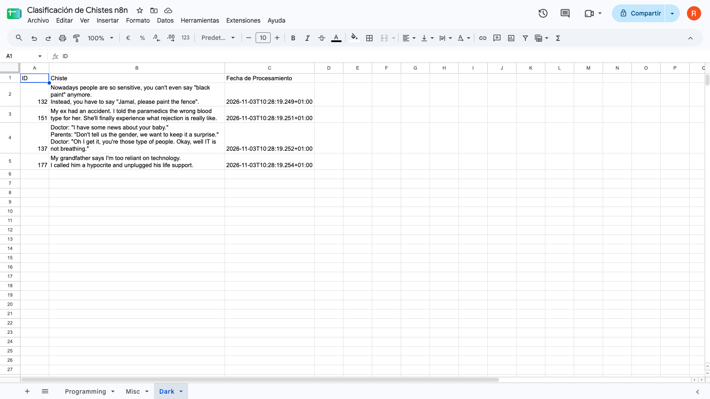

---

## 4. Ejercicios propuestos

Los siete ejercicios propuestos del enunciado se resolvieron sobre la misma instancia de n8n, con la credencial de Google Sheets de la práctica guiada. Cada uno tiene además su propio informe en PDF (`Practica-3.N-Roberto-Castillo.pdf`).

| Ejercicio | Workflow | JSON exportado | Documento de Google Sheets |
|---|---|---|---|
| 1. Consolidación en una sola hoja | `P3 Ejercicio 1 - Consolidacion en una hoja` | [`E1-Consolidacion-en-una-hoja.json`](workflows/ejercicios/E1-Consolidacion-en-una-hoja.json) | `Clasificación de Chistes n8n` (hoja nueva `Todos`) |
| 2. Clasificación de productos por valoración | `P3 Ejercicio 2 - Clasificacion por valoracion` | [`E2-Clasificacion-por-valoracion.json`](workflows/ejercicios/E2-Clasificacion-por-valoracion.json) | `Análisis de Valoraciones` |
| 3. Gestor de tareas por prioridad | `P3 Ejercicio 3 - Gestor de tareas por prioridad` | [`E3-Gestor-de-tareas-por-prioridad.json`](workflows/ejercicios/E3-Gestor-de-tareas-por-prioridad.json) | `Gestor de Tareas por Prioridad` |
| 4. Repositorios de GitHub por lenguaje | `P3 Ejercicio 4 - Repositorios por lenguaje` | [`E4-Repositorios-por-lenguaje.json`](workflows/ejercicios/E4-Repositorios-por-lenguaje.json) | `Repositorios de GitHub por Lenguaje` |
| 5. Pronóstico del tiempo | `P3 Ejercicio 5 - Pronostico del tiempo` | [`E5-Pronostico-del-tiempo.json`](workflows/ejercicios/E5-Pronostico-del-tiempo.json) | `Pronóstico del Tiempo Madrid` |
| 6. Combinación de datos por posición | `P3 Ejercicio 6 - Plan del dia` | [`E6-Plan-del-dia.json`](workflows/ejercicios/E6-Plan-del-dia.json) | `Plan del Día` |
| 7. Informe diario de productos | `P3 Ejercicio 7 - Informe diario de productos` | [`E7-Informe-diario-de-productos.json`](workflows/ejercicios/E7-Informe-diario-de-productos.json) | `Informe Diario de Productos` |

Al importar estos workflows hay que volver a seleccionar en cada nodo de Google Sheets la credencial propia y el documento, porque los identificadores de los documentos son de esta instancia.

### 4.1. Ejercicio 1: Consolidación en una sola hoja

Se partió del workflow guiado, se eliminaron los tres nodos de Google Sheets y el Merge, y en el documento `Clasificación de Chistes n8n` se creó la hoja `Todos` con las cabeceras `ID`, `Chiste`, `Fecha de Procesamiento` y `categoria_original`.

| # | Nodo | Configuración |
|---|---|---|
| 1 | Manual Trigger | — |
| 2 | HTTP Request | `GET https://v2.jokeapi.dev/joke/Programming,Misc,Dark?type=single&amount=10` |
| 3 | Split Out | **Fields To Split Out** = `jokes`, **Include** = `All Other Fields` |
| 4 | Switch | Tres reglas sobre `{{ $json.jokes.category }}`, con las salidas renombradas `Programming`, `Misc` y `Dark` |
| 5 | Categoria Programming / Misc / Dark | Edit Fields con **Include Other Input Fields**: `categoria_original` = `Programming`, `Misc` o `Dark` |
| 6 | Append row in Todos | Un único Google Sheets con las tres entradas conectadas, hoja `Todos` |

Columnas del nodo de Google Sheets:

| Columna | Expresión |
|---|---|
| `ID` | `{{ $json.jokes.id }}` |
| `Chiste` | `{{ $json.jokes.joke }}` |
| `Fecha de Procesamiento` | `{{ $now }}` |
| `categoria_original` | `{{ $json.categoria_original }}` |

En la ejecución #183, el Switch repartió los 10 chistes en 6 de `Programming`, 3 de `Misc` y 1 de `Dark`, y las 10 filas se escribieron en la hoja `Todos`.

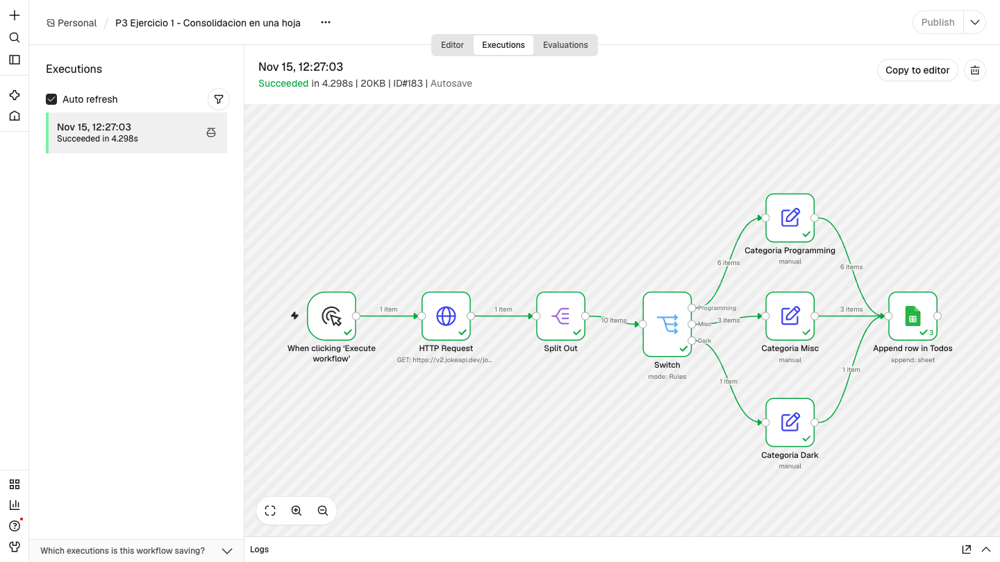

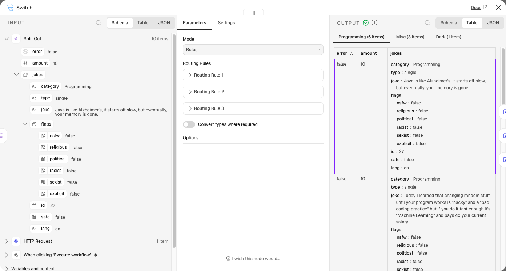

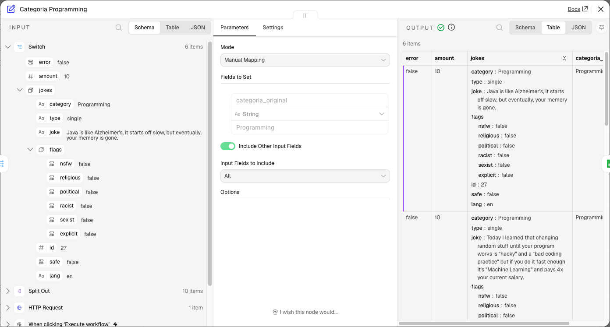

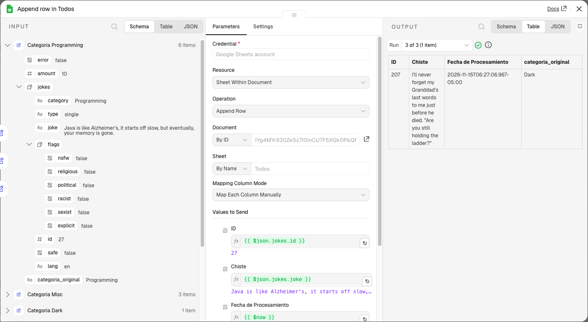

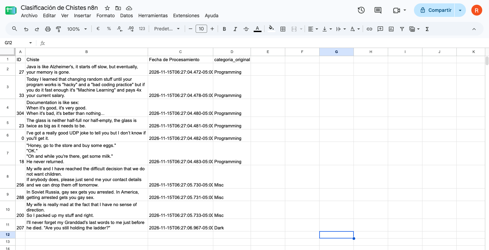

### 4.2. Ejercicio 2: Clasificación de productos por valoración

Se creó el documento `Análisis de Valoraciones` con las hojas `Top`, `Bueno` y `Regular` y las cabeceras `ID`, `Título`, `Precio` y `Valoración`.

| # | Nodo | Configuración |
|---|---|---|
| 1 | Manual Trigger | — |
| 2 | HTTP Request | `GET https://fakestoreapi.com/products` |
| 3 | Switch | Reglas sobre `{{ $json.rating.rate }}` (Number) |
| 4 | Append row in Top / Bueno / Regular | Google Sheets, una hoja por salida |

| Salida | Condiciones |
|---|---|
| `Top` | **is greater than or equal to** `4.5` |
| `Bueno` | **is greater than or equal to** `3.5` **AND** **is less than** `4.5` |
| `Regular` | **is less than** `3.5` |

Columnas: `ID` = `{{ $json.id }}`, `Título` = `{{ $json.title }}`, `Precio` = `{{ $json.price }}` y `Valoración` = `{{ $json.rating.rate }}`.

La Fake Store API devuelve directamente un array, y el HTTP Request de n8n lo separa en un ítem por producto, así que no fue necesario un Split Out. En la ejecución #184, de los 20 productos, 6 fueron a `Top`, 5 a `Bueno` y 9 a `Regular`.

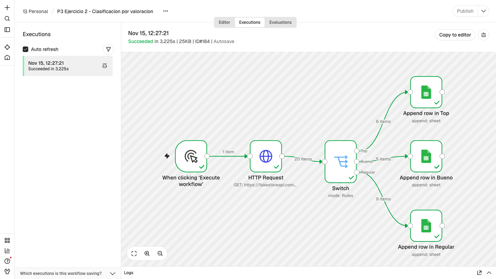

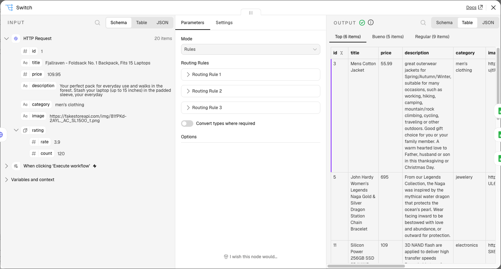

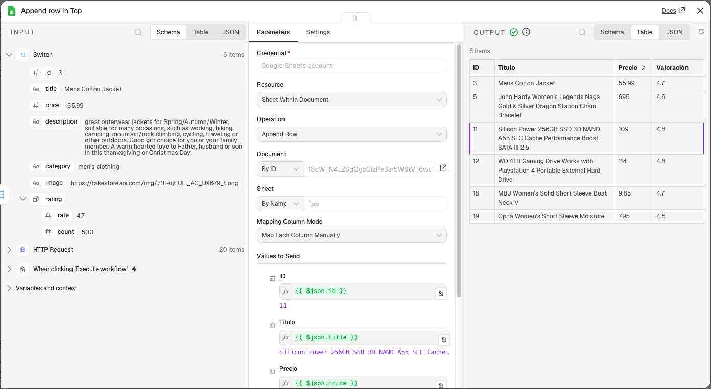

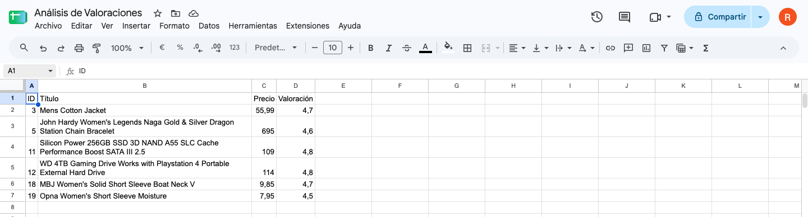

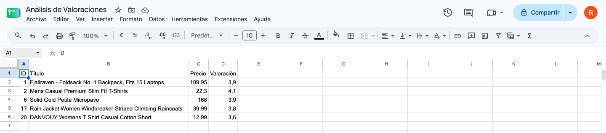

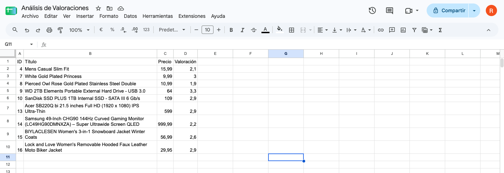

### 4.3. Ejercicio 3: Gestor de tareas por prioridad

Se creó el documento `Gestor de Tareas por Prioridad` con nueve hojas, una por combinación de prioridad y tipo (`Tareas_Tecnicas_Alta`, `Tareas_Marketing_Alta`, `Tareas_Administrativas_Alta`, …, `Tareas_Administrativas_Baja`), con las cabeceras `Actividad`, `Prioridad` y `Tipo`, y la hoja `Registro_General` con `activity`, `priority`, `type` y `hora_asignacion`.

| # | Nodo | Configuración |
|---|---|---|
| 1 | Schedule Trigger | Cada 5 minutos |
| 2 | HTTP Request | `GET https://bored-api.appbrewery.com/filter?number=5` |
| 3 | Limit | **Max Items** = `5` |
| 4 | Asignar prioridad y tipo | Edit Fields con **Include Other Input Fields** |
| 5 | Switch prioridad | Tres salidas sobre `{{ $json.priority }}`: `Alta`, `Media` y `Baja` |
| 6 | Tipo (Alta) / Tipo (Media) / Tipo (Baja) | Switch anidado sobre `{{ $json.type }}`: `Técnico`, `Marketing` y `Administrativo` |
| 7 | Tareas_… (9 nodos) | Google Sheets, cada uno en su hoja |
| 8 | Merge | Mode `Append`, 9 entradas |
| 9 | Append row in Registro_General | Google Sheets, hoja `Registro_General` |

La Bored API no aplica el parámetro `number`: el endpoint `/filter` devolvió las 196 actividades disponibles. Para quedarse con 5 se añadió un nodo **Limit** después del HTTP Request.

La prioridad y el tipo se asignan al azar con estas expresiones:

```
priority = {{ ['Alta', 'Media', 'Baja'][Math.floor(Math.random() * 3)] }}
type     = {{ ['Técnico', 'Marketing', 'Administrativo'][Math.floor(Math.random() * 3)] }}
```

Cada nodo `Tareas_…` escribe `Actividad` = `{{ $json.activity }}`, `Prioridad` = `{{ $json.priority }}` y `Tipo` = `{{ $json.type }}`. Como su salida es la fila escrita, el registro final lee esas columnas: `activity` = `{{ $json.Actividad }}`, `priority` = `{{ $json.Prioridad }}`, `type` = `{{ $json.Tipo }}` y `hora_asignacion` = `{{ $now }}`.

En la ejecución #185, las 5 actividades se repartieron en 2 de prioridad `Alta`, 2 de `Media` y 1 de `Baja`, cada una se escribió en la hoja de su combinación y las 5 quedaron en `Registro_General`.

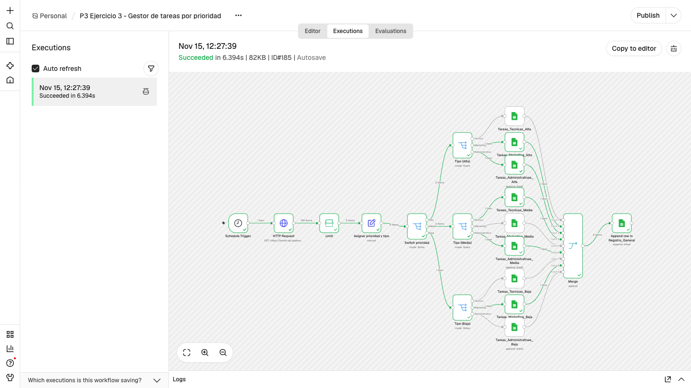

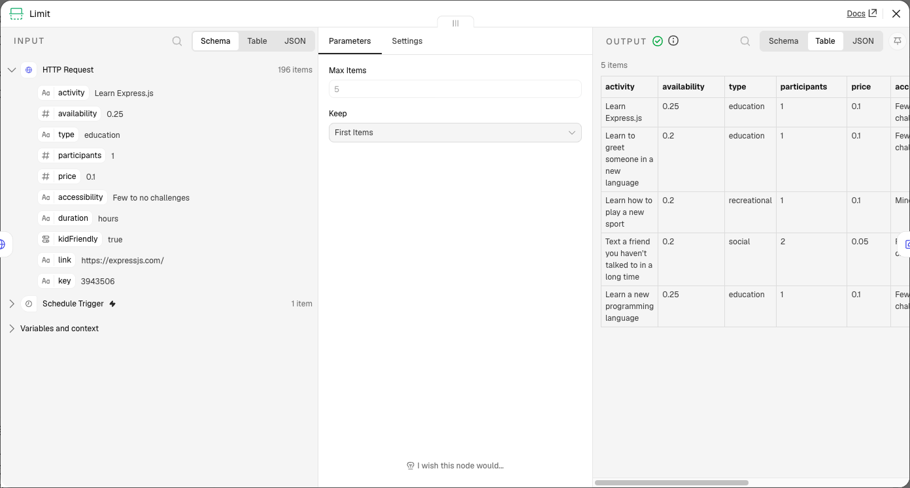

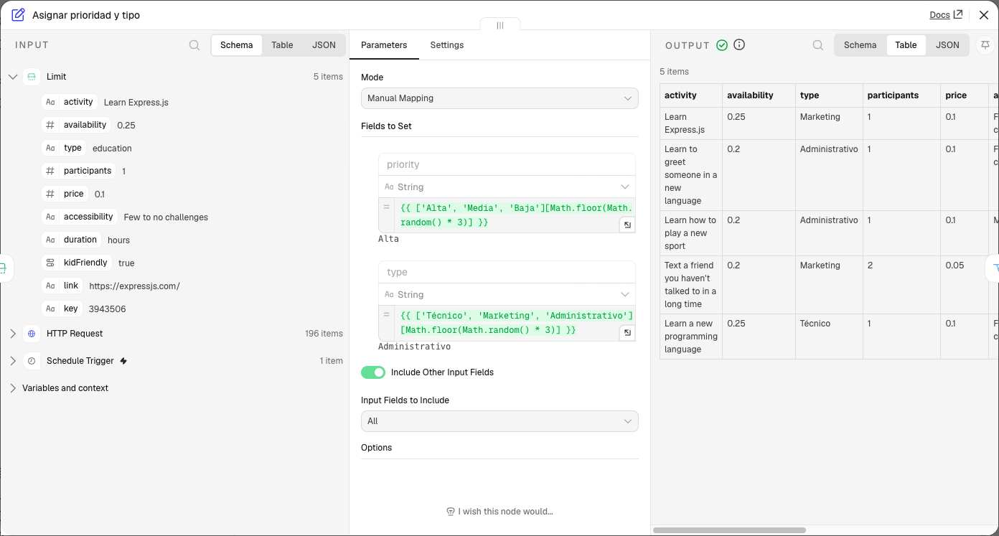

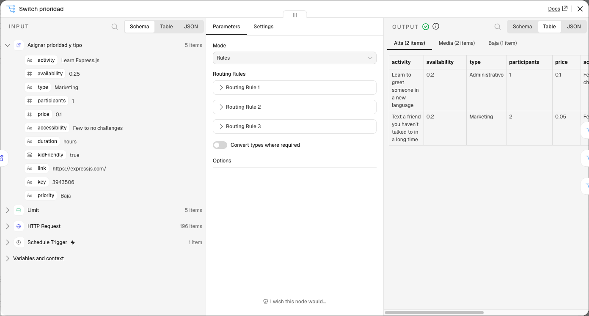

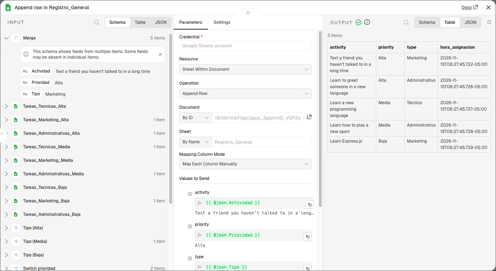

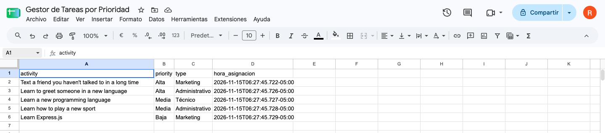

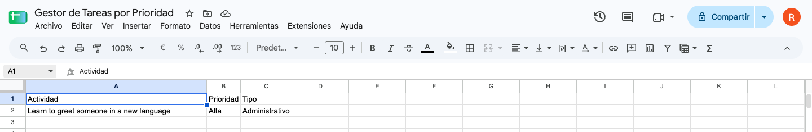

### 4.4. Ejercicio 4: Repositorios de GitHub por lenguaje

Se creó el documento `Repositorios de GitHub por Lenguaje` con las hojas `JavaScript`, `Python`, `C++` y `Otros` y las cabeceras `Nombre`, `Lenguaje`, `Estrellas` y `Última Actualización`.

| # | Nodo | Configuración |
|---|---|---|
| 1 | Manual Trigger | — |
| 2 | HTTP Request | `GET https://api.github.com/orgs/google/repos?per_page=30` |
| 3 | Switch | `{{ $json.language }}` **is equal to** `JavaScript`, `Python` y `C++`; **Fallback Output** = `Extra Output`, renombrada `Otros` |
| 4 | Append row in JavaScript / Python / C++ / Otros | Google Sheets, una hoja por salida |

Columnas: `Nombre` = `{{ $json.name }}`, `Lenguaje` = `{{ $json.language ?? 'Sin lenguaje' }}`, `Estrellas` = `{{ $json.stargazers_count }}` y `Última Actualización` = `{{ $json.updated_at }}`.

Algunos repositorios tienen `language` a `null`. Para que el Switch no falle al comparar `null` con un texto con la validación de tipos estricta, se activó **Convert types where required**. En la columna `Lenguaje`, el operador `??` escribe `Sin lenguaje` cuando el valor es `null`.

En la ejecución #191 se obtuvieron 30 repositorios de la organización `google`: 9 de JavaScript, 4 de Python, 4 de C++ y 13 de otros lenguajes.

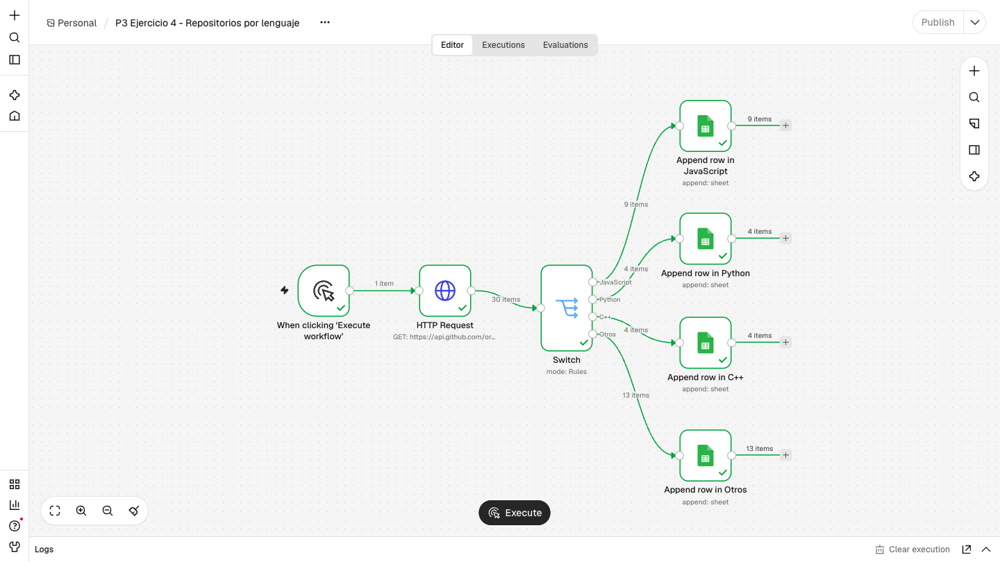

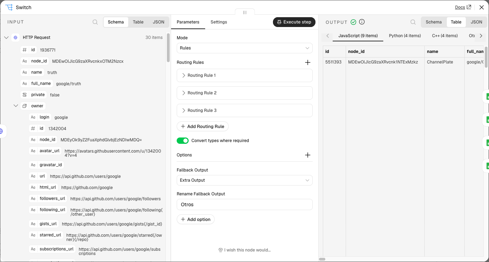

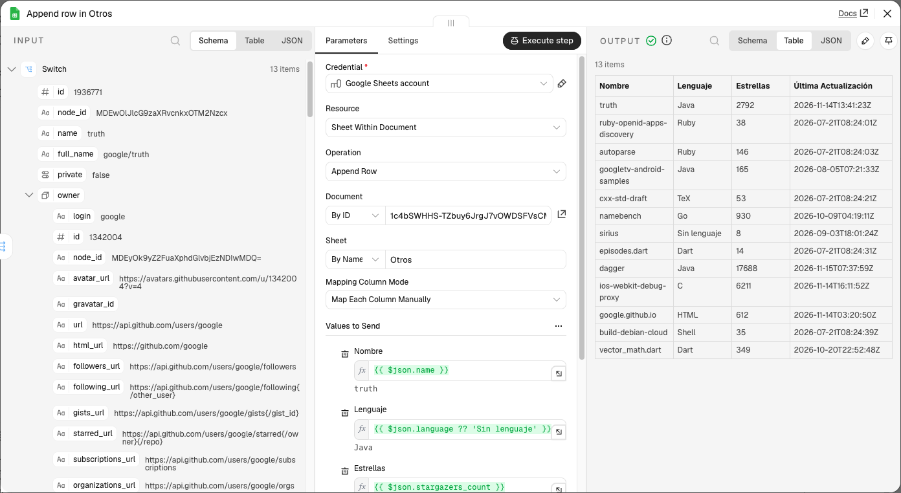

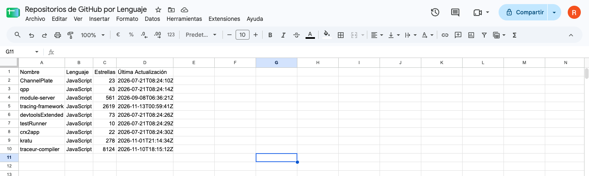

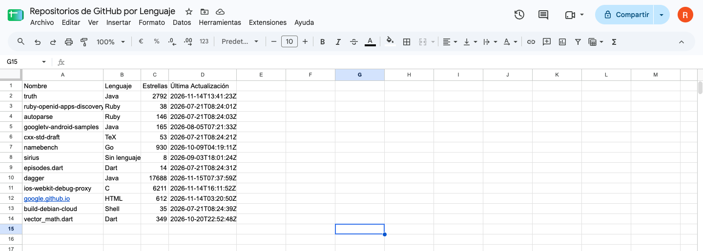

**Pregunta de reflexión.** Si la organización no tuviera repositorios en Python, la salida `Python` del Switch no recibiría ningún ítem y n8n no ejecutaría el nodo de Google Sheets conectado a ella: en el lienzo aparecería sin ejecutar y no se escribiría nada en la hoja. El resto de ramas se ejecutan con normalidad. Un Switch solo pasa a cada salida los ítems que cumplen su regla, y una rama sin ítems simplemente se omite, sin error.

### 4.5. Ejercicio 5: Pronóstico del tiempo con transformación de datos

Se creó el documento `Pronóstico del Tiempo Madrid` con las hojas `Despejado`, `Nublado`, `Lluvia` y `Otro` y las cabeceras `Fecha`, `Código WMO`, `Temperatura Máx (°C)` y `Categoría`.

| # | Nodo | Configuración |
|---|---|---|
| 1 | Manual Trigger | — |
| 2 | HTTP Request | `GET https://api.open-meteo.com/v1/forecast?latitude=40.4168&longitude=-3.7038&daily=weather_code,temperature_2m_max&timezone=auto&forecast_days=5` |
| 3 | Code | Convierte los arrays paralelos de `daily` en un array de objetos |
| 4 | Split Out | **Fields To Split Out** = `dias` |
| 5 | Switch | Reglas sobre `{{ $json.codigo }}`; **Fallback Output** renombrada `Otro` |
| 6 | Append row in Despejado / Nublado / Lluvia / Otro | Google Sheets, una hoja por salida |

Código del nodo Code:

```javascript
const daily = $input.first().json.daily;
const dias = [];
for (let i = 0; i < daily.time.length; i++) {
  dias.push({
    fecha: daily.time[i],
    codigo: daily.weather_code[i],
    temp_max: daily.temperature_2m_max[i],
  });
}
return [{ json: { dias } }];
```

| Salida | Condiciones |
|---|---|
| `Despejado` | **is less than or equal to** `1` |
| `Nublado` | **is greater than** `1` **AND** **is less than or equal to** `3` |
| `Lluvia` | **is greater than or equal to** `51` **AND** **is less than or equal to** `67` |
| `Otro` | Resto de códigos |

Columnas: `Fecha` = `{{ $json.fecha }}`, `Código WMO` = `{{ $json.codigo }}`, `Temperatura Máx (°C)` = `{{ $json.temp_max }}` y `Categoría` con el nombre fijo de cada hoja.

En la ejecución #192, de los 5 días de previsión, 2 fueron nublados (código 3) y 3 de lluvia (códigos 61 y 63); no hubo días despejados ni de otro tipo.

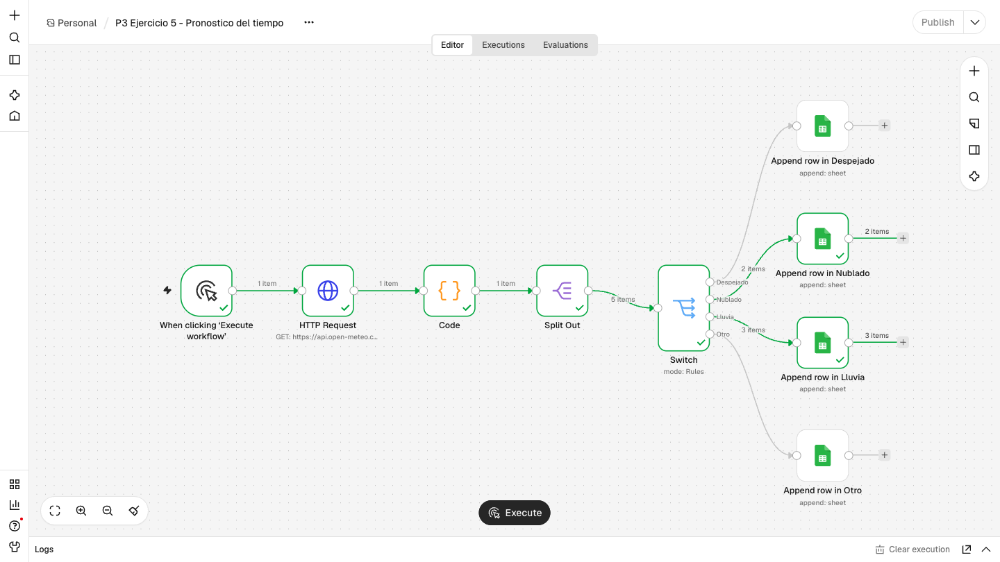

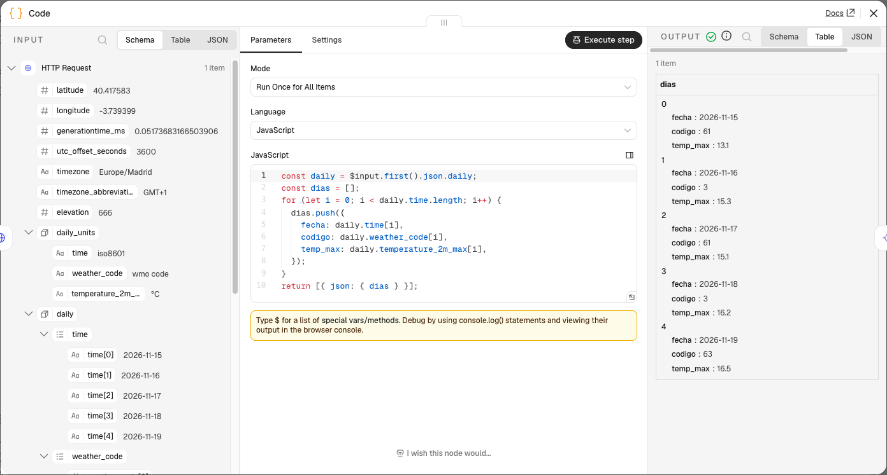

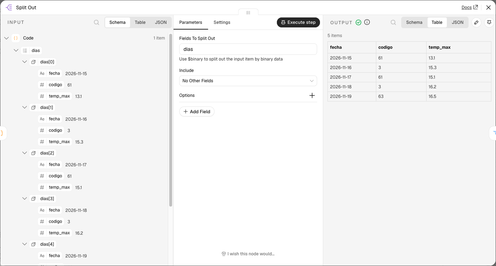

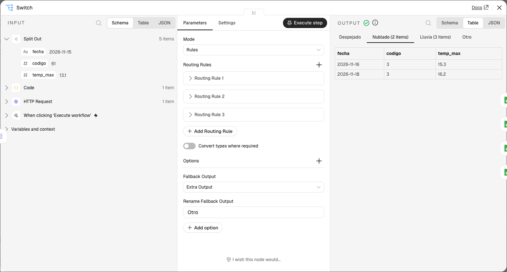

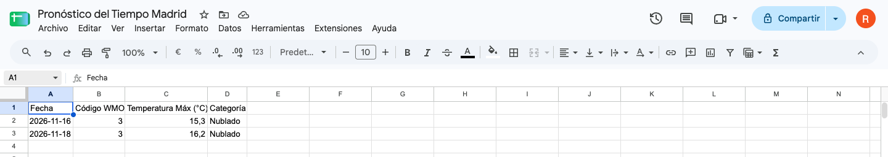

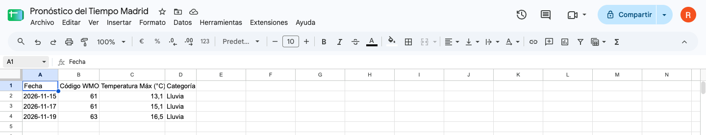

**Pregunta de reflexión.** En la tabla de códigos WMO, los códigos 71 a 77 corresponden a nieve (71, 73 y 75 son nevadas débil, moderada y fuerte, y 77 son granos de nieve). Para separarlos bastaría con añadir una cuarta regla al Switch, antes del fallback, con `{{ $json.codigo }}` **is greater than or equal to** `71` **AND** **is less than or equal to** `77`, conectarla a un nodo de Google Sheets nuevo y crear la hoja `Nieve`. Así quedarían cinco salidas: las cuatro reglas y la de `Otro`.

### 4.6. Ejercicio 6: Combinación de datos por posición

Se creó el documento `Plan del Día` con la hoja `Planes` y las cabeceras `Chiste`, `Actividad` y `Plan`.

| # | Nodo | Configuración |
|---|---|---|
| 1 | Manual Trigger | Conectado a los dos HTTP Request en paralelo |
| 2 | Chistes | HTTP Request: `GET https://v2.jokeapi.dev/joke/Programming?type=single&amount=5` |
| 3 | Actividades | HTTP Request: `GET https://bored-api.appbrewery.com/filter?number=5` |
| 4 | Split Out | Sobre `jokes`, a la salida de Chistes |
| 5 | Limit | **Max Items** = `5`, a la salida de Actividades |
| 6 | Merge | **Mode** = `Combine`, **Combine By** = `Position` |
| 7 | Crear plan | Edit Fields con **Include Other Input Fields**: `plan` = `Chiste: {{ $json.joke }} \| Actividad: {{ $json.activity }}` |
| 8 | Append row in Planes | Google Sheets: `Chiste`, `Actividad` y `Plan` |

Igual que en el ejercicio 3, la Bored API devuelve las 196 actividades, y el HTTP Request ya las separa en ítems; por eso, en lugar de un Split Out, en esa rama se usó un Limit de 5. En la ejecución #188 el Merge emparejó los 5 chistes con las 5 primeras actividades y se escribieron 5 planes.

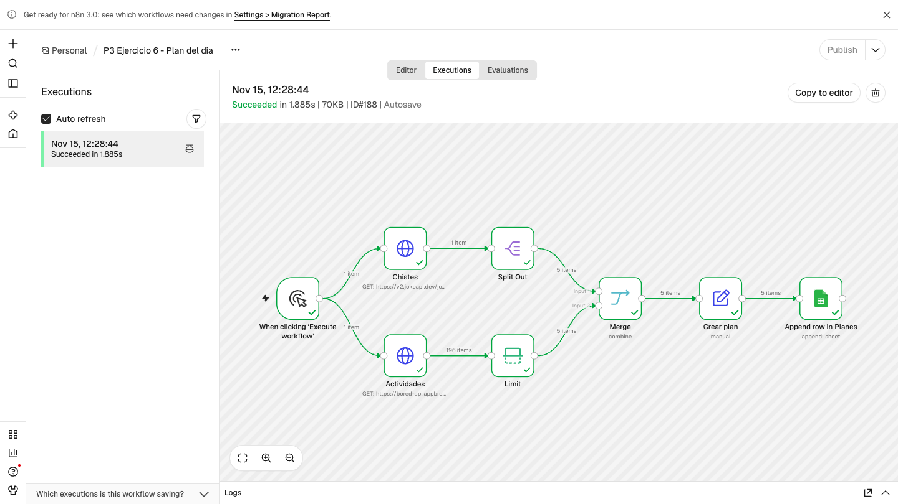

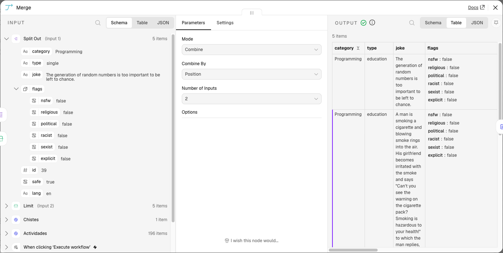

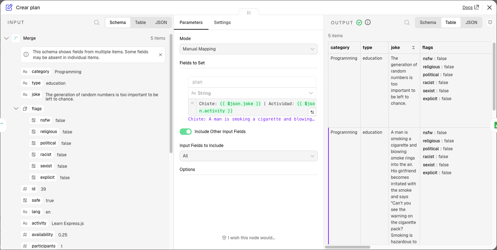

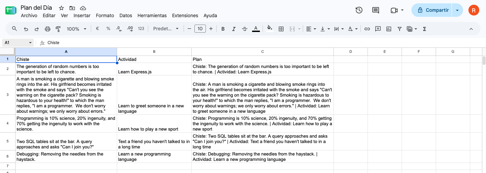

**Pregunta de reflexión.** Si una de las dos APIs devolviera menos de 5 elementos, `Combine by Position` solo emparejaría tantas posiciones como ítems tenga la entrada más corta: con 5 chistes y 3 actividades saldrían 3 planes, y los 2 chistes sobrantes se descartarían. Para no perderlos, el Merge tiene la opción **Include Any Unpaired Items**, que los añade a la salida aunque no tengan pareja (con los campos de la otra entrada vacíos).

### 4.7. Ejercicio 7: Informe diario de productos

Se creó el documento `Informe Diario de Productos` con la hoja `Informe_Diario` y las cabeceras `ID`, `Título`, `Precio`, `Categoría` y `Fecha del Informe`.

| # | Nodo | Configuración |
|---|---|---|
| 1 | Schedule Trigger | Una vez al día, a las 8:00 (**Trigger Interval** = `Days`, **Trigger at Hour** = `8am`) |
| 2 | HTTP Request | `GET https://fakestoreapi.com/products` |
| 3 | Switch | Reglas sobre `{{ $json.price }}` |
| 4 | Categoria Económico / Medio / Premium | Edit Fields con **Include Other Input Fields**: `categoria` = `Económico`, `Medio` o `Premium` |
| 5 | Merge | Mode `Append`, 3 entradas |
| 6 | Append row in Informe_Diario | Google Sheets, hoja `Informe_Diario` |

| Salida | Condiciones |
|---|---|
| `Económico` | **is less than** `50` |
| `Medio` | **is greater than or equal to** `50` **AND** **is less than or equal to** `200` |
| `Premium` | **is greater than** `200` |

Columnas: `ID` = `{{ $json.id }}`, `Título` = `{{ $json.title }}`, `Precio` = `{{ $json.price }}`, `Categoría` = `{{ $json.categoria }}` y `Fecha del Informe` = `{{ $now }}`.

Se ejecutó con **Execute workflow** (ejecución #189): de los 20 productos, 9 son económicos, 8 de precio medio y 3 premium, y las 20 filas se escribieron en `Informe_Diario` agrupadas por categoría, en el orden en que el Merge une las tres ramas.

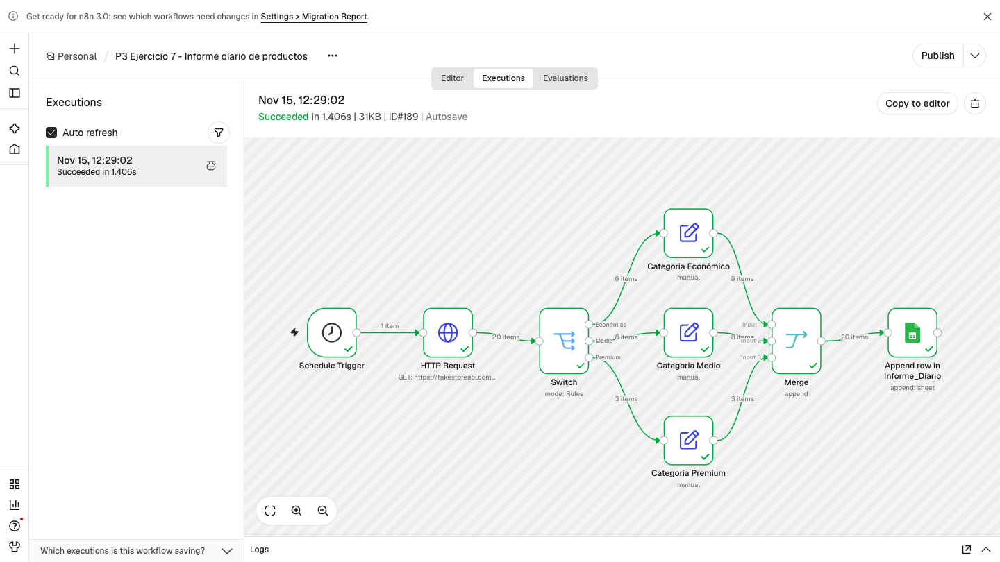

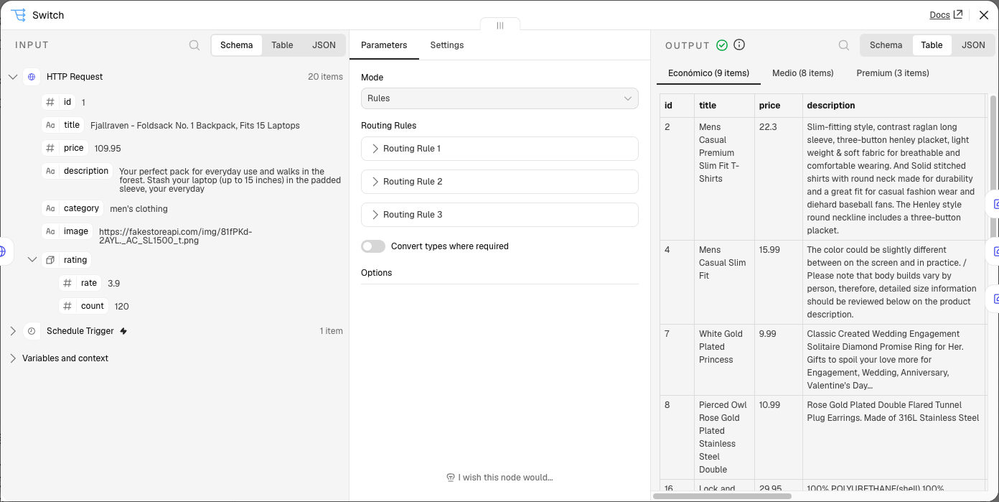

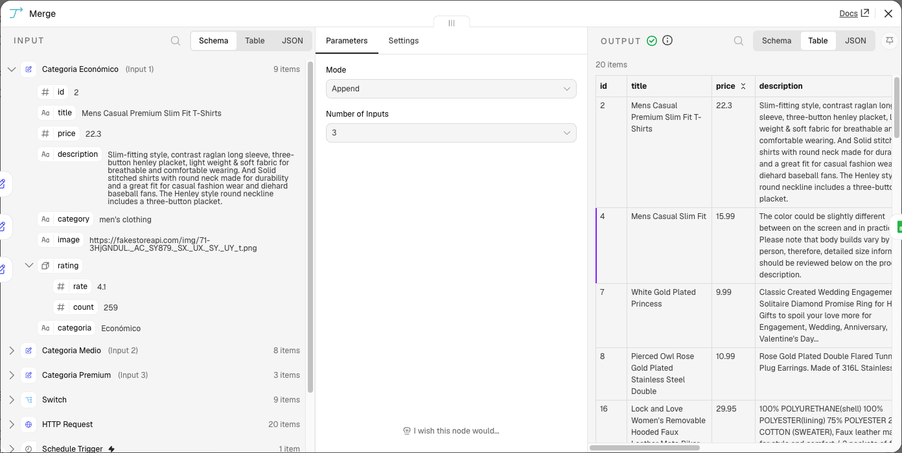

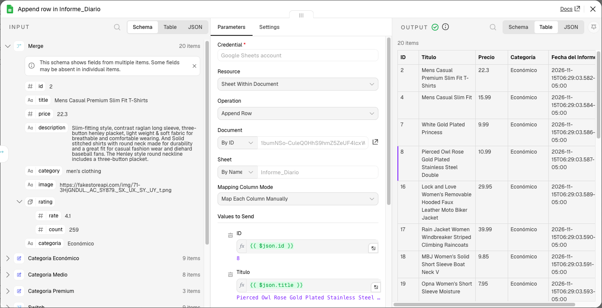

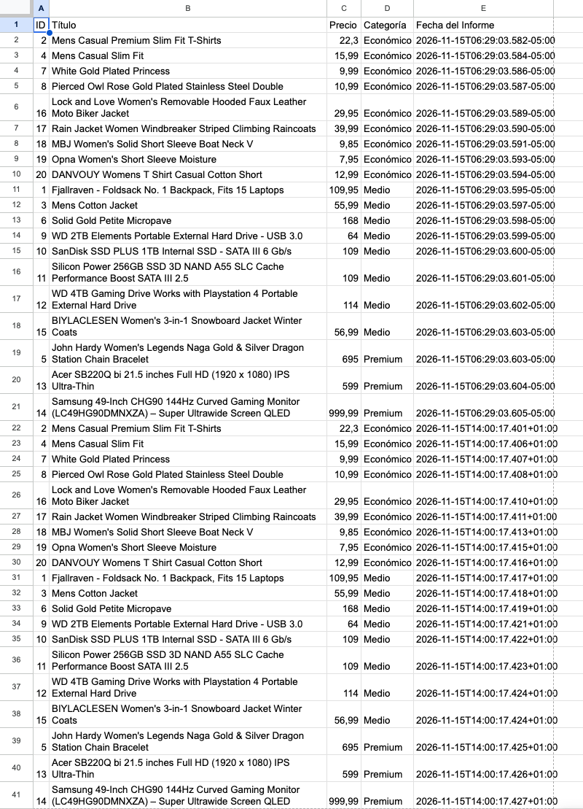

**Pregunta de reflexión.** Para escribir además un resumen con el número de productos por categoría, se puede añadir después del Merge una segunda rama con un nodo **Summarize** (o **Aggregate**) que agrupe por `categoria` y cuente los ítems, o un nodo **Code** que recorra los ítems y cuente cuántos hay de cada categoría. El resultado, tres filas del tipo `Económico: 9`, se escribiría con otro nodo de Google Sheets en una hoja aparte, por ejemplo `Resumen`.
