# Práctica 4: Robustez y modularidad - Manejo de errores y sub-flujos de trabajo

**Asignatura:** Integración de Tecnologías y Servicios Informáticos (ITSI)
**Alumno:** Roberto Castillo — rct419@inlumine.ual.es  
**Enunciado:** https://ualitsi.github.io/n8n-004/

Solución formada por tres workflows: uno principal que recorre una lista de URLs de imágenes, un sub-flujo que descarga cada imagen y un manejador que registra los errores en Google Sheets. Una de las URLs no existe a propósito, para comprobar que el error queda registrado.

---

## Cómo importar y ejecutar los workflows

1. Crear en Google Sheets un documento con estas cabeceras: `Timestamp`, `Workflow Fallido`, `Nodo Fallido`, `Mensaje de Error` y `URL de Ejecución`.
2. Abrir la instancia de n8n en el navegador (por defecto, en local: http://localhost:5678).
3. Importar los tres workflows con **Create workflow → menú `…` → Import from File**, en este orden:
   1. [`workflows/Practica-4-Manejador-de-Errores.json`](workflows/Practica-4-Manejador-de-Errores.json)
   2. [`workflows/Practica-4-Sub-flujo-Descargador.json`](workflows/Practica-4-Sub-flujo-Descargador.json)
   3. [`workflows/Practica-4-Procesador-Principal.json`](workflows/Practica-4-Procesador-Principal.json)
4. En `Manejador de Errores`, seleccionar en el nodo de Google Sheets una credencial propia de Google (OAuth 2.0), el documento y la hoja.
5. En `Sub-flujo: Descargador de imagenes` y `Procesador Principal de imagenes`, abrir **Settings → Error Workflow** y seleccionar `Manejador de Errores`.
6. En `Procesador Principal de imagenes`, abrir el nodo `Call 'Sub-flujo: Descargador de imagenes'` y seleccionar de nuevo el sub-flujo.
7. Publicar `Manejador de Errores` y `Sub-flujo: Descargador de imagenes`.
8. Abrir `Procesador Principal de imagenes` y pulsar **Execute workflow**.

Los pasos 5 y 6 son necesarios porque n8n asigna identificadores nuevos a los workflows importados. Las credenciales no se incluyen en los JSON exportados, por lo que cada instancia debe configurar la suya.

## 1. Workflows

### `Procesador Principal de imagenes`

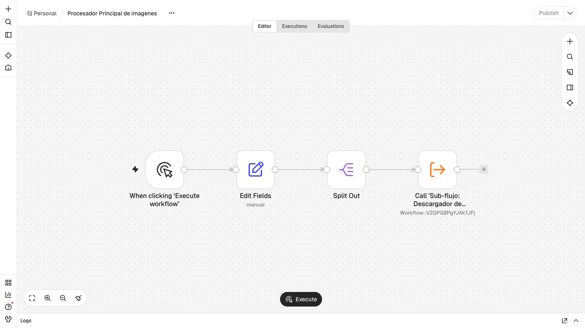

| # | Nodo | Tipo | Función |
|---|---|---|---|
| 1 | When clicking 'Execute workflow' | Manual Trigger | Inicia el workflow manualmente |
| 2 | Edit Fields | Edit Fields (Set) | Crea el array `imageUrls` con las tres URLs |
| 3 | Split Out | Split Out | Separa `imageUrls` en 3 ítems |
| 4 | Call 'Sub-flujo: Descargador de imagenes' | Execute Workflow | Llama al sub-flujo y le pasa `Image` = `{{ $json.imageUrls.imageUrl }}` |

URLs de la lista:

| URL | Resultado esperado |
|---|---|
| `https://placedog.net/320/240` | Válida |
| `https://dummyimage.com/320x240` | Válida |
| `https://esta-url-no-existe.xyz/imagen.jpg` | Error: el dominio no existe |

### `Sub-flujo: Descargador de imagenes`

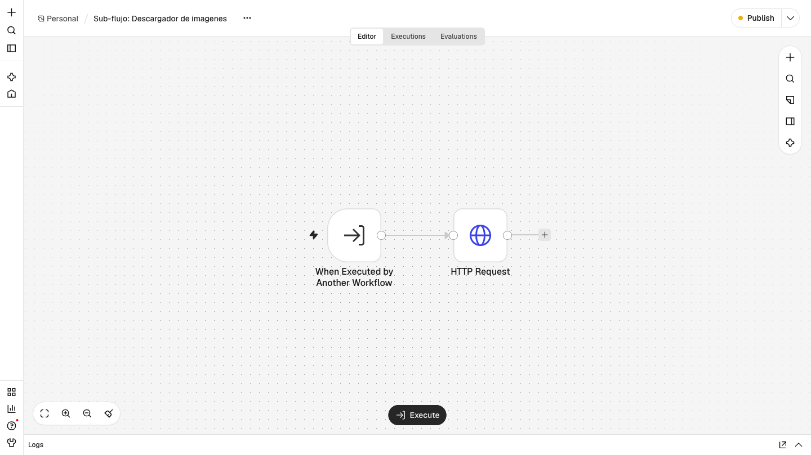

| # | Nodo | Tipo | Función |
|---|---|---|---|
| 1 | When Executed by Another Workflow | Execute Workflow Trigger | Recibe el campo de entrada `Image` |
| 2 | HTTP Request | HTTP Request | `GET {{ $json.Image }}`, con la respuesta en formato `File` |

### `Manejador de Errores`

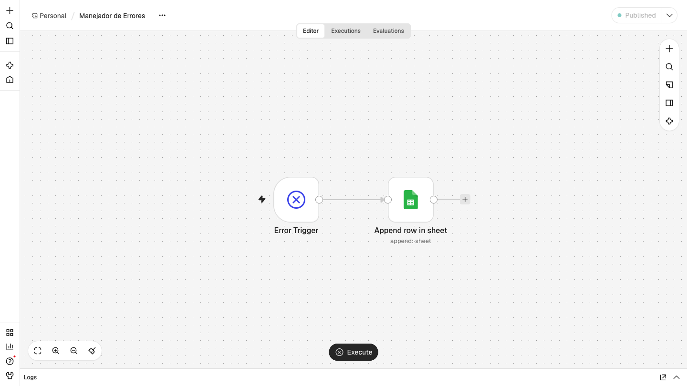

| # | Nodo | Tipo | Función |
|---|---|---|---|
| 1 | Error Trigger | Error Trigger | Se inicia cuando falla un workflow que lo tiene asignado como Error Workflow |
| 2 | Append row in sheet | Google Sheets | Añade una fila con los datos del error |

Columnas que escribe el nodo de Google Sheets:

| Columna | Expresión |
|---|---|
| `Timestamp` | `{{ $now }}` |
| `Workflow Fallido` | `{{ $json.workflow.name }}` |
| `Nodo Fallido` | `{{ $json.execution.lastNodeExecuted }}` |
| `Mensaje de Error` | `{{ $json.execution.error.message }}` |
| `URL de Ejecución` | `{{ $json.execution.url }}` |

## 2. Dónde se configura el Error Workflow

`Manejador de Errores` está asignado en **Settings → Error Workflow** de `Procesador Principal de imagenes` y de `Sub-flujo: Descargador de imagenes`.

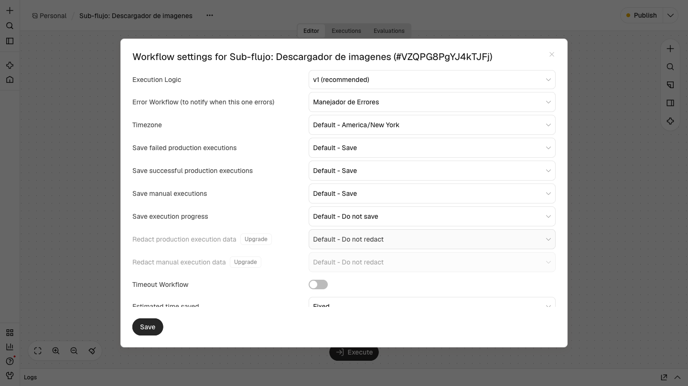

La asignación que se activa en esta prueba es la del sub-flujo. n8n no lanza el Error Workflow en las ejecuciones manuales, y el workflow principal se inicia de forma manual. El sub-flujo, en cambio, se ejecuta en modo `integrated` porque lo llama otro workflow, así que su fallo sí inicia el manejador.

## 3. Ejecución

Cada ejecución termina con error en los workflows principal y sub-flujo, porque la tercera URL no existe. Ese es el resultado esperado de la prueba.

| Workflow | Modo | Estado |
|---|---|---|
| `Procesador Principal de imagenes` | `manual` | Error |
| `Sub-flujo: Descargador de imagenes` | `integrated` | Error |
| `Manejador de Errores` | `error` | Correcto |

### Procesador principal

Split Out genera 3 ítems y el nodo que llama al sub-flujo falla al recibir su error.

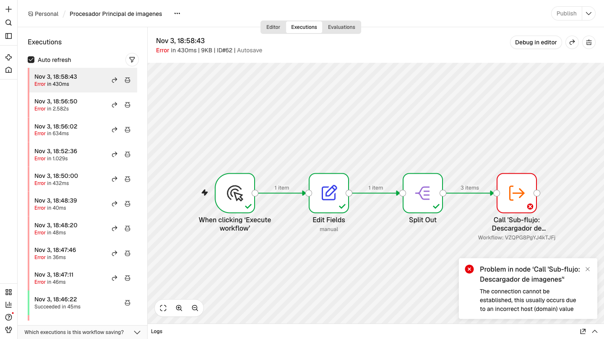

### Sub-flujo

El nodo HTTP Request recibe los 3 ítems y falla en el tercero (`itemIndex: 2`) con el código `ENOTFOUND`.

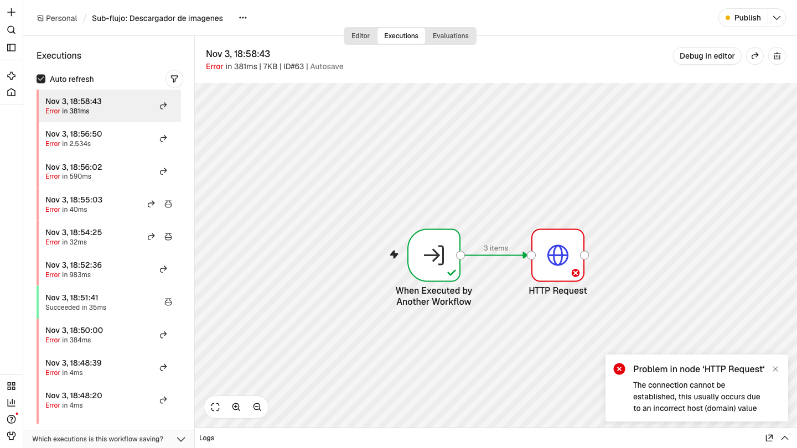

### Manejador de errores

El Error Trigger recibe los datos del fallo y Google Sheets añade la fila:

```json
{
  "Timestamp": "2026-11-03T12:58:45.103-05:00",
  "Workflow Fallido": "Sub-flujo: Descargador de imagenes",
  "Nodo Fallido": "HTTP Request",
  "Mensaje de Error": "The connection cannot be established, this usually occurs due to an incorrect host (domain) value",
  "URL de Ejecución": "http://localhost:5678/workflow/VZQPG8PgYJ4kTJFj/executions/63"
}
```

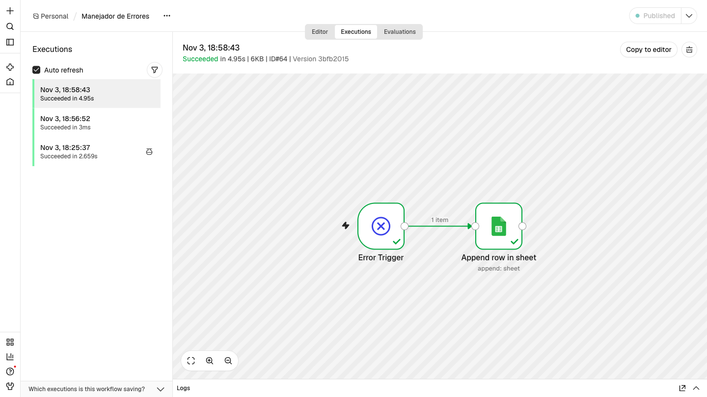

## 4. Resultado en Google Sheets

El error queda registrado con el workflow y el nodo que fallaron, el mensaje y el enlace a la ejecución.

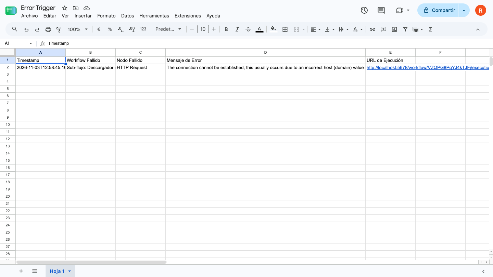

---

## 5. Ejercicios propuestos

Los cinco ejercicios propuestos del enunciado se resolvieron sobre la misma instancia de n8n. Cada uno tiene además su propio informe en PDF (`Practica-4.N-Roberto-Castillo.pdf`).

| Ejercicio | Workflows | JSON exportados |
|---|---|---|
| 4.1 Notificación de errores mejorada | `Manejador de Errores` (modificado) | [`E1-E4-Manejador-de-Errores.json`](workflows/ejercicios/E1-E4-Manejador-de-Errores.json) |
| 4.2 Sub-flujo de validación de datos | `Ejercicio 2 - Validar producto`, `Sub-flujo: Validador de Productos` | [`E2-Validar-producto.json`](workflows/ejercicios/E2-Validar-producto.json), [`E2-Sub-flujo-Validador-de-Productos.json`](workflows/ejercicios/E2-Sub-flujo-Validador-de-Productos.json) |
| 4.3 Orquestador de tareas dinámicas | `Ejercicio 3 - Orquestador de tareas`, `Sub-flujo: Obtener Actividad`, `Sub-flujo: Obtener Festivos` | [`E3-Orquestador-de-tareas.json`](workflows/ejercicios/E3-Orquestador-de-tareas.json), [`E3-Sub-flujo-Obtener-Actividad.json`](workflows/ejercicios/E3-Sub-flujo-Obtener-Actividad.json), [`E3-Sub-flujo-Obtener-Festivos.json`](workflows/ejercicios/E3-Sub-flujo-Obtener-Festivos.json) |
| 4.4 Sub-flujo notificador reutilizable | `Sub-flujo: Notificador`, `Manejador de Errores` y `Procesador Principal de imagenes` (modificados) | [`E4-Sub-flujo-Notificador.json`](workflows/ejercicios/E4-Sub-flujo-Notificador.json), [`E4-Procesador-Principal.json`](workflows/ejercicios/E4-Procesador-Principal.json), [`E1-E4-Manejador-de-Errores.json`](workflows/ejercicios/E1-E4-Manejador-de-Errores.json) |
| 4.5 Monitor de salud de APIs | `Ejercicio 5 - Monitor de salud de APIs`, `Sub-flujo: Comprobar API` | [`E5-Monitor-de-salud-de-APIs.json`](workflows/ejercicios/E5-Monitor-de-salud-de-APIs.json), [`E5-Sub-flujo-Comprobar-API.json`](workflows/ejercicios/E5-Sub-flujo-Comprobar-API.json) |

Los JSON de la práctica guiada (`workflows/Practica-4-*.json`) no se modificaron; las versiones del `Manejador de Errores` y del `Procesador Principal` con los cambios de los ejercicios 4.1 y 4.4 están en `workflows/ejercicios/`.

Las hojas de los ejercicios 4.4 y 4.5 están en un documento nuevo de Google Sheets, `Practica 4 - Ejercicios propuestos`:

| Hoja | Columnas | Ejercicio |
|---|---|---|
| `Eventos` | `Timestamp`, `Nivel`, `Mensaje` | 4.4 |
| `Alertas` | `Timestamp`, `Nivel`, `Mensaje` | 4.4 |
| `Salud_OK` | `URL`, `Hora` | 4.5 |
| `Salud_Fallo` | `URL`, `Hora` | 4.5 |

Al importar estos workflows hay que volver a seleccionar en cada nodo **Execute Workflow** el sub-flujo correspondiente, el **Error Workflow** en **Settings**, y las credenciales de Google Sheets y SMTP, porque n8n asigna identificadores nuevos.

### 5.1. Ejercicio 1: Notificación de errores mejorada

El `Manejador de Errores` envía, además de la fila en Google Sheets, un correo de alerta.

**Credencial SMTP.** Se creó la credencial `Gmail SMTP` con el servidor SMTP de Gmail y una contraseña de aplicación de Google (requiere tener activada la verificación en dos pasos):

| Campo | Valor |
|---|---|
| Host | `smtp.gmail.com` |
| Port | `465` |
| SSL/TLS | Activado |
| User | `defused15@gmail.com` |
| Password | Contraseña de aplicación de Google |

Al guardarla, n8n probó la conexión y mostró **Connection tested successfully**.

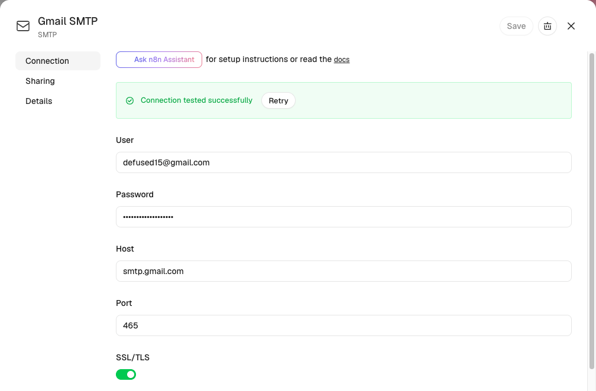

**Nodo Send Email.** Se conectó a la salida de `Append row in sheet`:

| Parámetro | Valor |
|---|---|
| Credential | `Gmail SMTP` |
| From Email | `defused15@gmail.com` |
| To Email | `rct419@inlumine.ual.es, defused15@gmail.com` |
| Subject | `¡Alerta de Error en n8n!` |
| Email Format | `Text` |
| Append n8n Attribution | Desactivado |
| On Error (Settings) | `Continue`: si el correo falla, el error se sigue registrando |

Cuerpo del correo:

```
Se ha producido un error en n8n.

Workflow fallido: {{ $('Error Trigger').item.json.workflow.name }}
Nodo fallido: {{ $('Error Trigger').item.json.execution.lastNodeExecuted }}
Mensaje de error: {{ $('Error Trigger').item.json.execution.error.message }}
URL de ejecución: {{ $('Error Trigger').item.json.execution.url }}
Fecha: {{ $now }}
```

Las expresiones leen de `$('Error Trigger')` porque, después del nodo de Google Sheets, `$json` contiene la fila escrita y no los datos del error.

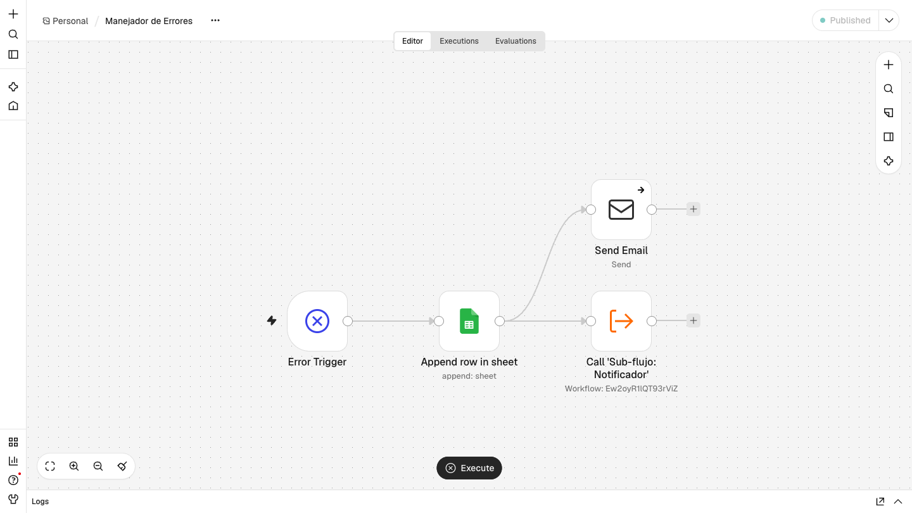

En la captura ya aparece la llamada al `Sub-flujo: Notificador`, que se añadió después en el ejercicio 4.4.

**Prueba.** Se ejecutó `Procesador Principal de imagenes` con la URL incorrecta. El fallo del sub-flujo de descarga activó el manejador, y el nodo Send Email terminó correctamente: Gmail aceptó el mensaje para los dos destinatarios (`accepted`).

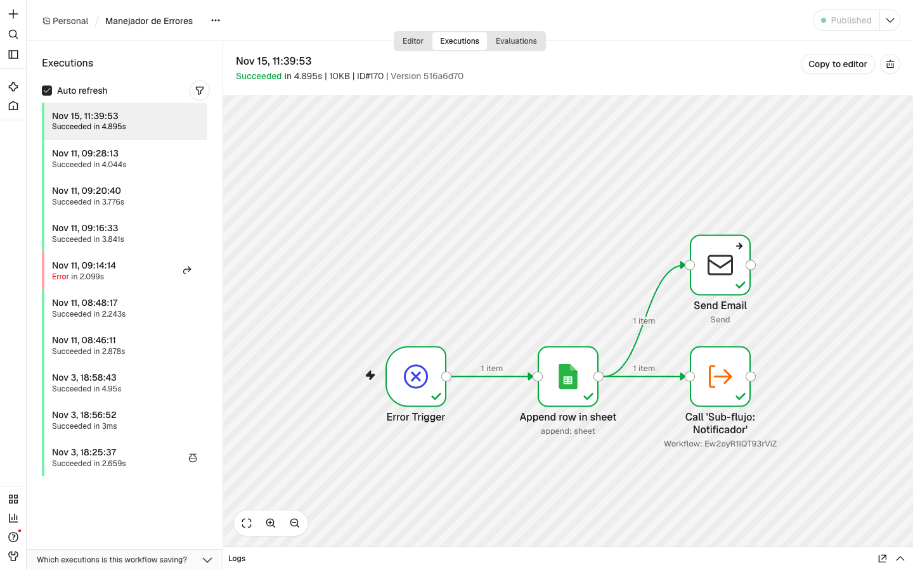

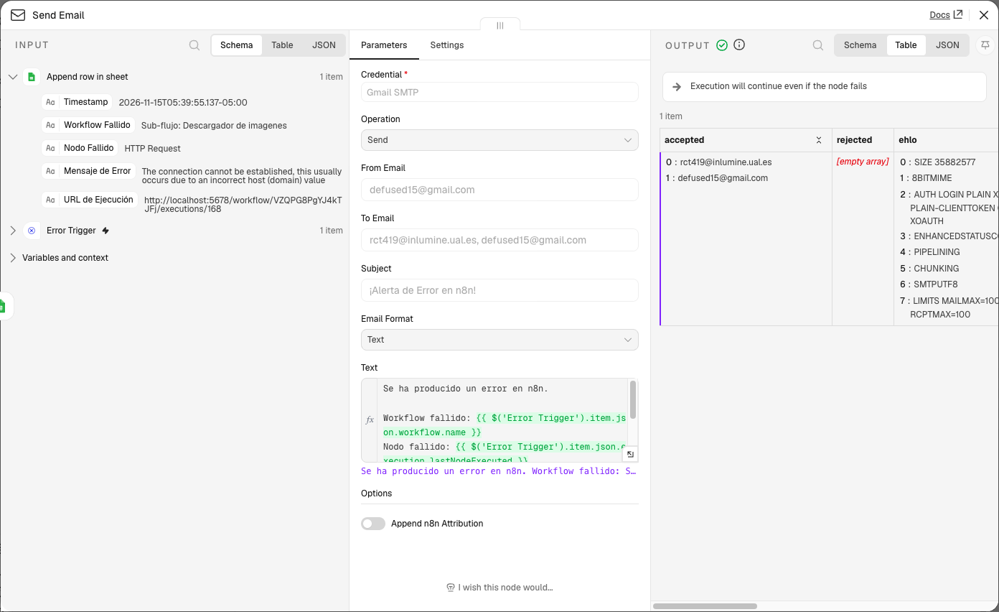

El correo llegó al buzón `rct419@inlumine.ual.es` con el asunto `¡Alerta de Error en n8n!` y todos los datos del error:

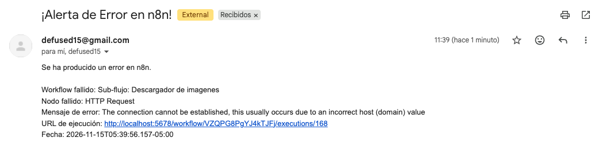

### 5.2. Ejercicio 2: Sub-flujo de validación de datos

**`Sub-flujo: Validador de Productos`**

| # | Nodo | Configuración |
|---|---|---|
| 1 | When Executed by Another Workflow | **Input data mode** = `Accept all data` |
| 2 | If | `{{ $json.title }}` (String) **is not empty** **AND** `{{ $json.price }}` (Number) **exists** |
| 3 | Edit Fields | Rama `true`: `validacion` = `OK` |
| 4 | Stop and Error | Rama `false`: `Validación fallida: Faltan campos de producto obligatorios` |

En **Settings → Error Workflow** se seleccionó `Manejador de Errores`.

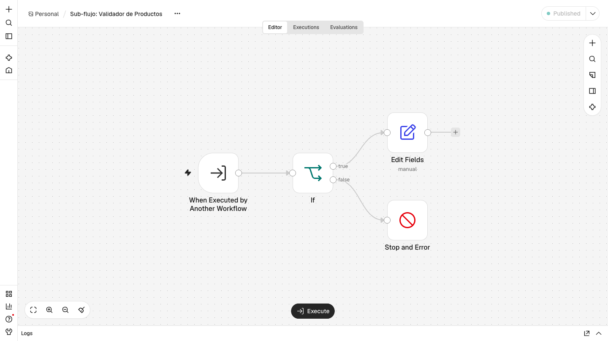

**`Ejercicio 2 - Validar producto`**

| # | Nodo | Configuración |
|---|---|---|
| 1 | When clicking 'Execute workflow' | Manual Trigger |
| 2 | HTTP Request | `GET https://fakestoreapi.com/products/1` |
| 3 | Edit Fields | **Include Other Input Fields** activado, **Input Fields to Include** = `All Except`, **Fields to Exclude** = `price` |
| 4 | Call 'Sub-flujo: Validador de Productos' | Execute Workflow |

En la versión de n8n utilizada, el nodo Edit Fields no tiene un tipo `Remove` en los campos; el campo `price` se elimina con la opción **All Except**. El workflow también tiene `Manejador de Errores` como Error Workflow.

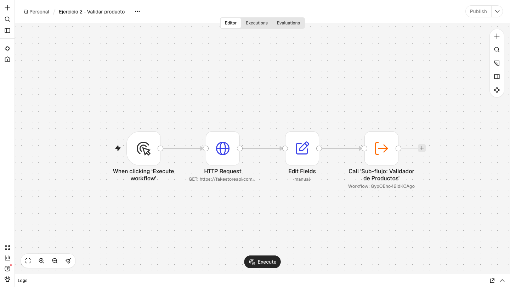

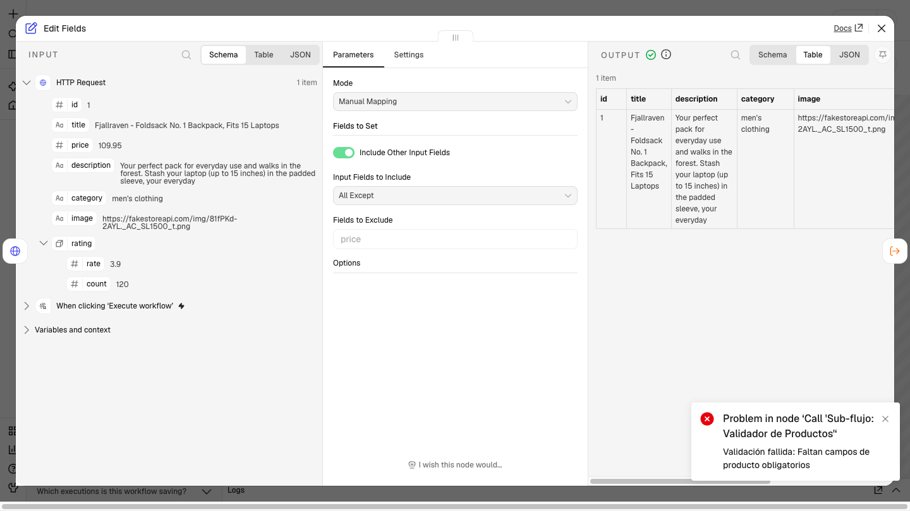

**Resultado.**

| Workflow | Modo | Estado |
|---|---|---|
| `Ejercicio 2 - Validar producto` | `manual` | Error |
| `Sub-flujo: Validador de Productos` | `integrated` | Error en `Stop and Error` |
| `Manejador de Errores` | `error` | Correcto |

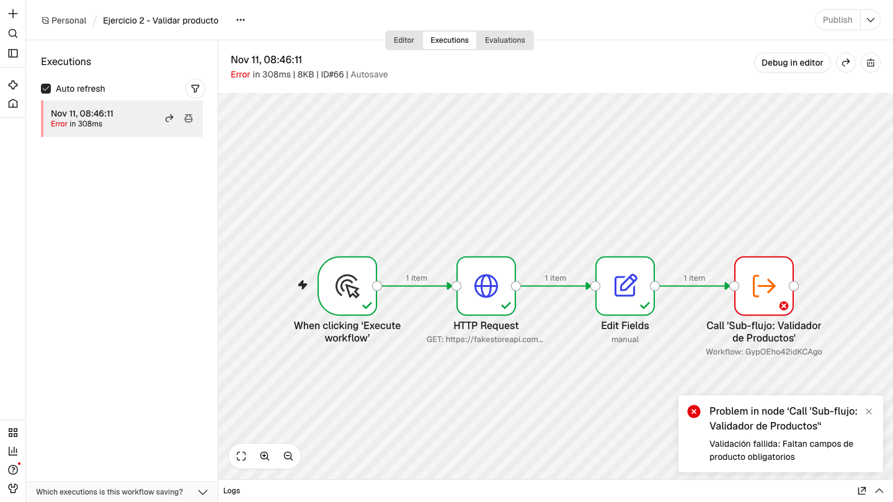

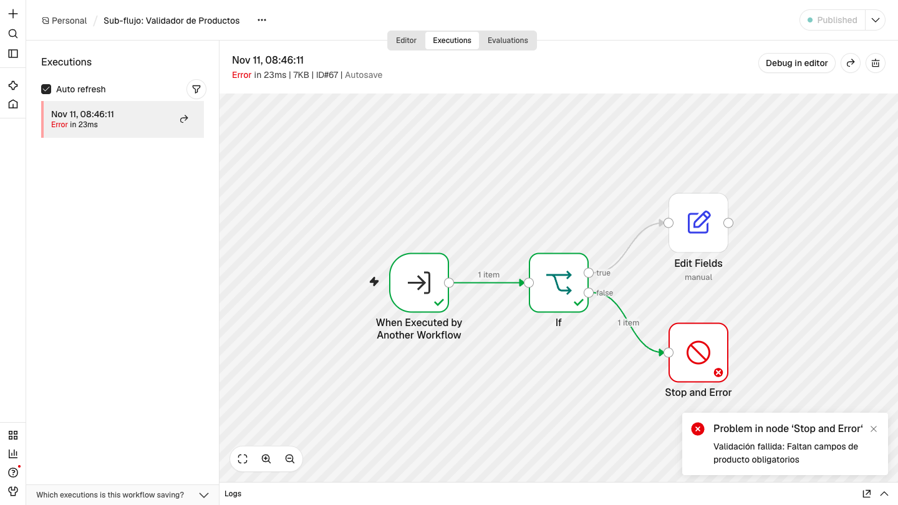

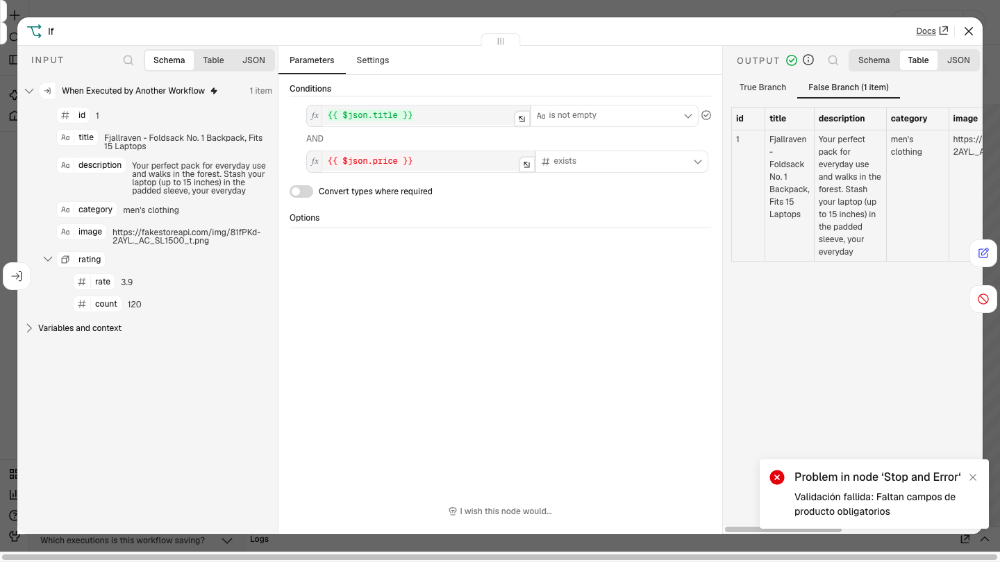

Como en la práctica guiada, el manejador se activa por el Error Workflow del sub-flujo, que se ejecuta en modo `integrated`. La fila registrada indica `Sub-flujo: Validador de Productos`, `Stop and Error` y el mensaje personalizado:

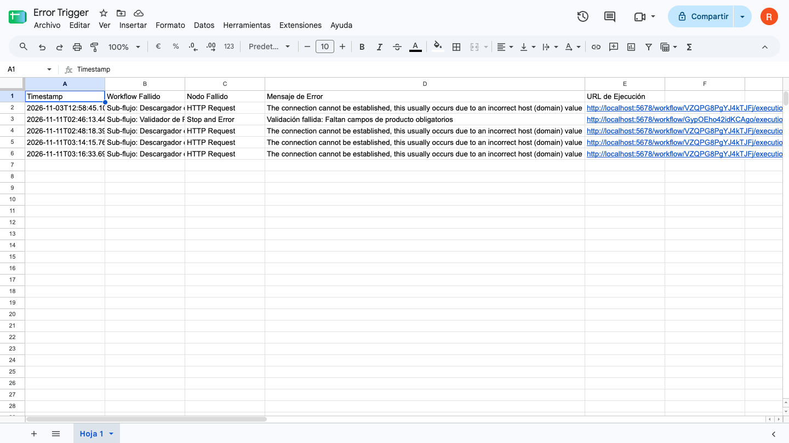

**Pregunta de reflexión.** Si la rama `false` no tuviera ningún nodo conectado, el sub-flujo terminaría correctamente sin devolver ningún ítem. El workflow principal no recibiría ningún error: seguiría como si todo hubiera ido bien, pero sin datos, y el `Manejador de Errores` no se activaría. Es un fallo silencioso. Con **Stop and Error**, la ejecución se marca como fallida, se detiene y el error queda registrado con su mensaje.

### 5.3. Ejercicio 3: Orquestador de tareas dinámicas

**Sub-flujos.** Los dos tienen un **When Executed by Another Workflow** (`Accept all data`) y un **HTTP Request**:

| Sub-flujo | URL |
|---|---|
| `Sub-flujo: Obtener Actividad` | `https://bored-api.appbrewery.com/random` |
| `Sub-flujo: Obtener Festivos` | `https://date.nager.at/api/v3/PublicHolidays/2026/ES` |


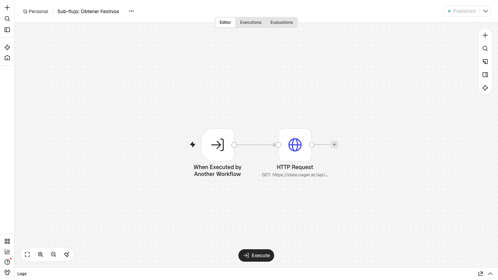

**`Ejercicio 3 - Orquestador de tareas`**

| # | Nodo | Configuración |
|---|---|---|
| 1 | When clicking 'Execute workflow' | Manual Trigger |
| 2 | Definir tarea | Edit Fields: `tarea` = `actividad` |
| 3 | Switch | Salida 0: `{{ $json.tarea }}` **is equal to** `actividad`; salida 1: **is equal to** `festivos` |
| 4 | Call 'Sub-flujo: Obtener Actividad' | Execute Workflow (salida 0) |
| 5 | Call 'Sub-flujo: Obtener Festivos' | Execute Workflow (salida 1) |
| 6 | Merge | Mode `Append`, una entrada por cada sub-flujo |
| 7 | Verificar salida | Edit Fields con **Include Other Input Fields** y `tarea` = `{{ $('Definir tarea').first().json.tarea }}` |

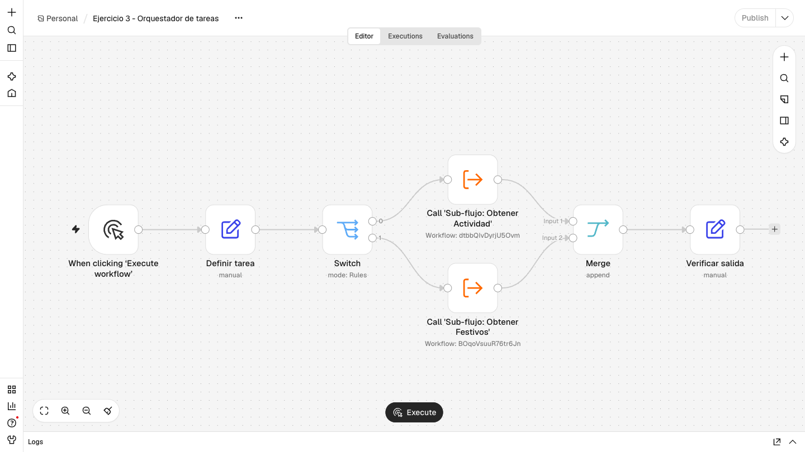

**Resultado.**

| `tarea` | Sub-flujo llamado | Ítems en la salida final |
|---|---|---|
| `actividad` | `Obtener Actividad` | 1 (`Learn a new programming language`) |
| `festivos` | `Obtener Festivos` | 32 |

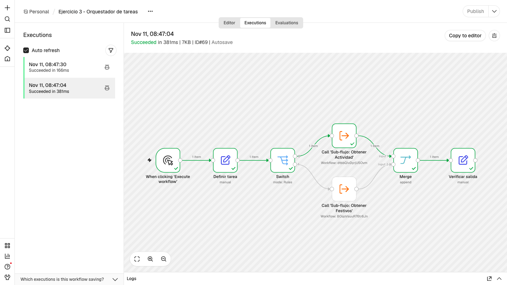

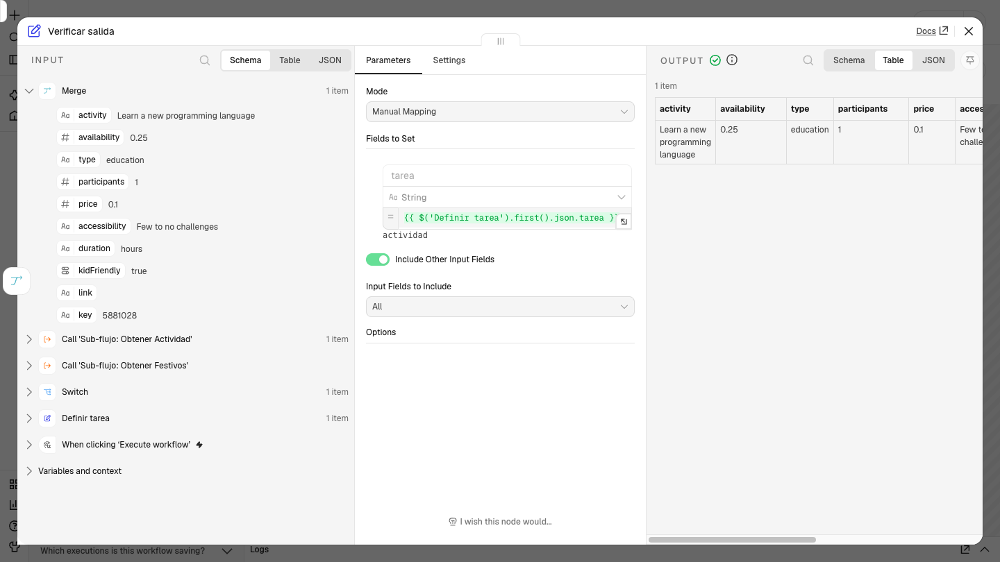

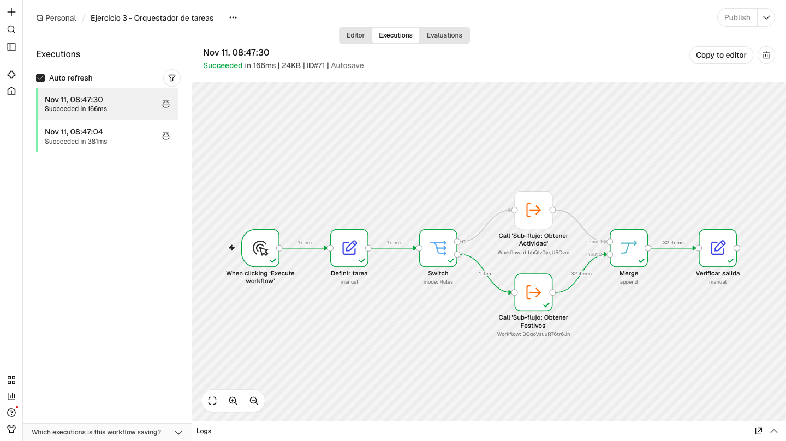

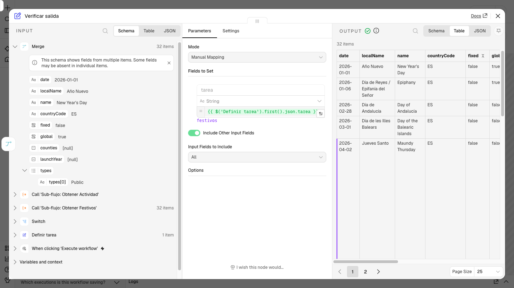

**Pregunta de reflexión.** En la versión de n8n utilizada, el sub-flujo de festivos no devuelve un único ítem con un array: el nodo HTTP Request separa automáticamente el array de la respuesta en 32 ítems, de modo que la salida final ya contiene un ítem por festivo. Si la API devolviera el array dentro de un campo (por ejemplo, `{ "festivos": [...] }`), habría que añadir un **Split Out** sobre ese campo al final del sub-flujo para que devolviera un ítem por festivo.

### 5.4. Ejercicio 4: Sub-flujo notificador reutilizable

**`Sub-flujo: Notificador`**

| # | Nodo | Configuración |
|---|---|---|
| 1 | When Executed by Another Workflow | Campos de entrada `mensaje` y `nivel` |
| 2 | Switch | Salida 0: `{{ $json.nivel }}` **is equal to** `INFO`; salida 1: **is equal to** `ERROR` |
| 3 | Append row in Eventos | Google Sheets, hoja `Eventos` |
| 4 | Append row in Alertas | Google Sheets, hoja `Alertas` |

Columnas de las dos hojas: `Timestamp` = `{{ $now }}`, `Nivel` = `{{ $json.nivel }}` y `Mensaje` = `{{ $json.mensaje }}`.

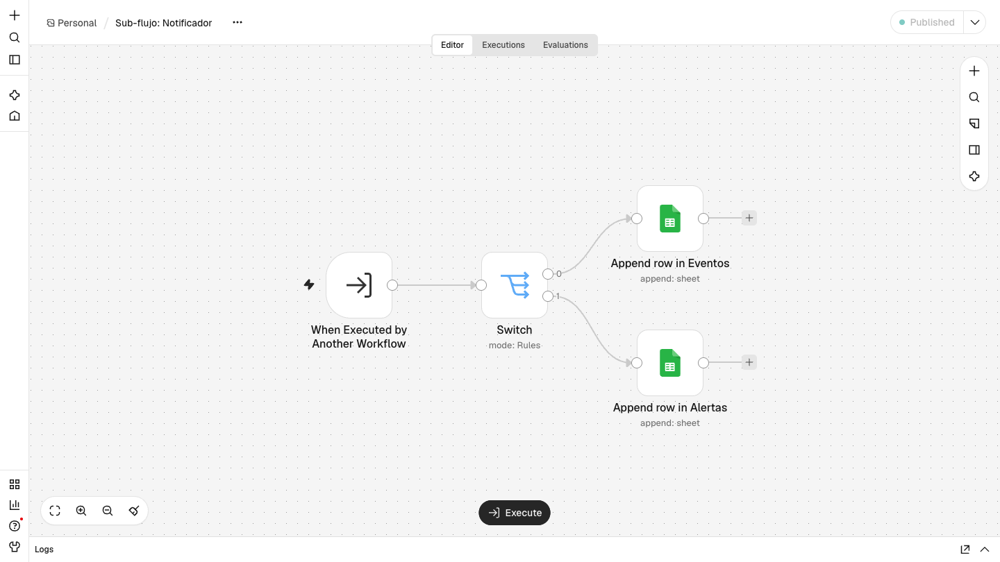

**Cambios en `Manejador de Errores`.** Después de `Append row in sheet` se añadió `Call 'Sub-flujo: Notificador'` con `nivel` = `ERROR` y:

```
mensaje = {{ "Fallo en " + $('Error Trigger').item.json.workflow.name + ": " + $('Error Trigger').item.json.execution.error.message }}
```

**Cambios en `Procesador Principal de imagenes`.**

- Al final se añadió `Call 'Sub-flujo: Notificador'` con `nivel` = `INFO`, `mensaje` = `Procesamiento de imágenes completado` y la opción **Execute Once**, para enviar un único aviso.
- En `Call 'Sub-flujo: Descargador de imagenes'` se activó **On Error: Continue**. Sin este cambio, el error de la tercera URL detiene el workflow y el aviso final nunca se ejecuta. El sub-flujo sigue fallando, así que el `Manejador de Errores` se activa igualmente.

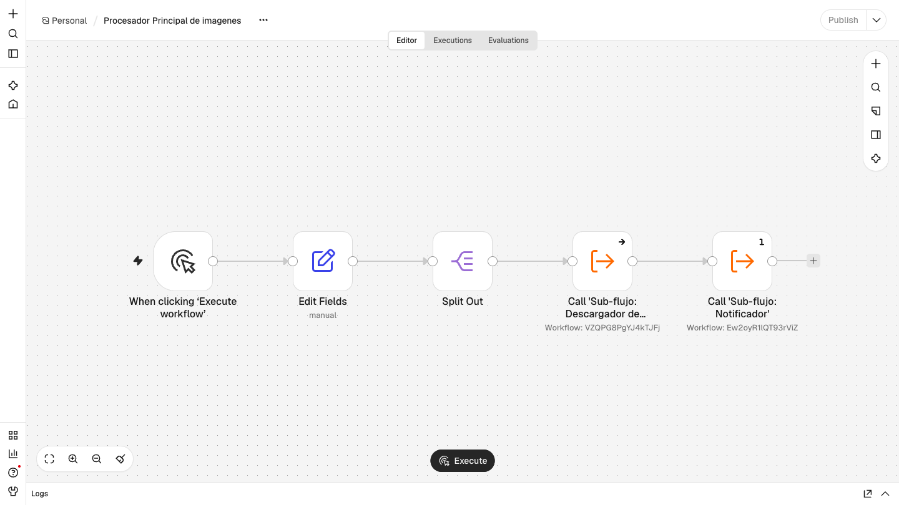

**Resultado.** Una sola ejecución del `Procesador Principal` generó los dos eventos:

| Workflow | Resultado |
|---|---|
| `Procesador Principal de imagenes` | Correcto; llama al Notificador con `INFO` |
| `Sub-flujo: Notificador` | Escribe en `Eventos` |
| `Manejador de Errores` | Registra el fallo del descargador y llama al Notificador con `ERROR` |
| `Sub-flujo: Notificador` | Escribe en `Alertas` |

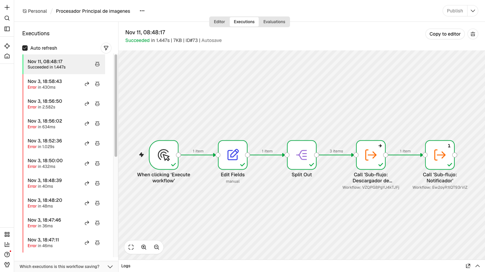

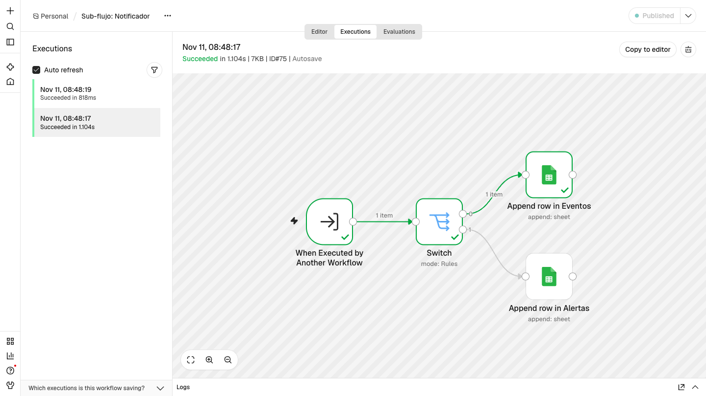

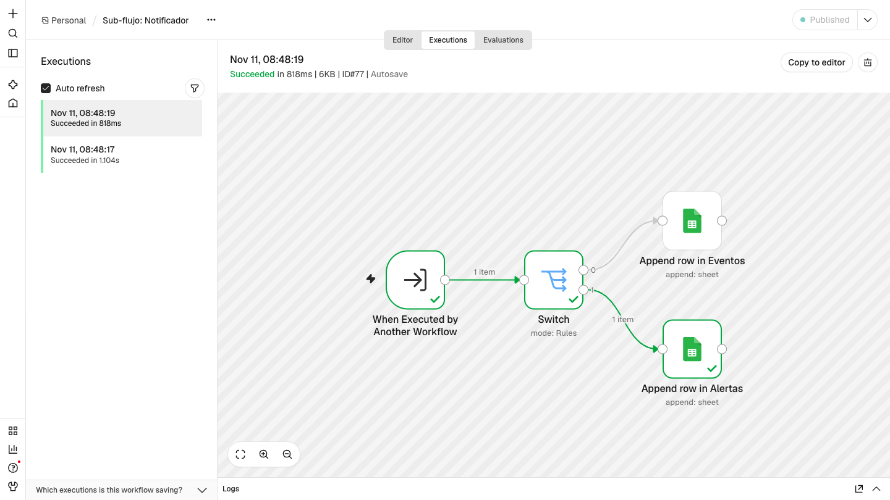

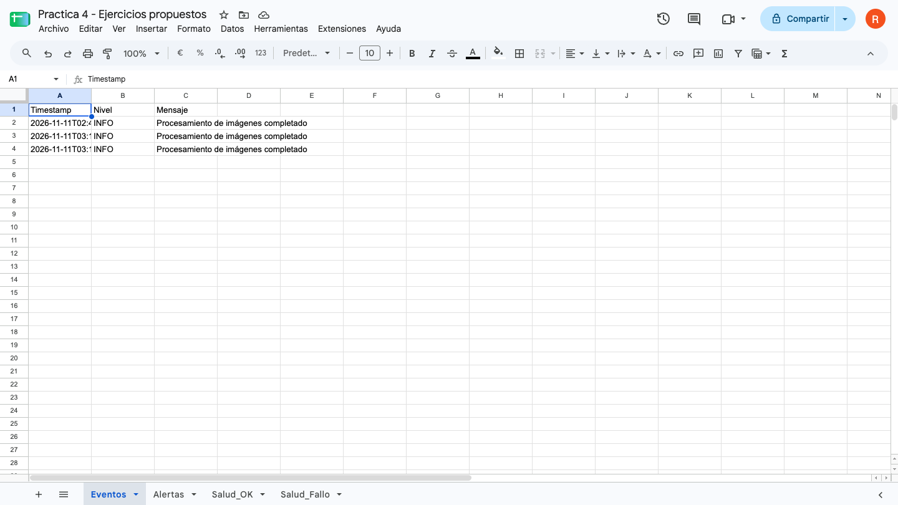

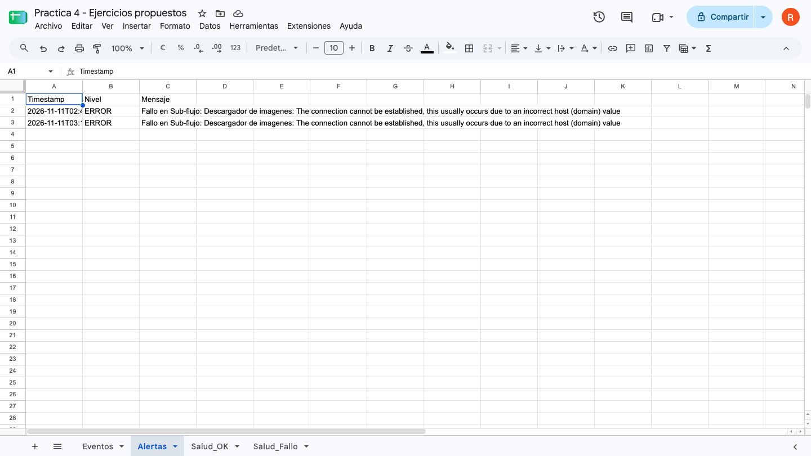

Las hojas tienen más de una fila porque el `Procesador Principal` se ejecutó varias veces durante las pruebas de los ejercicios 4.1 y 4.4.

**Pregunta de reflexión.** Con este diseño, para añadir un canal nuevo (por ejemplo, Slack) solo habría que modificar un workflow, el `Sub-flujo: Notificador`. Si cada flujo escribiera sus notificaciones por su cuenta, habría que modificar todos los que notifican: en este caso, el `Manejador de Errores` y el `Procesador Principal`, y cualquier otro que se añadiera después.

### 5.5. Ejercicio 5: Monitor de salud de APIs

**`Sub-flujo: Comprobar API`**

| # | Nodo | Configuración |
|---|---|---|
| 1 | When Executed by Another Workflow | Campo de entrada `url` |
| 2 | HTTP Request | `GET {{ $json.url }}` |
| 3 | Edit Fields | `estado` = `OK`, con **Execute Once** activado |

**Execute Once** es necesario porque la API de festivos devuelve 32 ítems: sin esa opción, el sub-flujo devolvería 32 `estado = OK` y se escribirían 32 filas para una sola API.

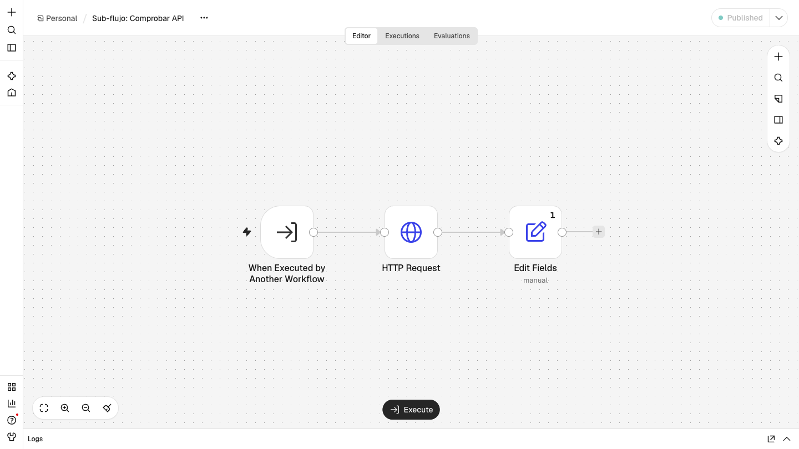

**`Ejercicio 5 - Monitor de salud de APIs`**

| # | Nodo | Configuración |
|---|---|---|
| 1 | Schedule Trigger | Cada hora (**Trigger Interval** = `Hours`, `1`) |
| 2 | Edit Fields | Modo JSON: lista `apis` con las tres URLs |
| 3 | Split Out | **Fields To Split Out** = `apis` (un ítem por API) |
| 4 | Call 'Sub-flujo: Comprobar API' | `url` = `{{ $json.url }}`, **Mode** = `Run once for each item`, **On Error** = `Continue` |
| 5 | If | `{{ $json.estado }}` **is equal to** `OK` |
| 6 | Append row in Salud_OK | Rama `true`: `URL` = `{{ $('Split Out').item.json.url }}`, `Hora` = `{{ $now }}` |
| 7 | Append row in Salud_Fallo | Rama `false`: mismas columnas |

APIs comprobadas:

```json
{
  "apis": [
    { "url": "https://fakestoreapi.com/products/1" },
    { "url": "https://v2.jokeapi.dev/joke/Programming?type=single" },
    { "url": "https://date.nager.at/api/v3/PublicHolidays/2026/ES" }
  ]
}
```

El modo **Run once for each item** hace que cada API se compruebe en una ejecución del sub-flujo distinta, de modo que el fallo de una no afecta a las demás. Con **On Error: Continue**, si una petición falla, el nodo devuelve un ítem con el campo `error` en lugar de detener el workflow; ese ítem no tiene `estado = OK` y va a la rama `false`. La URL se toma de `$('Split Out')` porque el sub-flujo solo devuelve el campo `estado`.

El workflow tiene `Manejador de Errores` como Error Workflow y está publicado para que el Schedule Trigger lo ejecute cada hora.

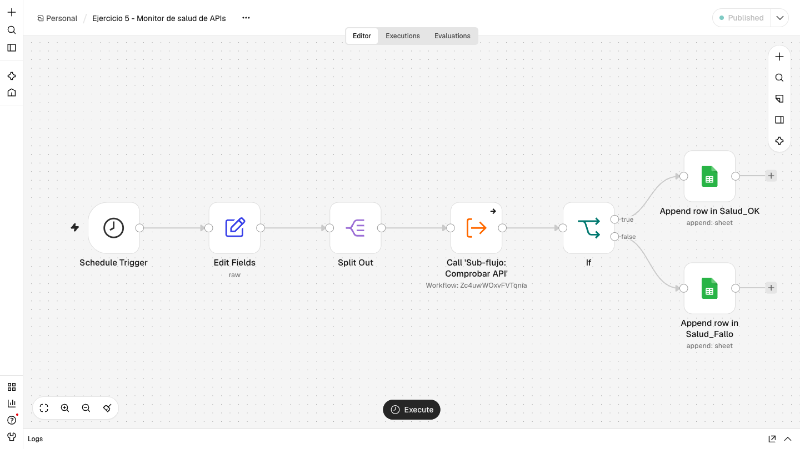

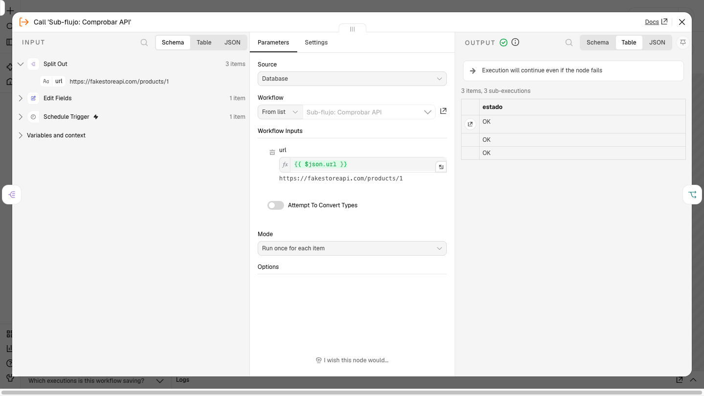

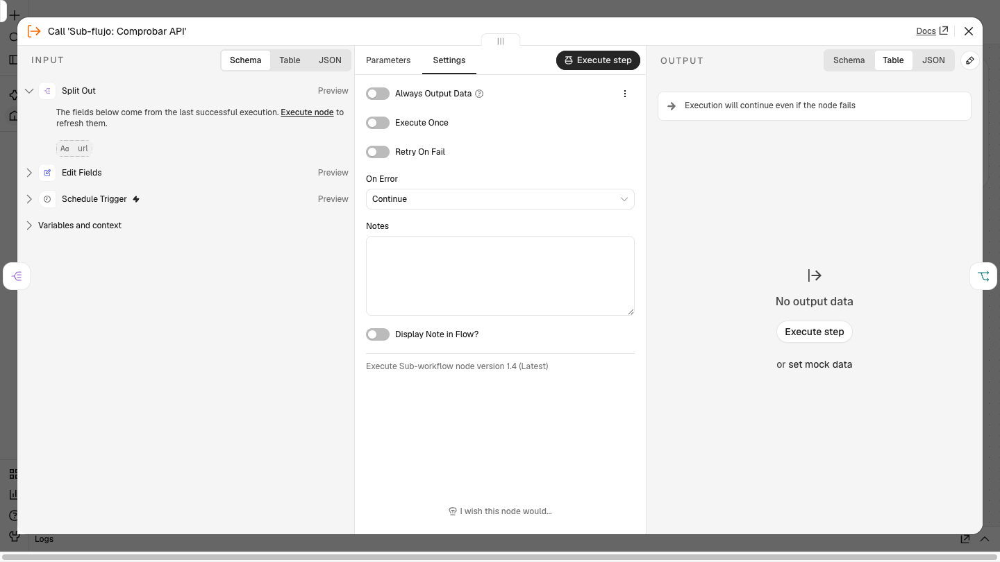

**Resultado.** La ejecución programada de las 10:00 comprobó las tres APIs, que respondieron correctamente:

| Workflow | Resultado |
|---|---|
| `Ejercicio 5 - Monitor de salud de APIs` (`trigger`) | 3 ítems por la rama `true` |
| `Sub-flujo: Comprobar API` | Fake Store API: `estado = OK` |
| `Sub-flujo: Comprobar API` | JokeAPI: `estado = OK` |
| `Sub-flujo: Comprobar API` | Nager.Date: 32 ítems → un único `estado = OK` |

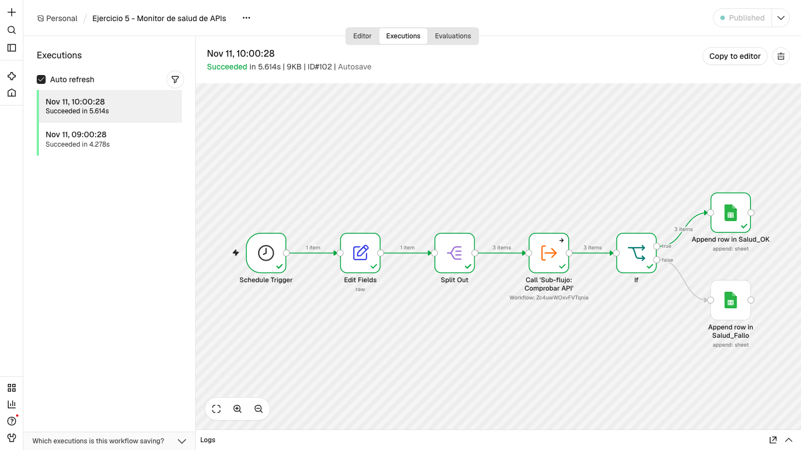

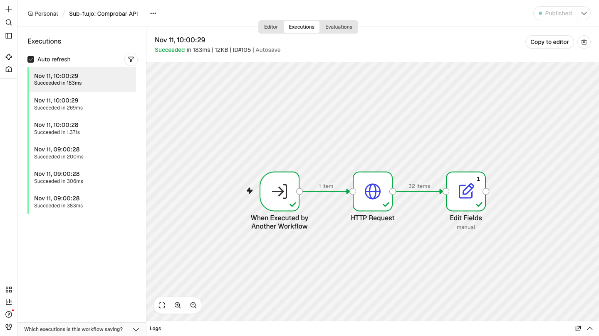

Se escribió una fila por API en `Salud_OK`; `Salud_Fallo` quedó vacía porque ninguna API falló:

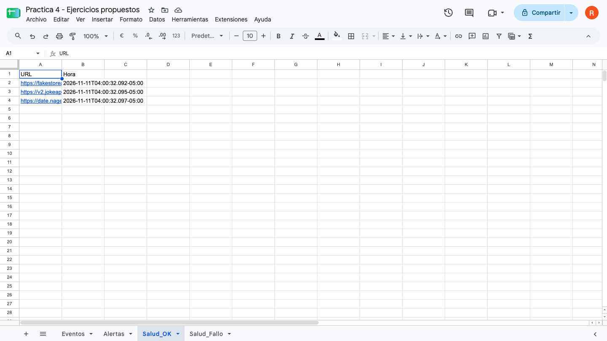

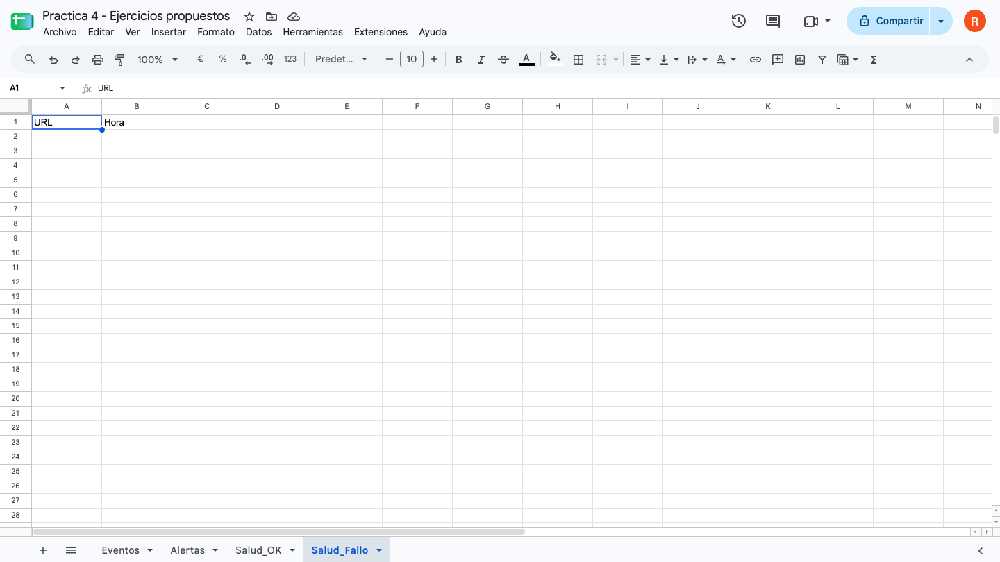

**Prueba con una API caída.** Para comprobar la rama `false` se hizo una ejecución manual añadiendo temporalmente en el nodo Edit Fields una cuarta URL con un dominio que no existe, `https://api-inexistente.invalid/status`. El cambio no se publicó, así que las ejecuciones programadas siguieron usando la lista original, y después se eliminó.

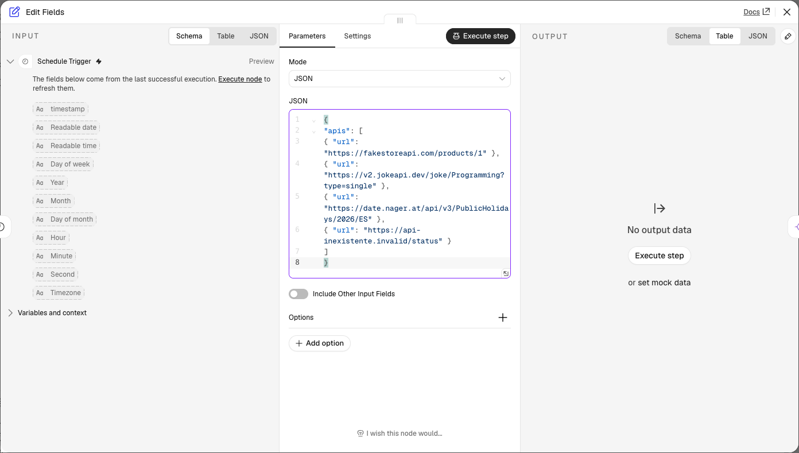

El sub-flujo falló para la URL de prueba, pero con **On Error: Continue** el nodo Execute Workflow devolvió un ítem con el campo `error` y el monitor siguió con las demás: 3 ítems por la rama `true` y 1 por la rama `false`.

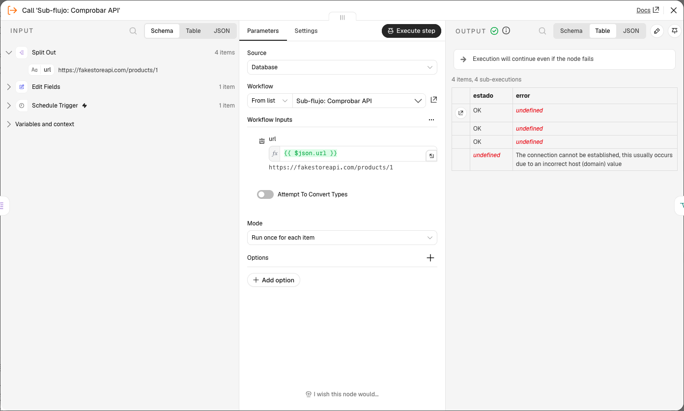

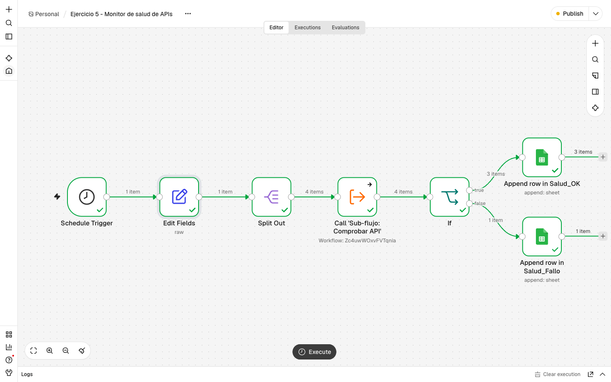

En `Salud_OK` se añadieron las filas 47 a 49 (las anteriores son las ejecuciones horarias del 11 de noviembre) y en `Salud_Fallo` la fila de la URL de prueba:

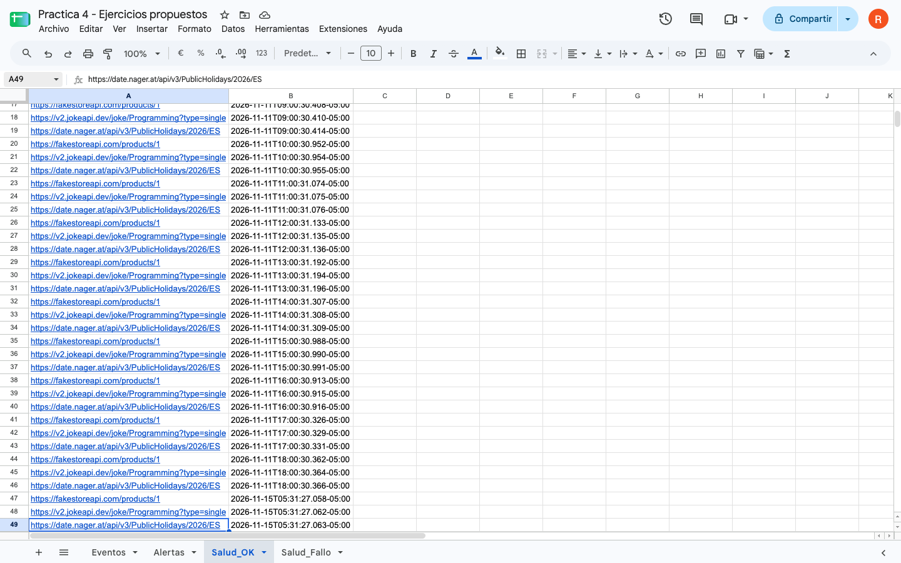

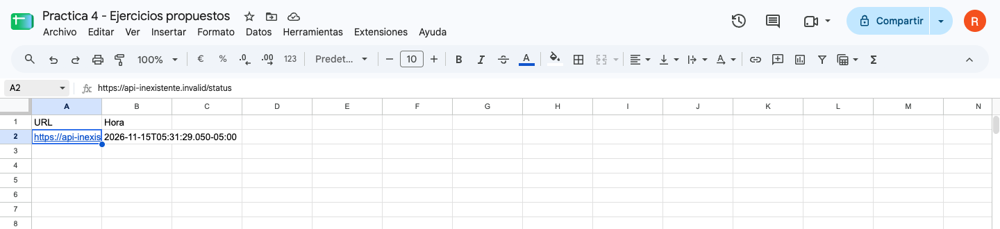

**Pregunta de reflexión.** Los dos mecanismos cubren fallos distintos. **On Error: Continue** gestiona los fallos esperados de cada ítem, como que una API no responda: el monitor sigue con las demás y el fallo queda registrado en `Salud_Fallo`, como se vio en la prueba con la URL inexistente. El **Error Workflow** captura los fallos inesperados que detienen la ejecución entera, como un error del propio nodo de Google Sheets o una credencial caducada, y avisa de ellos. Combinados, el monitor no se detiene por una API caída y, si algo falla en el propio monitor, el fallo no pasa desapercibido.
