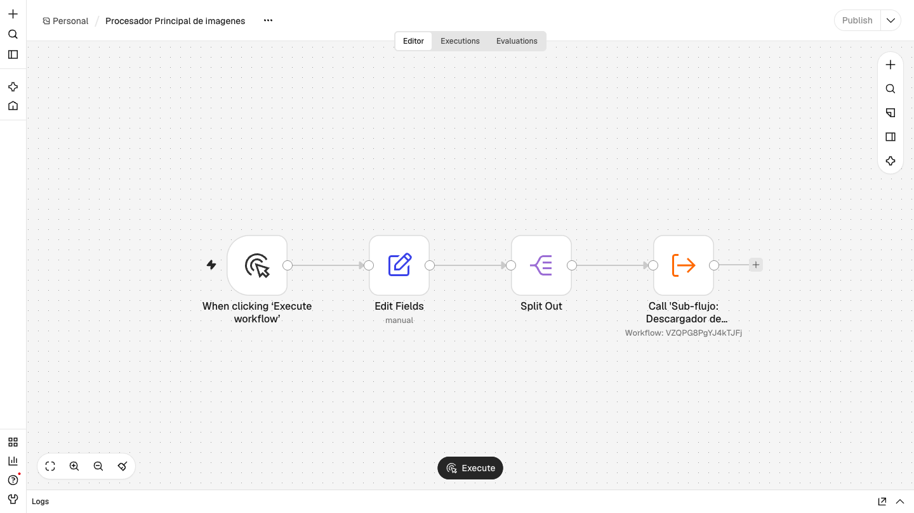
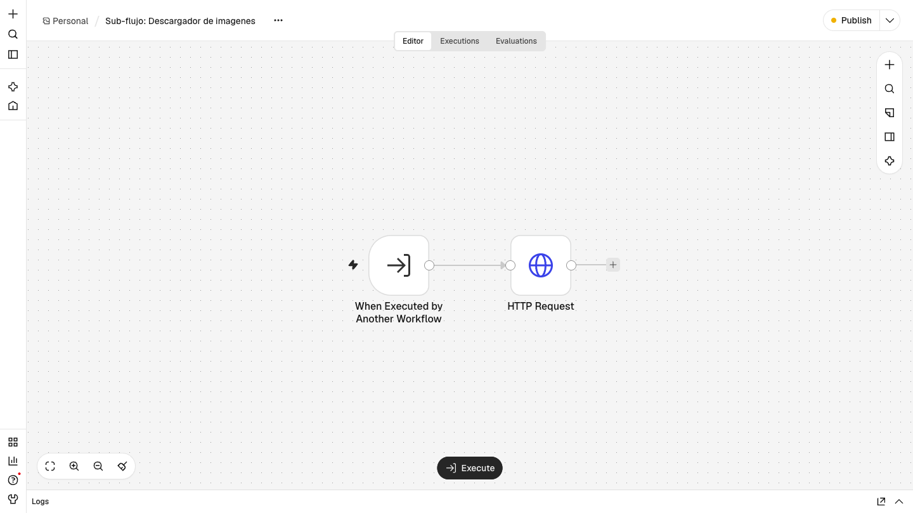
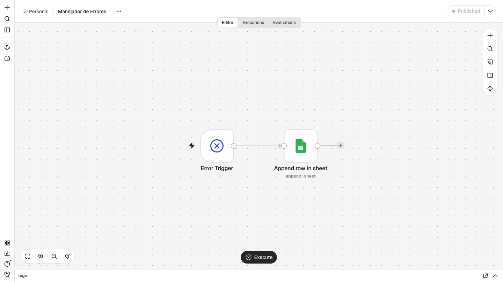
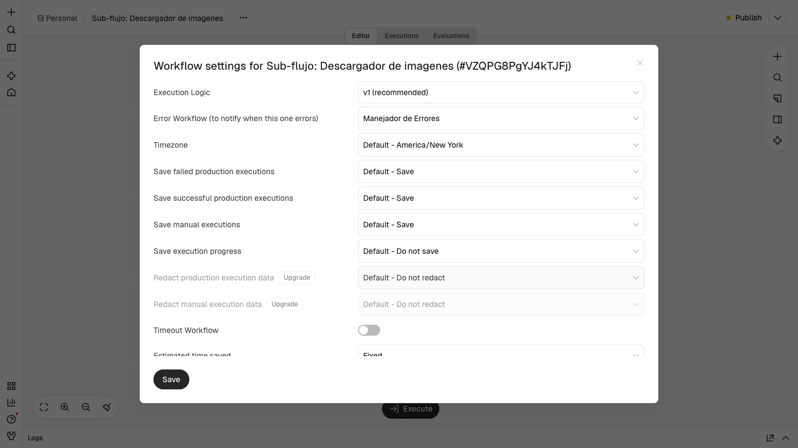
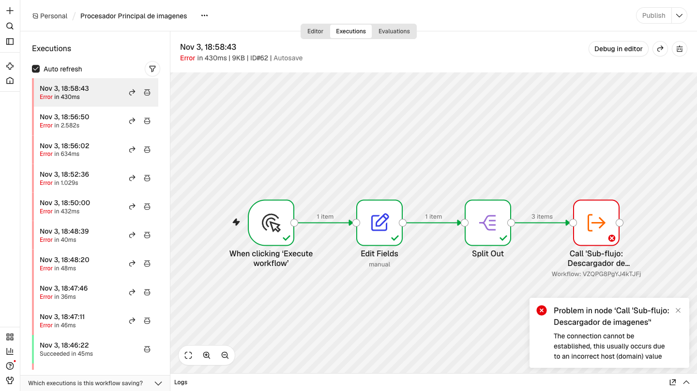
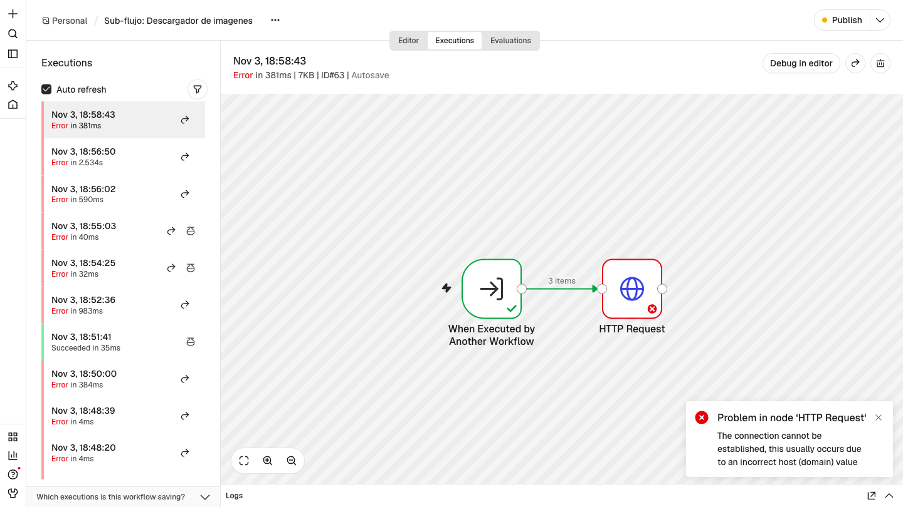
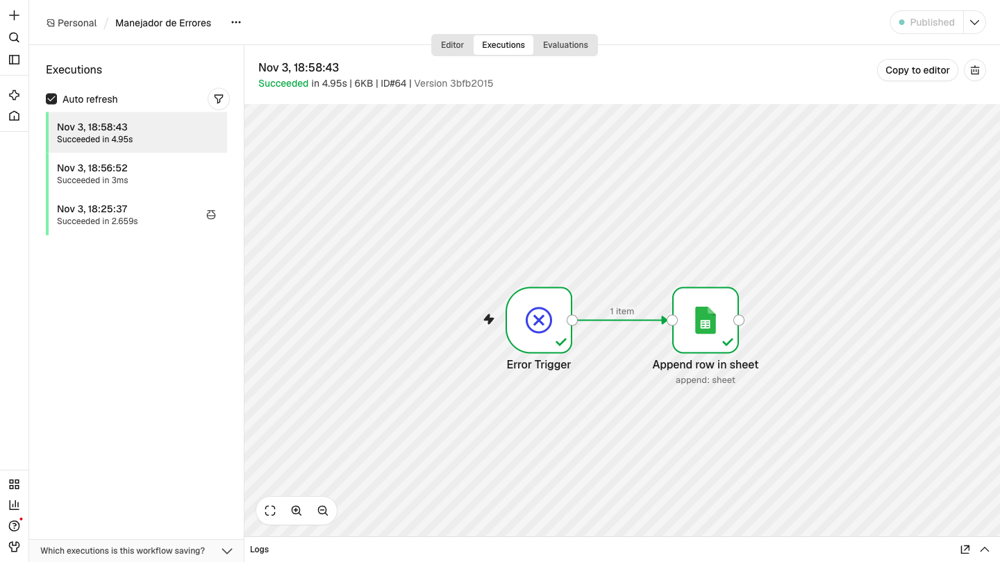
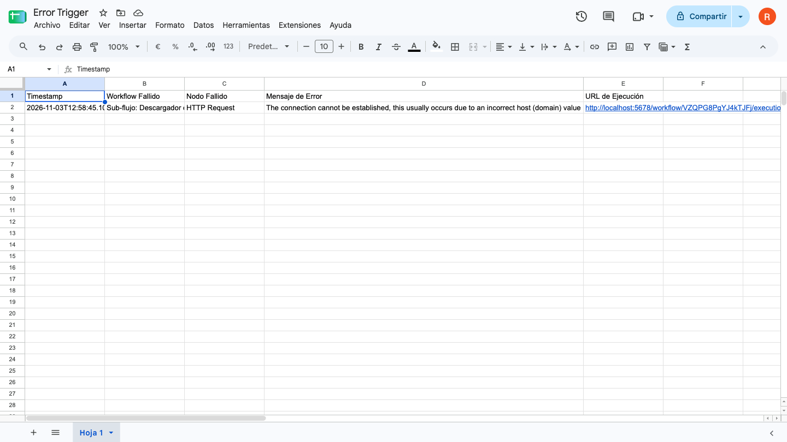

# Práctica 4: Sub-flujos y gestión centralizada de errores

**Asignatura:** Integración de Tecnologías y Servicios Informáticos (ITSI)
**Alumno:** Roberto Castillo — rct419@inlumine.ual.es

Solución formada por tres workflows: uno principal que recorre una lista de URLs de imágenes, un sub-flujo que descarga cada imagen y un manejador que registra los errores en Google Sheets. Una de las URLs no existe a propósito, para comprobar que el error queda registrado.

---

## Cómo importar y ejecutar los workflows

1. Crear en Google Sheets un documento con estas cabeceras: `Timestamp`, `Workflow Fallido`, `Nodo Fallido`, `Mensaje de Error` y `URL de Ejecución`.
2. Abrir la instancia de n8n en el navegador (por defecto, en local: http://localhost:5678).
3. Importar los tres workflows con **Create workflow → menú `…` → Import from File**, en este orden:
   1. [`workflows/Practica-4-Manejador-de-Errores.json`](workflows/Practica-4-Manejador-de-Errores.json)
   2. [`workflows/Practica-4-Sub-flujo-Descargador.json`](workflows/Practica-4-Sub-flujo-Descargador.json)
   3. [`workflows/Practica-4-Procesador-Principal.json`](workflows/Practica-4-Procesador-Principal.json)
4. En `Manejador de Errores`, seleccionar en el nodo de Google Sheets una credencial propia de Google (OAuth 2.0), el documento y la hoja.
5. En `Sub-flujo: Descargador de imagenes` y `Procesador Principal de imagenes`, abrir **Settings → Error Workflow** y seleccionar `Manejador de Errores`.
6. En `Procesador Principal de imagenes`, abrir el nodo `Call 'Sub-flujo: Descargador de imagenes'` y seleccionar de nuevo el sub-flujo.
7. Publicar `Manejador de Errores` y `Sub-flujo: Descargador de imagenes`.
8. Abrir `Procesador Principal de imagenes` y pulsar **Execute workflow**.

Los pasos 5 y 6 son necesarios porque n8n asigna identificadores nuevos a los workflows importados. Las credenciales no se incluyen en los JSON exportados, por lo que cada instancia debe configurar la suya.

## 1. Workflows

### `Procesador Principal de imagenes`



| # | Nodo | Tipo | Función |
|---|---|---|---|
| 1 | When clicking 'Execute workflow' | Manual Trigger | Inicia el workflow manualmente |
| 2 | Edit Fields | Edit Fields (Set) | Crea el array `imageUrls` con las tres URLs |
| 3 | Split Out | Split Out | Separa `imageUrls` en 3 ítems |
| 4 | Call 'Sub-flujo: Descargador de imagenes' | Execute Workflow | Llama al sub-flujo y le pasa `Image` = `{{ $json.imageUrls.imageUrl }}` |

URLs de la lista:

| URL | Resultado esperado |
|---|---|
| `https://placedog.net/320/240` | Válida |
| `https://dummyimage.com/320x240` | Válida |
| `https://esta-url-no-existe.xyz/imagen.jpg` | Error: el dominio no existe |

### `Sub-flujo: Descargador de imagenes`



| # | Nodo | Tipo | Función |
|---|---|---|---|
| 1 | When Executed by Another Workflow | Execute Workflow Trigger | Recibe el campo de entrada `Image` |
| 2 | HTTP Request | HTTP Request | `GET {{ $json.Image }}`, con la respuesta en formato `File` |

### `Manejador de Errores`



| # | Nodo | Tipo | Función |
|---|---|---|---|
| 1 | Error Trigger | Error Trigger | Se inicia cuando falla un workflow que lo tiene asignado como Error Workflow |
| 2 | Append row in sheet | Google Sheets | Añade una fila con los datos del error |

Columnas que escribe el nodo de Google Sheets:

| Columna | Expresión |
|---|---|
| `Timestamp` | `{{ $now }}` |
| `Workflow Fallido` | `{{ $json.workflow.name }}` |
| `Nodo Fallido` | `{{ $json.execution.lastNodeExecuted }}` |
| `Mensaje de Error` | `{{ $json.execution.error.message }}` |
| `URL de Ejecución` | `{{ $json.execution.url }}` |

## 2. Dónde se configura el Error Workflow

`Manejador de Errores` está asignado en **Settings → Error Workflow** de `Procesador Principal de imagenes` y de `Sub-flujo: Descargador de imagenes`.



La asignación que se activa en esta prueba es la del sub-flujo. n8n no lanza el Error Workflow en las ejecuciones manuales, y el workflow principal se inicia de forma manual. El sub-flujo, en cambio, se ejecuta en modo `integrated` porque lo llama otro workflow, así que su fallo sí inicia el manejador.

## 3. Ejecución

Cada ejecución termina con error en los workflows principal y sub-flujo, porque la tercera URL no existe. Ese es el resultado esperado de la prueba.

| Ejecución | Workflow | Modo | Estado |
|---|---|---|---|
| 62 | `Procesador Principal de imagenes` | `manual` | Error |
| 63 | `Sub-flujo: Descargador de imagenes` | `integrated` | Error |
| 64 | `Manejador de Errores` | `error` | Correcto |

### Procesador principal

Split Out genera 3 ítems y el nodo que llama al sub-flujo falla al recibir su error.



### Sub-flujo

El nodo HTTP Request recibe los 3 ítems y falla en el tercero (`itemIndex: 2`) con el código `ENOTFOUND`.



### Manejador de errores

El Error Trigger recibe los datos del fallo y Google Sheets añade la fila:

```json
{
  "Timestamp": "2026-11-03T12:58:45.103-05:00",
  "Workflow Fallido": "Sub-flujo: Descargador de imagenes",
  "Nodo Fallido": "HTTP Request",
  "Mensaje de Error": "The connection cannot be established, this usually occurs due to an incorrect host (domain) value",
  "URL de Ejecución": "http://localhost:5678/workflow/VZQPG8PgYJ4kTJFj/executions/63"
}
```



## 4. Resultado en Google Sheets

El error queda registrado con el workflow y el nodo que fallaron, el mensaje y el enlace a la ejecución.


