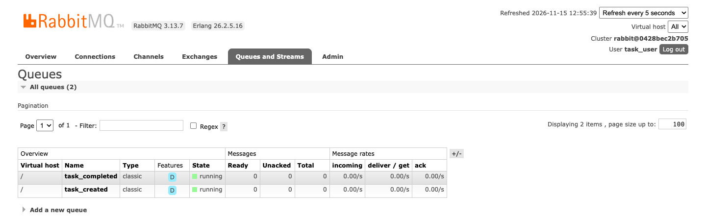
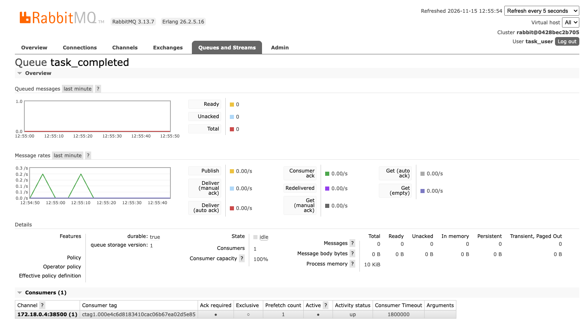
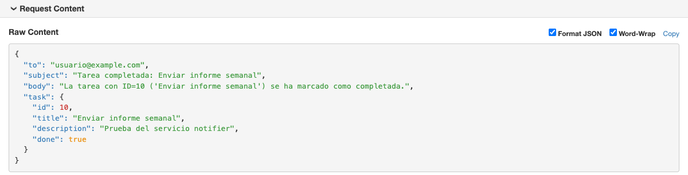
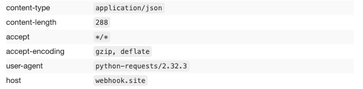
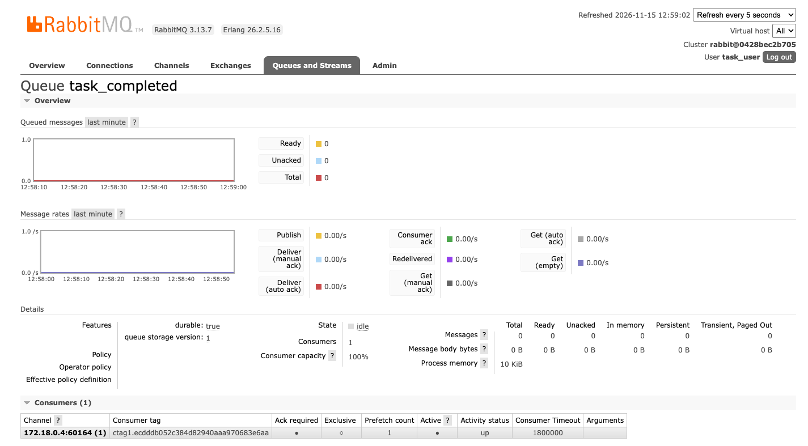
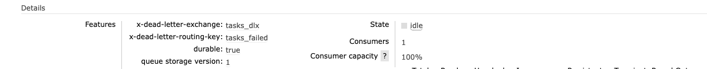
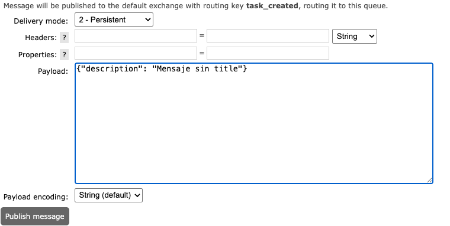
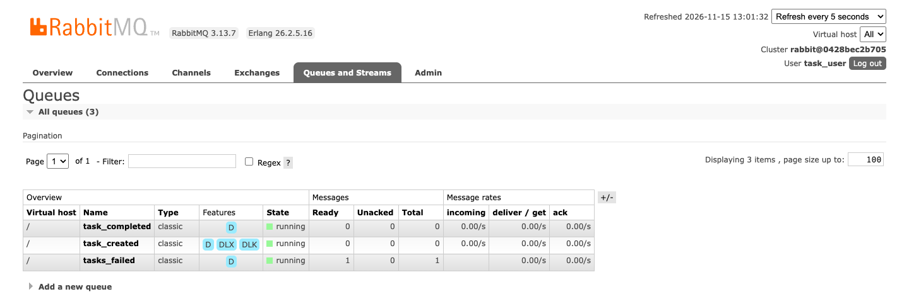
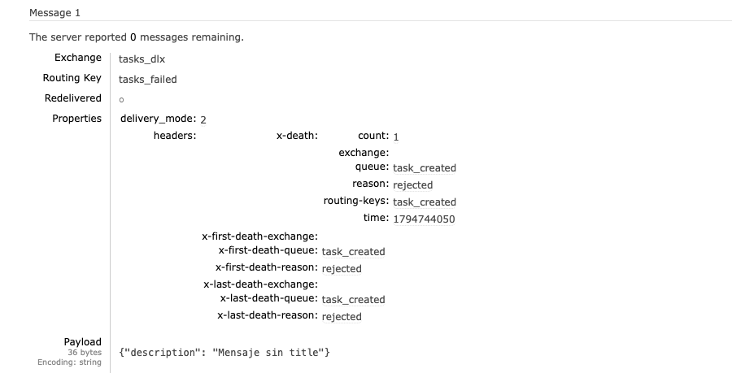

# Práctica 5: Orquestación de microservicios con Docker Compose, PostgreSQL y RabbitMQ

**Asignatura:** Integración de Tecnologías y Servicios Informáticos (ITSI)
**Alumno:** Roberto Castillo — rct419@inlumine.ual.es  
**Enunciado:** https://ualitsi.github.io/n8n-005/

Gestor de tareas formado por varios contenedores orquestados con Docker Compose: una API REST en Flask (`web`) que guarda las tareas en PostgreSQL y publica un evento en RabbitMQ cada vez que se crea o se completa una tarea, y varios consumidores que reaccionan a esos eventos.

---

## Estructura del proyecto

```
practica 5/
├── docker-compose.yml
├── .env.example                 # plantilla de la variable WEBHOOK_URL
├── web/                         # API REST (productor)
│   ├── app.py
│   ├── requirements.txt
│   └── Dockerfile
├── worker/                      # consumidor de task_created
│   ├── worker.py
│   ├── requirements.txt
│   └── Dockerfile
├── notifier/                    # consumidor de task_completed (ejercicio 2)
│   ├── worker.py
│   ├── requirements.txt
│   └── Dockerfile
├── error_handler/               # consumidor de tasks_failed (ejercicio 3, bonus)
│   ├── error_handler.py
│   ├── requirements.txt
│   └── Dockerfile
├── test_api.sh                  # pruebas de la API con curl
└── Task-Manager-API.postman_collection.json
```

Cada ejercicio propuesto tiene además su propio informe en PDF (`Practica-5.N-Roberto-Castillo.pdf`), y la parte guiada está en `Practica-5-Roberto-Castillo.pdf`.

## Cómo ejecutarlo

1. Copiar `.env.example` a `.env` y poner en `WEBHOOK_URL` la URL única que da https://webhook.site/ (la usa el servicio `notifier`). El fichero `.env` no se sube al repositorio.
2. Desde la carpeta `practica 5/`, ejecutar `docker compose up --build`.
3. La API queda en http://localhost:5001, PostgreSQL en `localhost:5433` y la interfaz de RabbitMQ en http://localhost:15672 (usuario `task_user`, contraseña `task_password`).
4. Lanzar las pruebas con `./test_api.sh` o importando la colección de Postman con la variable `baseUrl` = `http://localhost:5001`.
5. Para parar: `docker compose down`. Con `docker compose down -v` se borran también los volúmenes `postgres_data` y `rabbitmq_data`, es decir, las tareas y las colas.

Las credenciales de PostgreSQL y RabbitMQ que aparecen en `docker-compose.yml` son las del enunciado y solo sirven para desarrollo local.

---

## 1. Arquitectura

| Servicio | Contenedor | Origen | Puertos (host → contenedor) | Función |
|---|---|---|---|---|
| `web` | `task-manager-web` | `build: ./web` | `5001 → 5000` | API Flask; publica en `task_created` y `task_completed` |
| `worker` | `task-manager-worker` | `build: ./worker` | — | Consume `task_created` |
| `notifier` | `task-manager-notifier` | `build: ./notifier` | — | Consume `task_completed` y simula un email |
| `error_handler` | `task-manager-error-handler` | `build: ./error_handler` | — | Consume `tasks_failed` y registra el fallo en PostgreSQL |
| `db` | `task-manager-db` | `postgres:16-alpine` | `5433 → 5432` | Base de datos `taskdb` |
| `mq` | `task-manager-mq` | `rabbitmq:3-management-alpine` | `5672 → 5672`, `15672 → 15672` | Bróker de mensajes con interfaz de gestión |

Los contenedores se comunican por la red que crea Docker Compose, usando el nombre del servicio como host (`db:5432` y `mq:5672`). Los datos se guardan en dos volúmenes nombrados, `postgres_data` y `rabbitmq_data`, y el código de `web`, `worker`, `notifier` y `error_handler` se monta con un bind mount (`./web:/app`, etc.).

`db` y `mq` tienen un **healthcheck** (`pg_isready -U user -d taskdb` y `rabbitmq-diagnostics -q ping`), y el resto de servicios dependen de ellos con `condition: service_healthy`. Así no arrancan hasta que PostgreSQL y RabbitMQ aceptan conexiones; un `depends_on` sin condición solo ordenaría el arranque.

| Cola / exchange | Tipo | Productor | Consumidor |
|---|---|---|---|
| `task_created` | Cola durable, con dead letter hacia `tasks_dlx` | `web` (`POST /tasks`) | `worker` |
| `task_completed` | Cola durable | `web` (`PUT /tasks/<id>/complete`) | `notifier` |
| `tasks_dlx` | Exchange `direct` durable | RabbitMQ (mensajes rechazados) | — |
| `tasks_failed` | Cola durable enlazada a `tasks_dlx` | `tasks_dlx` | `error_handler` |

`web` publica con el exchange por defecto (`exchange=""`), mensajes persistentes (`delivery_mode=2`), confirmación de entrega (`confirm_delivery()`) y `mandatory=True`. Los consumidores usan `basic_qos(prefetch_count=1)` y confirmación manual (`basic_ack`).

## 2. Parte guiada

### API REST (`web`)

| Método | Ruta | Respuesta |
|---|---|---|
| `GET` | `/tasks` | Lista de tareas ordenadas por `id` |
| `GET` | `/tasks/<id>` | Una tarea, o `404` |
| `POST` | `/tasks` | Crea la tarea (`201`) y publica `task_created` |
| `PUT` | `/tasks/<id>/complete` | Marca `done = true` y publica `task_completed` |
| `DELETE` | `/tasks/<id>` | Borra la tarea (`204`) |

`POST /tasks` valida que el cuerpo sea un objeto JSON, que `title` sea un texto no vacío de 120 caracteres como máximo y que `description`, si se envía, sea un texto de 255 caracteres como máximo; si no, responde `400`. Si la tarea se guarda en PostgreSQL pero RabbitMQ no acepta el mensaje, responde `503` indicando que la tarea sí se guardó.

La tabla `task` la crea SQLAlchemy (`db.create_all()`) al arrancar la API:

```
$ docker exec task-manager-db psql -U user -d taskdb -c '\d task'
                                      Table "public.task"
   Column    |          Type          | Collation | Nullable |             Default
-------------+------------------------+-----------+----------+----------------------------------
 id          | integer                |           | not null | nextval('task_id_seq'::regclass)
 title       | character varying(120) |           | not null |
 description | character varying(255) |           |          |
 done        | boolean                |           | not null | false
```

### Ejecución y verificación

Con los servicios levantados, en la interfaz de RabbitMQ aparecen las dos colas, durables (`D`):



Se creó una tarea con `POST /tasks`:

```
$ curl -X POST http://localhost:5001/tasks -H "Content-Type: application/json" -d '{"title": "Configurar Docker Compose", "description": "Levantar web, worker, PostgreSQL y RabbitMQ"}'
{"task":{"description":"Levantar web, worker, PostgreSQL y RabbitMQ","done":false,"id":8,"title":"Configurar Docker Compose"}}
HTTP 201

$ curl http://localhost:5001/tasks/8
{"task":{"description":"Levantar web, worker, PostgreSQL y RabbitMQ","done":false,"id":8,"title":"Configurar Docker Compose"}}
HTTP 200
```

En los logs de `web` aparece la petición, y el `worker` recibe el mensaje de `task_created`:

```
$ docker compose logs web
192.168.65.1 - - [15/Nov/2026 11:54:51] "POST /tasks HTTP/1.1" 201 -
192.168.65.1 - - [15/Nov/2026 11:54:53] "GET /tasks/8 HTTP/1.1" 200 -

$ docker compose logs worker
Worker: conectado a RabbitMQ.
 [*] Esperando mensajes. Para salir presione CTRL+C
 [x] Tarea recibida: ID=8, Título='Configurar Docker Compose'
```

El script `test_api.sh` prueba todos los endpoints y las validaciones:

```
$ ./test_api.sh
...
POST /tasks -> 400
{"error":"A non-empty title is required"}
  ✔ Rechaza tarea sin title
POST /tasks -> 400
{"error":"A JSON object is required"}
  ✔ Rechaza cuerpo que no es JSON
...
Resultado: 11 correctas / 0 fallidas
```

La colección de Postman se ejecutó también con Postman CLI (`postman collection run Task-Manager-API.postman_collection.json --env-var baseUrl=http://localhost:5001`): 9 peticiones y 14 aserciones, sin fallos.

---

## 3. Ejercicios propuestos

Los tres ejercicios se fueron aplicando sobre el mismo proyecto, en orden; el código del repositorio corresponde al estado final, después del ejercicio 3.

### 3.1. Ejercicio 1: Actualización de tareas y notificación

**Cambios.**

- En `web/app.py`, el endpoint `PUT /tasks/<int:task_id>/complete` busca la tarea (`404` si no existe), pone `done = True`, guarda el cambio y publica la tarea actualizada en la cola `task_completed`.
- En `worker/worker.py` se declararon las dos colas y se registró un consumidor para cada una con `make_callback(nombre_de_cola)`, que imprime un log distinto según el evento:

```python
if event_name == "task_completed":
    print(f" [+] Tarea completada: ID={task_data.get('id')}, Título='{task_data['title']}'")
else:
    print(f" [x] Tarea recibida: ID={task_data.get('id')}, Título='{task_data['title']}'")
```

**Prueba.** Se completó la tarea creada en la parte guiada:

```
$ curl -X PUT http://localhost:5001/tasks/8/complete
{"task":{"description":"Levantar web, worker, PostgreSQL y RabbitMQ","done":true,"id":8,"title":"Configurar Docker Compose"}}
HTTP 200

$ docker compose logs worker
 [x] Tarea recibida: ID=8, Título='Configurar Docker Compose'
 [+] Tarea completada: ID=8, Título='Configurar Docker Compose'
```

En RabbitMQ, la cola `task_completed` tenía un consumidor desde `172.18.0.4`, que en ese momento era la IP del contenedor `task-manager-worker` (`docker inspect`):



### 3.2. Ejercicio 2: Servicio de notificaciones por email simulado

**Cambios.**

- Se creó el directorio `notifier/` con su `worker.py`, `requirements.txt` (`pika==1.3.2` y `requests==2.32.3`) y `Dockerfile`.
- Se añadió el servicio `notifier` a `docker-compose.yml`. Recibe la URL de webhook.site en la variable `WEBHOOK_URL`, que se lee del fichero `.env` (`WEBHOOK_URL: ${WEBHOOK_URL:?Define WEBHOOK_URL en el fichero .env}`); si falta, Docker Compose no arranca.
- El `worker` volvió a consumir solo `task_created`.
- El `notifier` consume `task_completed` y, por cada tarea completada, hace un `POST` a webhook.site con un email simulado:

```python
email = {
    "to": "usuario@example.com",
    "subject": f"Tarea completada: {task_data['title']}",
    "body": f"La tarea con ID={task_data.get('id')} ('{task_data['title']}') se ha marcado como completada.",
    "task": task_data,
}
response = requests.post(WEBHOOK_URL, json=email, timeout=10)
response.raise_for_status()
```

Si el `POST` falla por un problema de red o del webhook, el mensaje se devuelve a la cola (`basic_nack` con `requeue=True`) para reintentarlo; si el mensaje no tiene `title`, se descarta (`requeue=False`).

**Prueba.**

```
$ curl -X POST http://localhost:5001/tasks -H "Content-Type: application/json" -d '{"title": "Enviar informe semanal", "description": "Prueba del servicio notifier"}'
HTTP 201
$ curl -X PUT http://localhost:5001/tasks/10/complete
HTTP 200

$ docker compose logs worker
 [x] Tarea recibida: ID=10, Título='Enviar informe semanal'

$ docker compose logs notifier
Notifier: conectado a RabbitMQ.
Notifier: esperando mensajes en 'task_completed'.
Notifier: email simulado enviado (HTTP 200) para la tarea ID=10, Título='Enviar informe semanal'
```

El `worker` ya no registra la tarea completada. webhook.site recibió la petición con el email:





Ahora el consumidor de `task_completed` es `172.18.0.4`, la IP que tenía en ese momento `task-manager-notifier` (al recrear los contenedores, Docker reasignó las IP y el `worker` pasó a `172.18.0.6`):



### 3.3. Ejercicio 3: Persistencia de mensajes y Dead Letter Queue

Una **Dead Letter Exchange** (DLX) es un exchange al que RabbitMQ reenvía los mensajes de una cola cuando se rechazan sin reencolar (`basic_nack`/`basic_reject` con `requeue=False`), cuando caducan o cuando la cola supera su longitud máxima. Se configura con los argumentos `x-dead-letter-exchange` y `x-dead-letter-routing-key` de la cola.

**Cambios en `web` y `worker`.** Los dos servicios declaran exactamente la misma topología, porque RabbitMQ rechaza volver a declarar una cola con argumentos distintos:

```python
channel.exchange_declare(exchange="tasks_dlx", exchange_type="direct", durable=True)
channel.queue_declare(queue="tasks_failed", durable=True)
channel.queue_bind(queue="tasks_failed", exchange="tasks_dlx", routing_key="tasks_failed")
channel.queue_declare(
    queue="task_created",
    durable=True,
    arguments={
        "x-dead-letter-exchange": "tasks_dlx",
        "x-dead-letter-routing-key": "tasks_failed",
    },
)
```

En `web/app.py` los argumentos están en el diccionario `QUEUE_ARGUMENTS`, porque `publish_message` se usa también para `task_completed`, que no lleva dead letter. El `worker` rechaza con `basic_nack(..., requeue=False)` cualquier mensaje que no sea un objeto JSON con `title`.

**Migración de la cola.** RabbitMQ no permite cambiar los argumentos de una cola que ya existe, así que antes de arrancar las versiones nuevas se pararon `web` y `worker` y se borró `task_created`, solo después de comprobar que estaba vacía. El volumen de PostgreSQL no se tocó.

```
$ docker compose stop web worker
$ docker exec task-manager-mq rabbitmqctl list_queues name messages consumers
name            messages  consumers
task_completed  0         1
task_created    0         0
$ docker exec task-manager-mq rabbitmqctl delete_queue task_created --if-empty
Deleting queue 'task_created' on vhost '/' if queue is empty ...
Queue was successfully deleted with 0 ready messages
```

Al volver a arrancar `web` y `worker`, la cola se redeclaró con los argumentos nuevos:

```
$ docker exec task-manager-mq rabbitmqctl list_queues name durable messages arguments
tasks_failed    true  0  []
task_completed  true  0  []
task_created    true  0  [{"x-dead-letter-exchange","tasks_dlx"},{"x-dead-letter-routing-key","tasks_failed"}]

$ docker exec task-manager-mq rabbitmqctl list_bindings source_name destination_name routing_key
tasks_dlx  tasks_failed  tasks_failed
```



Se comprobó que las tareas válidas seguían funcionando (`POST /tasks` → `201` y ` [x] Tarea recibida` en el `worker`).

**Prueba con un mensaje sin `title`.** Desde la interfaz de RabbitMQ (**Queues → task_created → Publish message**) se publicó en `task_created` el mensaje `{"description": "Mensaje sin title"}`, con el `error_handler` todavía parado:



El `worker` lo rechazó:

```
Worker: mensaje inválido; se rechaza: el mensaje no contiene un title válido
```

y RabbitMQ lo reenvió a `tasks_dlx`, que lo dejó en `tasks_failed`:



Al consultar el mensaje (**Get messages**, con **Ack Mode** = `Reject requeue true` para no sacarlo de la cola), se ve que llegó por `tasks_dlx` y que la cabecera `x-death` indica la cola de origen y el motivo:



**Bonus: servicio `error_handler`.** Se creó un cuarto servicio, `error_handler/`, que consume `tasks_failed` y guarda cada mensaje fallido en una tabla aparte de PostgreSQL, `task_error`, que crea él mismo si no existe:

```sql
CREATE TABLE IF NOT EXISTS task_error (
    id SERIAL PRIMARY KEY,
    received_at TIMESTAMPTZ NOT NULL DEFAULT now(),
    original_queue VARCHAR(120),
    reason VARCHAR(60),
    payload TEXT NOT NULL,
    payload_json JSONB
)
```

La cola de origen y el motivo los toma de la cabecera `x-death` del mensaje. En `docker-compose.yml` depende de `db` y `mq` con `condition: service_healthy` y recibe `DATABASE_URL` y `RABBITMQ_URL`. Al arrancarlo, procesó el mensaje que esperaba en la cola:

```
$ docker compose logs error_handler
Error handler: conectado a PostgreSQL.
Error handler: conectado a RabbitMQ.
Error handler: esperando mensajes en 'tasks_failed'.
Error handler: mensaje fallido registrado (fila 1): cola=task_created, motivo=rejected, contenido={"description": "Mensaje sin title"}

$ docker exec task-manager-db psql -U user -d taskdb -c "SELECT id, original_queue, reason, payload FROM task_error;"
 id | original_queue |  reason  |               payload
----+----------------+----------+--------------------------------------
  1 | task_created   | rejected | {"description": "Mensaje sin title"}
```

**Estado final.** Con los seis servicios levantados se repitieron las pruebas (`./test_api.sh`: 11 correctas / 0 fallidas) y se comprobó que una tarea creada y completada pasa por el `worker` y por el `notifier`:

```
$ docker compose ps
NAME                         SERVICE         STATUS                   PORTS
task-manager-db              db              Up 7 minutes (healthy)   0.0.0.0:5433->5432/tcp
task-manager-error-handler   error_handler   Up 20 seconds
task-manager-mq              mq              Up 7 minutes (healthy)   0.0.0.0:5672->5672/tcp, 0.0.0.0:15672->15672/tcp
task-manager-notifier        notifier        Up 5 minutes
task-manager-web             web             Up About a minute        0.0.0.0:5001->5000/tcp
task-manager-worker          worker          Up About a minute
```
