# Práctica 6: Orquestación de microservicios con n8n, PostgreSQL y RabbitMQ

**Asignatura:** Integración de Tecnologías y Servicios Informáticos (ITSI)
**Alumno:** Roberto Castillo — rct419@inlumine.ual.es  
**Enunciado:** https://ualitsi.github.io/n8n-006/

Integración de n8n con los servicios de la Práctica 5: n8n lee y escribe directamente en PostgreSQL, publica mensajes en RabbitMQ a partir de un webhook y consume las colas como un microservicio más. En los ejercicios, n8n borra tareas, notifica por correo las tareas completadas y sustituye al endpoint `POST /tasks` de la API.

Cada ejercicio tiene además su propio informe en PDF (`Practica-6.N-Roberto-Castillo.pdf`), y la parte guiada está en `Practica-6-Roberto-Castillo.pdf`.

---

## Cómo importar y ejecutar los workflows

1. Levantar los servicios de la Práctica 5 (`docker compose up -d` en `practica 5/`).
2. En n8n, crear las credenciales `PostgreSQL (Tasks)` y `RabbitMQ (Tasks)` (ver el paso 2).
3. **Create workflow → menú `…` → Import from File** con cada JSON de [`workflows/`](workflows/) y [`workflows/ejercicios/`](workflows/ejercicios/), y volver a seleccionar en cada nodo la credencial correspondiente.
4. Los workflows con Webhook o RabbitMQ Trigger hay que publicarlos (**Publish**) para usar la URL de producción (`/webhook/...`) o para que escuchen la cola.

| Workflow | JSON |
|---|---|
| `P6 Flujo 1 - Base de datos` | [`Flujo-1-Base-de-datos.json`](workflows/Flujo-1-Base-de-datos.json) |
| `Productor de Tareas` | [`Productor-de-Tareas.json`](workflows/Productor-de-Tareas.json) |
| `Consumidor de Tareas` | [`Consumidor-de-Tareas.json`](workflows/Consumidor-de-Tareas.json) |
| `P6 Ejercicio 1 - Eliminar tarea` | [`E1-Eliminar-tarea.json`](workflows/ejercicios/E1-Eliminar-tarea.json) |
| `P6 Ejercicio 2 - Completar tarea` | [`E2-Completar-tarea.json`](workflows/ejercicios/E2-Completar-tarea.json) |
| `P6 Ejercicio 2 - Notificador de tareas completadas` | [`E2-Notificador-de-tareas-completadas.json`](workflows/ejercicios/E2-Notificador-de-tareas-completadas.json) |
| `P6 Ejercicio 3 - Crear tarea por webhook` | [`E3-Crear-tarea-por-webhook.json`](workflows/ejercicios/E3-Crear-tarea-por-webhook.json) |

## 1. Preparación del entorno

Los cuatro servicios de la Práctica 5 (`web`, `worker`, `db` y `mq`), junto con `notifier` y `error_handler`, se levantaron con `docker compose up -d` y se comprobó con `docker compose ps` que estaban en marcha y `db` y `mq` en estado `healthy`.

En esta instalación n8n no se ejecuta en un contenedor, sino directamente en el equipo (instalado con npm, desde la Práctica 1). Por eso no hace falta conectarlo a la red de Docker Compose con `docker network connect`: n8n accede a PostgreSQL y RabbitMQ a través de los puertos que publica Docker Compose en el equipo, que es la alternativa que contempla el enunciado.

| Servicio | Desde un contenedor de la misma red | Desde n8n (en el equipo) |
|---|---|---|
| PostgreSQL | `db:5432` | `localhost:5433` |
| RabbitMQ | `mq:5672` | `localhost:5672` |
| API Flask | `web:5000` | `localhost:5001` |

## 2. Credenciales en n8n

Se crearon en **Overview → Credentials → Create credential** con los datos del `docker-compose.yml` de la Práctica 5 (credenciales de desarrollo):

| Credencial | Campos |
|---|---|
| `PostgreSQL (Tasks)` | **Host** = `localhost`, **Database** = `taskdb`, **User** = `user`, **Password** = `password`, **Port** = `5433`, SSL desactivado |
| `RabbitMQ (Tasks)` | **Hostname** = `localhost`, **Port** = `5672`, **User** = `task_user`, **Password** = `task_password`, **Vhost** = `/` |

Al guardarlas, n8n probó la conexión y mostró **Connection tested successfully** en las dos:

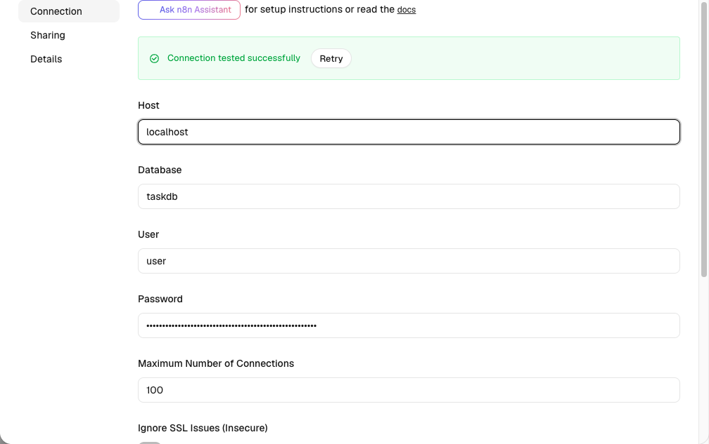

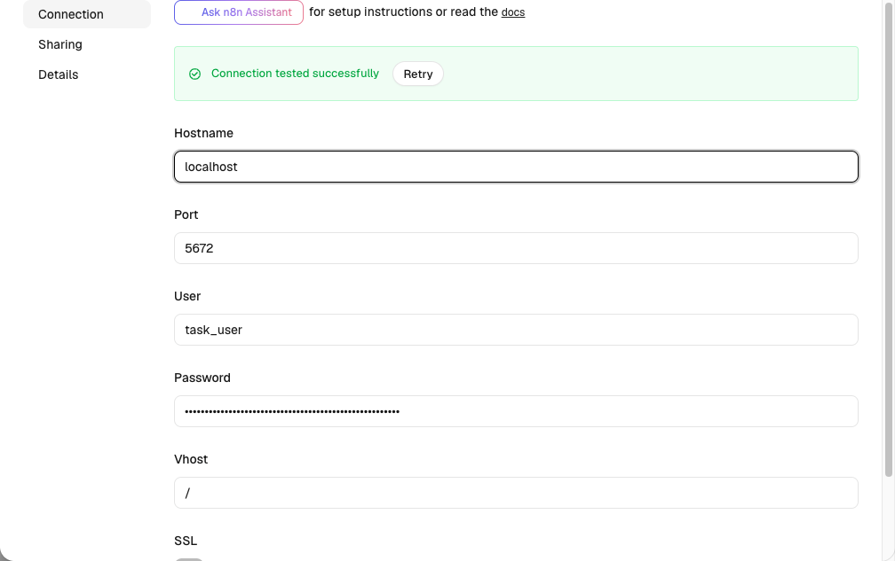

## 3. Flujo 1: interacción directa con la base de datos

| # | Nodo | Configuración |
|---|---|---|
| 1 | Manual Trigger | — |
| 2 | Insertar tarea | PostgreSQL, **Operation** = `Insert`, tabla `task`: `title` = `Tarea creada desde n8n`, `description` = `Prueba de integración directa con BBDD` |
| 3 | Leer tareas | PostgreSQL, **Operation** = `Select`, tabla `task`, **Return All**, ordenado por `id`, **Execute Once** |

El nodo de inserción devolvió la fila creada, con el `id` 14 y `done = false` (el valor por defecto de la columna), y la lectura devolvió las tareas creadas por la API en la Práctica 5 junto con la nueva.

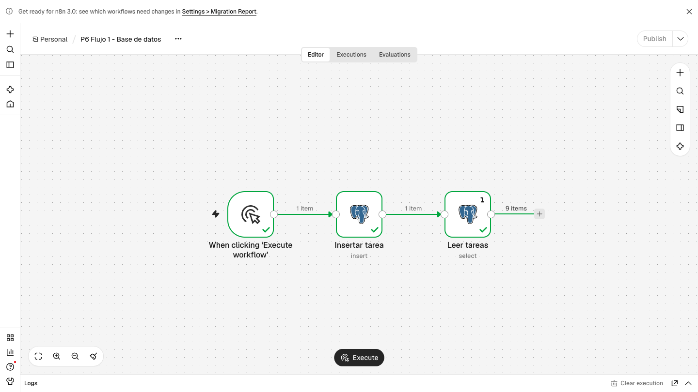

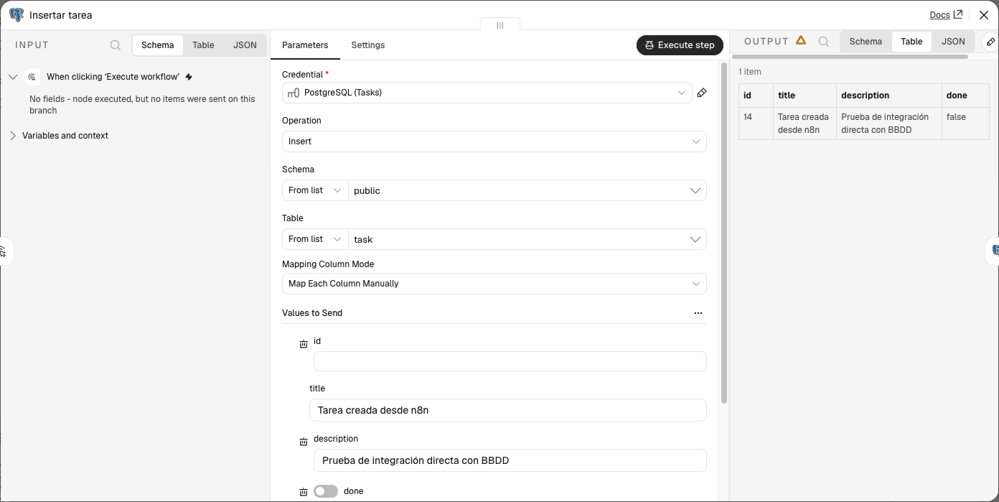

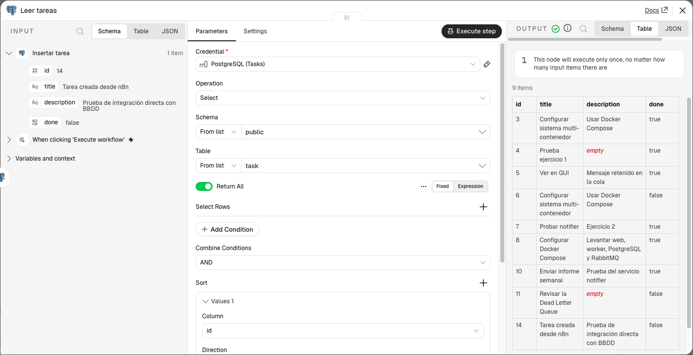

## 4. Flujos asíncronos

RabbitMQ usa `task_created` con los argumentos de dead letter del ejercicio 3 de la Práctica 5. Si n8n declarase la cola sin esos argumentos, RabbitMQ rechazaría la declaración, así que en los nodos de RabbitMQ se desactivó la opción **Assert Queue**: n8n solo comprueba que la cola existe y la usa tal como está.

### Flujo A: Productor de Tareas (Webhook → RabbitMQ)

| # | Nodo | Configuración |
|---|---|---|
| 1 | Webhook | **HTTP Method** = `POST`, **Path** = `productor-tareas`, **Respond** = `Immediately` |
| 2 | Enviar a task_created | RabbitMQ, **Operation** = `Send a Message to RabbitMQ`, **Mode** = `Queue`, **Queue** = `task_created`, **Send Input Data** desactivado, **Message** = `{{ JSON.stringify($json.body) }}`, **Assert Queue** desactivado |

Se publicó el workflow y se llamó a la URL de producción:

```
$ curl -X POST -H "Content-Type: application/json" -d '{"title": "Tarea enviada por Webhook n8n", "description": "A cola RabbitMQ"}' http://localhost:5678/webhook/productor-tareas
{"message":"Workflow was started"}
HTTP 200

$ docker compose logs worker
 [x] Tarea recibida: ID=None, Título='Tarea enviada por Webhook n8n'
```

El `worker` de Python recibió el mensaje con `ID=None`: el mensaje fue directamente a RabbitMQ y no pasó por la API, así que no se creó ninguna fila en PostgreSQL.

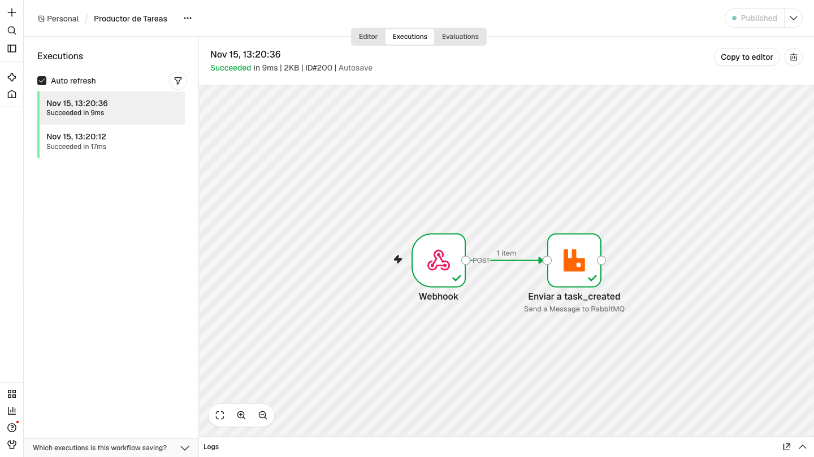

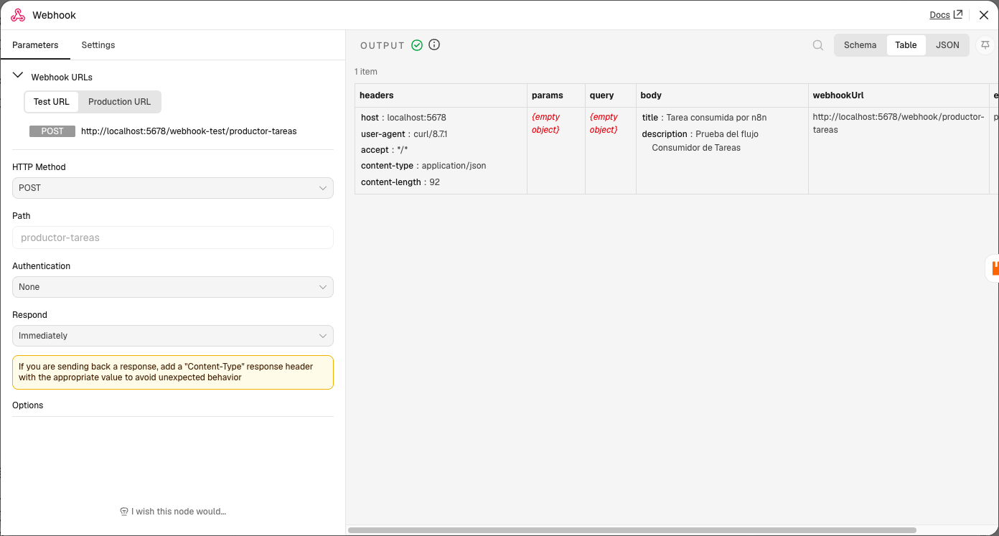

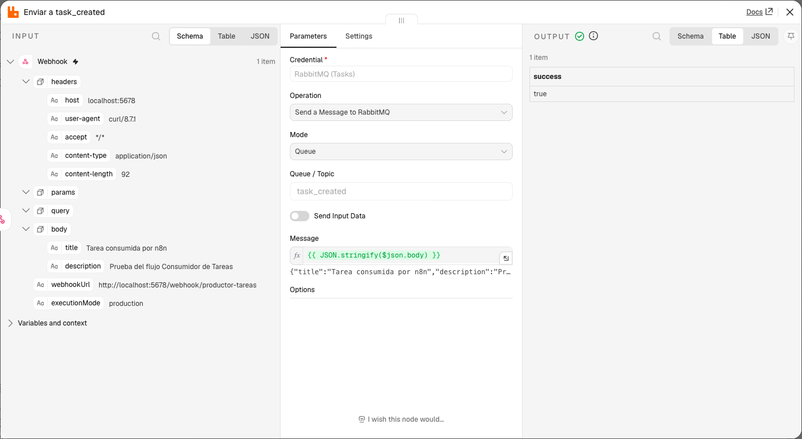

### Flujo B: Consumidor de Tareas (RabbitMQ → n8n)

| # | Nodo | Configuración |
|---|---|---|
| 1 | RabbitMQ Trigger | **Queue** = `task_created`, **JSON Parse Body** y **Only Content** activados, **Assert Queue** desactivado |
| 2 | Edit Fields | `procesado_por` = `n8n_consumidor`, con **Include Other Input Fields** |

Se paró el `worker` de Python (`docker compose stop worker`) para que n8n no compitiera con él por los mensajes, se publicó el workflow y se envió otro mensaje con el Productor:

```
$ curl -X POST -H "Content-Type: application/json" -d '{"title": "Tarea consumida por n8n", "description": "Prueba del flujo Consumidor de Tareas"}' http://localhost:5678/webhook/productor-tareas
{"message":"Workflow was started"}
```

En **Executions** apareció la ejecución disparada por la cola, con el mensaje y el campo `procesado_por`:

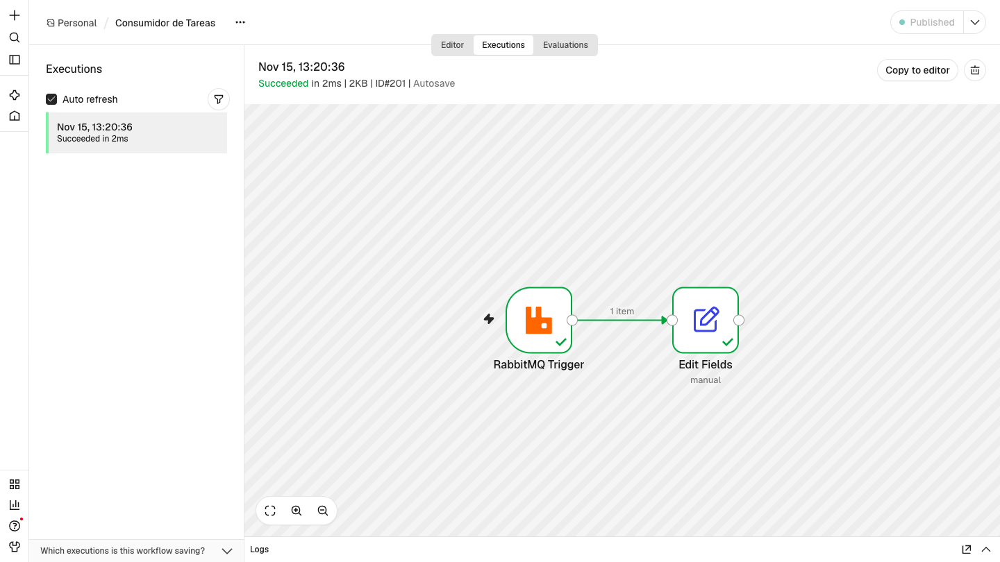

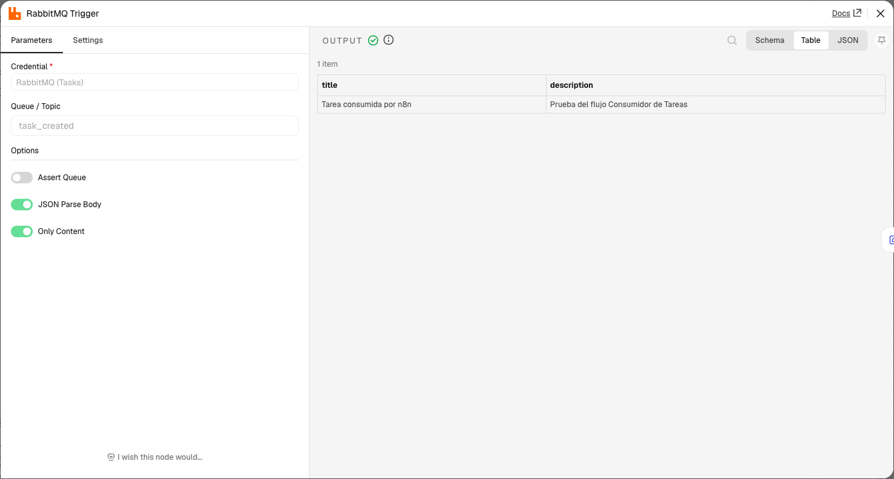

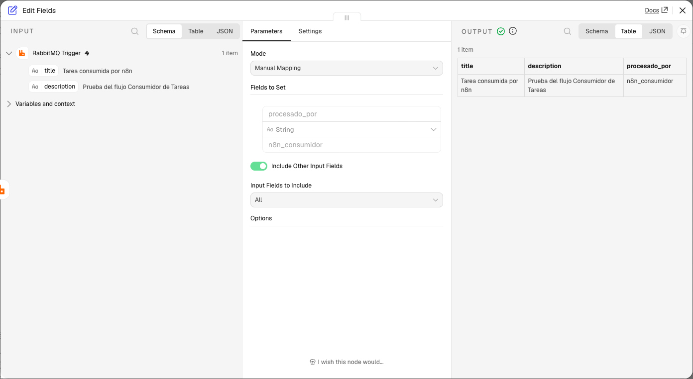

Después se volvió a arrancar el `worker` (`docker compose start worker`) y se despublicó el Consumidor. Cuando dos consumidores escuchan la misma cola, RabbitMQ entrega cada mensaje a uno solo de ellos, no a los dos; para que varios servicios reciban el mismo evento haría falta una cola por servicio enlazada a un exchange `fanout`.

---

## 5. Ejercicios propuestos

### 5.1. Ejercicio 1: Eliminación de tareas

| # | Nodo | Configuración |
|---|---|---|
| 1 | Manual Trigger | — |
| 2 | Tarea a borrar | Edit Fields: `id_a_borrar` (Number) = `14` |
| 3 | Borrar tarea | PostgreSQL, **Operation** = `Delete`, tabla `task`, **Command** = `Delete`, **Select Rows**: `id` **Equal** `{{ $json.id_a_borrar }}` |
| 4 | Comprobar borrado | PostgreSQL, **Execute Query**: `SELECT count(*)::int AS existe FROM task WHERE id = $1`, **Query Parameters** = `{{ $('Tarea a borrar').item.json.id_a_borrar }}` |

Se borró la tarea 14, la que había creado el flujo 1. La comprobación final devolvió `existe = 0`, y en PostgreSQL la consulta `SELECT id, title FROM task WHERE id = 14;` ya no devuelve ninguna fila. La consulta de comprobación usa un parámetro (`$1`) en lugar de concatenar el valor en el SQL.

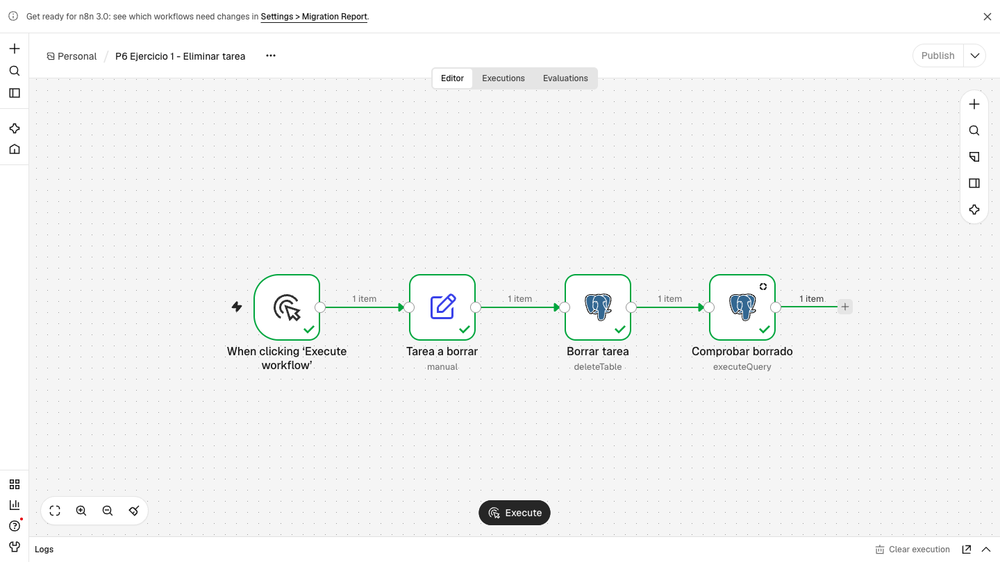

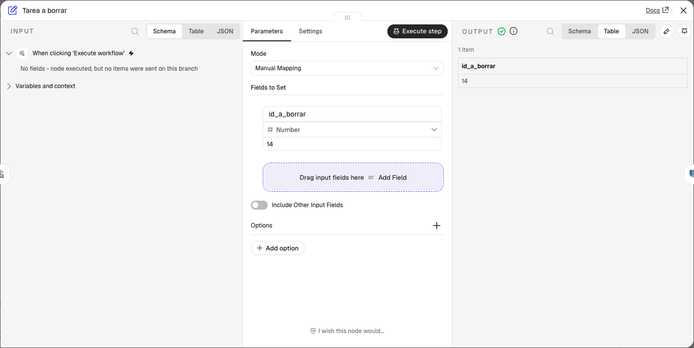

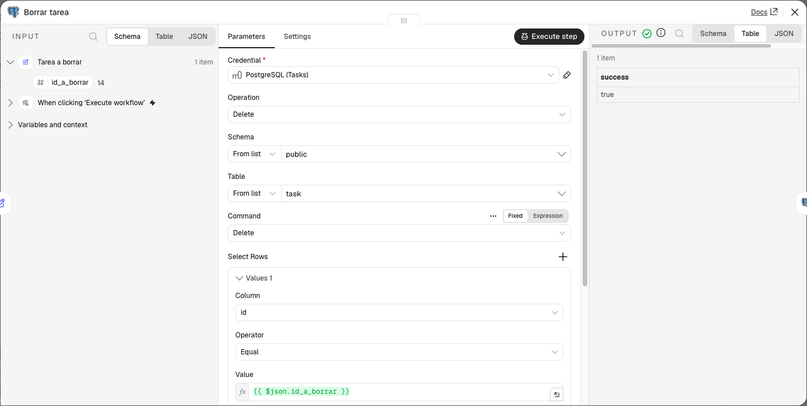

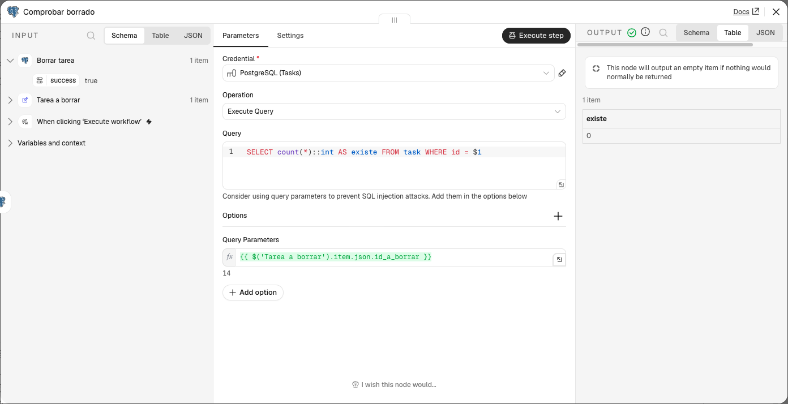

### 5.2. Ejercicio 2: Servicio de notificación

Se separó en dos workflows: uno que completa la tarea llamando a la API de la Práctica 5 y otro que consume la cola `task_completed` y envía el correo.

**`P6 Ejercicio 2 - Completar tarea`**

| # | Nodo | Configuración |
|---|---|---|
| 1 | Webhook | **HTTP Method** = `POST`, **Path** = `completar-tarea`; recibe `{"id": ...}` |
| 2 | Completar en la API | HTTP Request: `PUT http://localhost:5001/tasks/{{ $json.body.id }}/complete` |

**`P6 Ejercicio 2 - Notificador de tareas completadas`**

| # | Nodo | Configuración |
|---|---|---|
| 1 | RabbitMQ Trigger | **Queue** = `task_completed`, **JSON Parse Body** y **Only Content** activados, **Assert Queue** desactivado |
| 2 | Send Email | Credencial `Gmail SMTP` (la del ejercicio 4.1), para `rct419@inlumine.ual.es`, **Subject** = `Tarea completada: {{ $json.title }}` y un cuerpo con el id, el título, la descripción y el estado |

En la Práctica 5 la cola `task_completed` la consume el servicio `notifier` (ejercicio 2), así que durante la prueba se paró ese servicio (`docker compose stop notifier`) para que n8n no compitiera con él.

```
$ curl -X POST http://localhost:5001/tasks -H "Content-Type: application/json" -d '{"title": "Preparar la Práctica 6", "description": "Integrar n8n con PostgreSQL y RabbitMQ"}'
{"task":{"description":"Integrar n8n con PostgreSQL y RabbitMQ","done":false,"id":15,"title":"Preparar la Práctica 6"}}
HTTP 201

$ curl -X POST -H "Content-Type: application/json" -d '{"id": 15}' http://localhost:5678/webhook/completar-tarea
{"message":"Workflow was started"}
HTTP 200
```

El primer workflow llamó a `PUT /tasks/15/complete`; la API marcó la tarea como completada y publicó el mensaje en `task_completed`, que recibió el notificador de n8n y envió el correo:

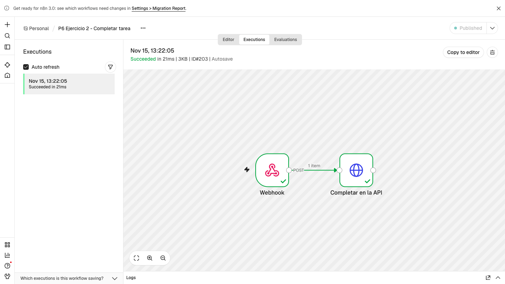

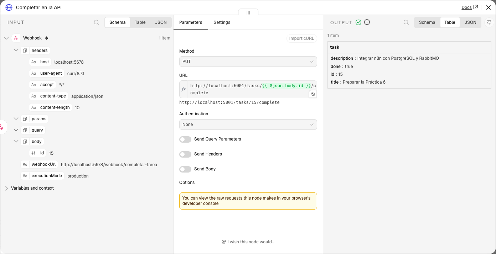

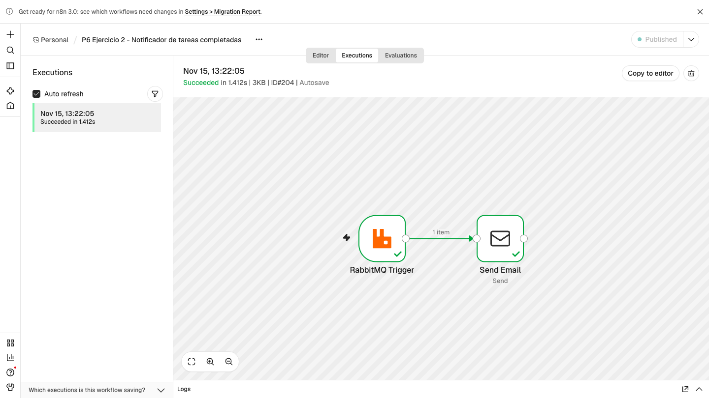

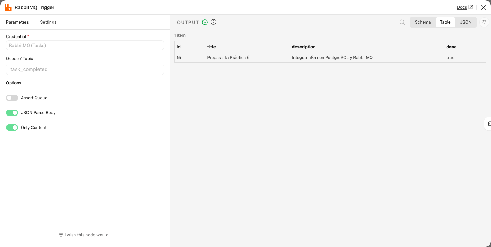

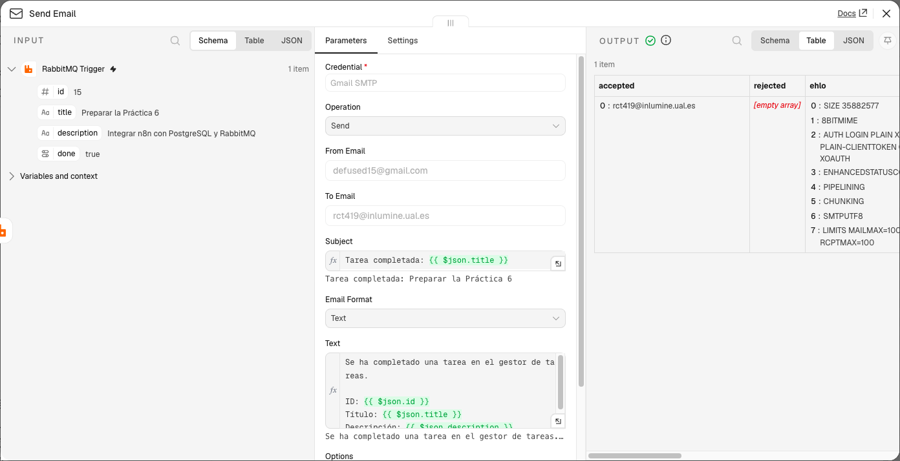

El correo llegó al buzón de la universidad con el título de la tarea:

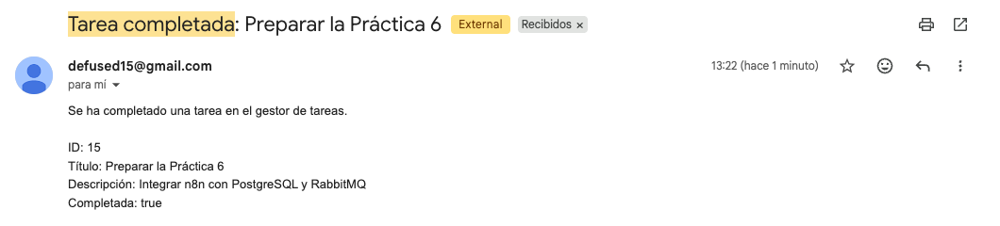

Al terminar se volvió a arrancar el servicio `notifier` y se despublicaron los dos workflows.

### 5.3. Ejercicio 3: Reemplazo de la API con Webhook

| # | Nodo | Configuración |
|---|---|---|
| 1 | Webhook | **HTTP Method** = `POST`, **Path** = `tasks-from-n8n`, **Respond** = `Using 'Respond to Webhook' Node` |
| 2 | Title válido | If: `{{ typeof $json.body.title === 'string' && $json.body.title.trim() !== '' }}` **is true** |
| 3 | Insertar tarea | PostgreSQL, **Execute Query** con parámetros (rama `true`) |
| 4 | Publicar en task_created | RabbitMQ: **Message** = `{{ JSON.stringify($json) }}`, **Assert Queue** desactivado |
| 5 | Responder 201 | Respond to Webhook: JSON `{{ JSON.stringify({ task: $('Insertar tarea').item.json }) }}`, **Response Code** = `201` |
| 6 | Responder 400 | Respond to Webhook (rama `false`): `{"error": "A non-empty title is required"}`, **Response Code** = `400` |

Consulta de inserción, con los valores pasados como parámetros y no concatenados en el SQL:

```sql
INSERT INTO task (title, description, done) VALUES ($1, $2, false)
RETURNING id, title, description, done
```

**Query Parameters** = `{{ [$json.body.title.trim(), $json.body.description ?? ''] }}`

El `RETURNING` hace que el nodo devuelva la fila insertada con su `id`, y esa fila es la que se publica en `task_created`: así el mensaje tiene `id`, `title`, `description` y `done` en el nivel superior, igual que los que publica la API, y el `worker` de Python lo procesa sin cambios.

```
$ curl -X POST -H "Content-Type: application/json" -d '{"title": "Tarea creada con el webhook de n8n", "description": "Sustituye a POST /tasks"}' http://localhost:5678/webhook/tasks-from-n8n
{"task":{"id":16,"title":"Tarea creada con el webhook de n8n","description":"Sustituye a POST /tasks","done":false}}
HTTP 201

$ curl -X POST -H "Content-Type: application/json" -d '{"title": "   ", "description": "Sin título"}' http://localhost:5678/webhook/tasks-from-n8n
{"error":"A non-empty title is required"}
HTTP 400

$ curl -X POST -H "Content-Type: application/json" -d '{"description": "Sin campo title"}' http://localhost:5678/webhook/tasks-from-n8n
{"error":"A non-empty title is required"}
HTTP 400

$ docker compose logs worker
 [x] Tarea recibida: ID=16, Título='Tarea creada con el webhook de n8n'

$ curl http://localhost:5001/tasks/16
{"task":{"description":"Sustituye a POST /tasks","done":false,"id":16,"title":"Tarea creada con el webhook de n8n"}}
HTTP 200
```

A diferencia del flujo A, ahora el `worker` recibe la tarea con su `id` real, y la API la devuelve porque se guardó en PostgreSQL.

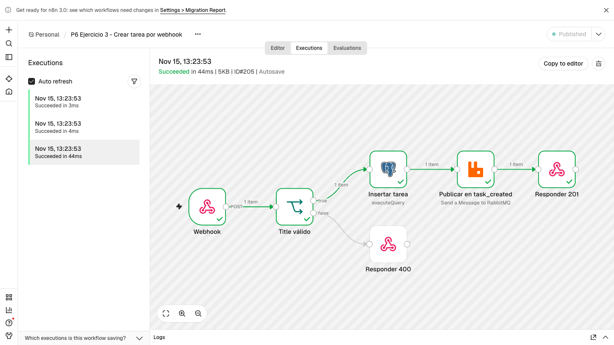

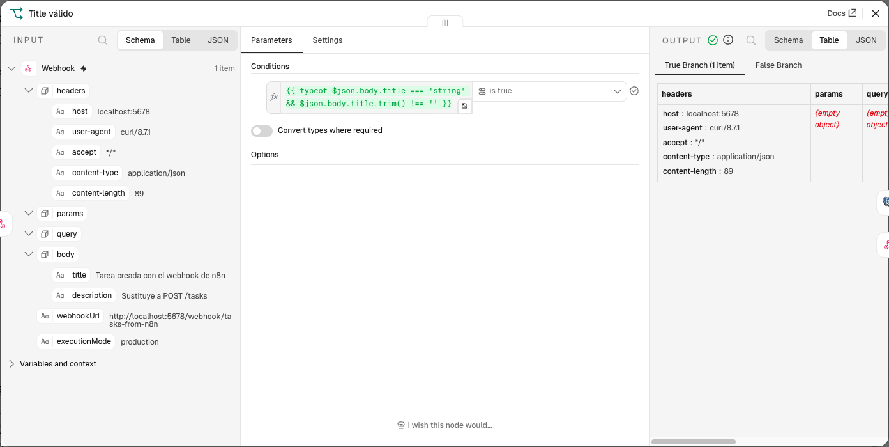

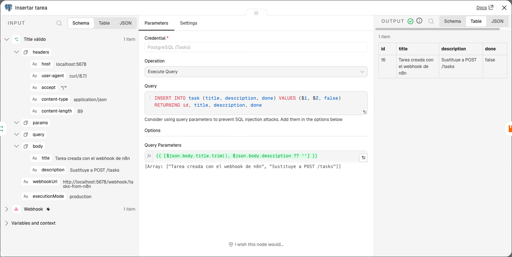

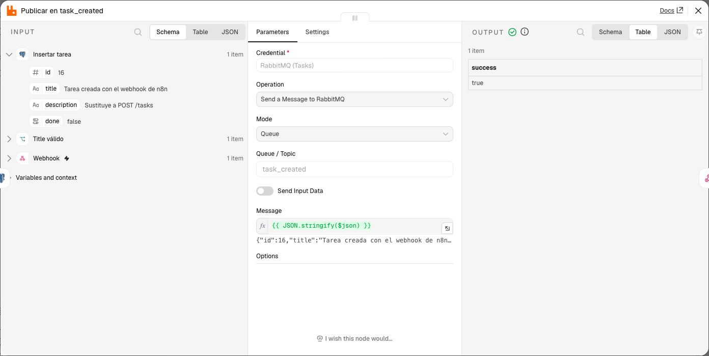

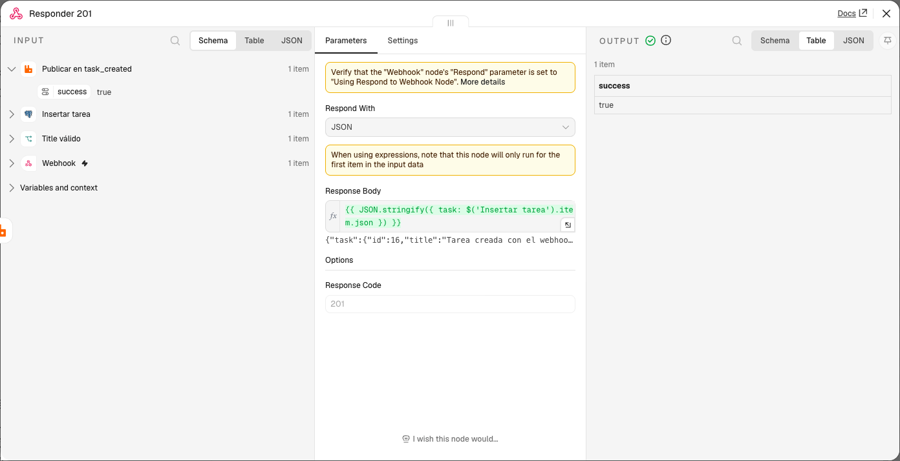

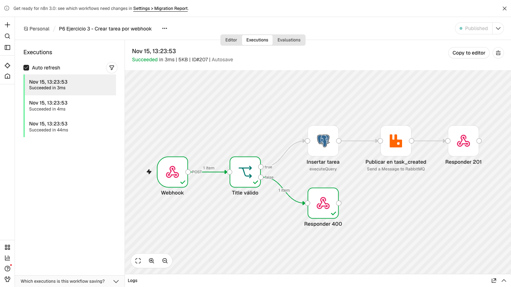

Con **Respond** = `Immediately`, el webhook respondería `Workflow got started` antes de insertar la tarea; con `Using 'Respond to Webhook' Node`, la respuesta espera a que termine la inserción y la publicación, y puede devolver la tarea creada o un `400` controlado.
