# Práctica 7: Orquestación de modelos de IA - Integración con Gemini

**Asignatura:** Integración de Tecnologías y Servicios Informáticos (ITSI)
**Alumno:** Roberto Castillo — rct419@inlumine.ual.es  
**Enunciado:** https://ualitsi.github.io/n8n-007/

Integración de n8n con Google Gemini. En la parte guiada, n8n lee tareas de la base de datos de la Práctica 5, Gemini decide su prioridad, el Switch las enruta según la respuesta del modelo, avisa por correo de las tareas de prioridad alta y guarda la prioridad en PostgreSQL. En los ejercicios, Gemini resume tareas, extrae datos en formato JSON de un texto libre que llega por webhook y encadena dos llamadas, generando primero títulos y después una introducción para cada uno.

Cada ejercicio tiene además su propio informe en PDF (`Practica-7.N-Roberto-Castillo.pdf`), y la parte guiada está en `Practica-7-Roberto-Castillo.pdf`.

---

## Cómo importar y ejecutar los workflows

1. Levantar los servicios de la Práctica 5 (`docker compose up -d` en `practica 5/`).
2. En n8n, tener las credenciales `PostgreSQL (Tasks)` (Práctica 6) y `Gmail SMTP` (ejercicio 4.1), y crear `Gemini Key` (ver el paso 1).
3. **Create workflow → menú `…` → Import from File** con cada JSON de [`workflows/`](workflows/) y [`workflows/ejercicios/`](workflows/ejercicios/), y volver a seleccionar en cada nodo la credencial correspondiente.
4. El workflow del ejercicio 2 hay que publicarlo (**Publish**) para usar la URL de producción (`/webhook/extraer-entidades`). Las peticiones de prueba están en [`peticiones/`](peticiones/).

| Workflow | JSON |
|---|---|
| `P7 Clasificador de prioridad con Gemini` | [`Clasificador-de-prioridad-con-Gemini.json`](workflows/Clasificador-de-prioridad-con-Gemini.json) |
| `P7 Ejercicio 1 - Generador de resúmenes` | [`E1-Generador-de-resumenes.json`](workflows/ejercicios/E1-Generador-de-resumenes.json) |
| `P7 Ejercicio 2 - Extracción de entidades` | [`E2-Extraccion-de-entidades.json`](workflows/ejercicios/E2-Extraccion-de-entidades.json) |
| `P7 Ejercicio 3 - Cadena de IA` | [`E3-Cadena-de-IA.json`](workflows/ejercicios/E3-Cadena-de-IA.json) |

## 1. Credencial de Google Gemini

La API key se generó en Google AI Studio (https://aistudio.google.com/app/apikey) con **Create API key in new project**. Es importante que el proyecto no tenga la facturación activada: un primer intento con una clave de un proyecto con facturación de prepago devolvió `402 Payment required` (*"Your prepayment credits are depleted"*), porque en esos proyectos cada llamada se cobra y no se aplica el nivel gratuito. La clave del proyecto nuevo usa el nivel gratuito, que es suficiente para la práctica.

En n8n: **Overview → Credentials → Create credential → Google Gemini(PaLM) API**, con el nombre `Gemini Key`, **Host** = `https://generativelanguage.googleapis.com` y la API key. Al guardarla, n8n mostró **Connection tested successfully**.

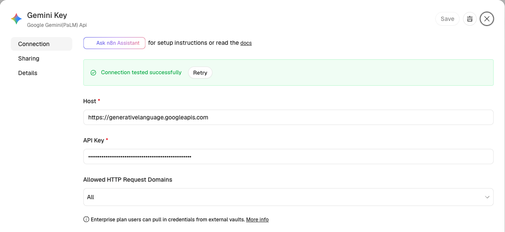

### Modelo

El enunciado usa como ejemplo `gemini-pro`, que ya no existe en la API. La lista de modelos del nodo (**Model → From list**) se carga con la propia clave. Primero se probó `gemini-2.5-flash`, pero la API respondió que *"is no longer available to new users"*. `gemini-3.8-flash`, el que recomienda ese mensaje, tardaba varios minutos en clasificar cinco tareas. Al final se usó **`models/gemini-3.5-flash-lite`**, que responde en un par de segundos y es suficiente para clasificar, resumir y extraer datos.

### Salida del nodo de Gemini

En esta versión de n8n el nodo **Google Gemini** (recurso **Text**, operación **Message a Model**) con **Simplify Output** activado no devuelve un campo `text` en el nivel superior, como supone el enunciado, sino la respuesta del modelo con esta forma:

```json
{ "content": { "parts": [ { "text": "ALTA" } ], "role": "model" }, "finishReason": "STOP", "index": 0 }
```

Por eso en todos los workflows el texto generado se lee con `{{ $json.content.parts[0].text }}` en lugar de `{{ $json.text }}`.

## 2. Preparación de los datos

Las tareas que tenían descripción en la tabla `task` eran pruebas de las prácticas 5 y 6 (*"Usar Docker Compose"*, *"Ejercicio 2"*…), con las que la clasificación no tiene mucho sentido. Se crearon cinco tareas nuevas con la API de la Práctica 5 (`POST http://localhost:5001/tasks`):

| id | title | description |
|---|---|---|
| 17 | Servidor de pagos caído | La API de pagos devuelve error 500 desde esta mañana y los clientes no pueden completar ninguna compra |
| 18 | Actualizar el README | Añadir capturas de la nueva pantalla de ajustes; no hay fecha límite |
| 19 | Contraseñas en los logs | Se han detectado contraseñas de usuarios guardadas en texto plano en los logs del servidor de producción |
| 20 | Preparar la demo del sprint | Montar el entorno de pruebas para la reunión con el cliente del viernes |
| 21 | Cambiar el color de los botones | El equipo de diseño sugiere un azul más claro para los botones de la página de inicio |

Para la parte opcional del paso 5 se añadió la columna `prioridad` a la tabla:

```
$ docker exec task-manager-db psql -U user -d taskdb -c "ALTER TABLE task ADD COLUMN prioridad VARCHAR(10);"
ALTER TABLE
```

## 3. Flujo guiado: clasificador de prioridad

| # | Nodo | Configuración |
|---|---|---|
| 1 | Manual Trigger | — |
| 2 | Leer tareas | PostgreSQL, **Execute Query** (consulta abajo) |
| 3 | Clasificar prioridad | Google Gemini, **Resource** = `Text`, **Operation** = `Message a Model`, **Model** = `models/gemini-3.5-flash-lite`, **Temperature** = `0.1` |
| 4 | Preparar tarea | Edit Fields: `id`, `title` y `description` de `Leer tareas`, y `text` = `{{ $json.content.parts[0].text.trim().toUpperCase() }}` |
| 5 | Switch | `{{ $json.text }}` **is equal to** `ALTA` → salida `ALTA`; **is equal to** `MEDIA` → salida `MEDIA`; **Fallback Output** = `Extra Output`, renombrada `BAJA` |
| 6 | Send Email | Rama `ALTA`. Credencial `Gmail SMTP`, para `rct419@inlumine.ual.es`, **Subject** = `¡Alerta de Tarea Prioridad ALTA!` |
| 7 | Merge | Mode `Append`, 3 entradas (una por cada salida del Switch) |
| 8 | Guardar prioridad | PostgreSQL, **Execute Query**: `UPDATE ... RETURNING` con parámetros |

Consulta de lectura:

```sql
SELECT * FROM task WHERE description IS NOT NULL AND description != '' ORDER BY id DESC LIMIT 5;
```

Respecto al enunciado se añadió `ORDER BY id DESC`, para que las cinco tareas sean las más recientes (las del apartado 2) y no las primeras que devuelva PostgreSQL. El `LIMIT 5` se mantiene para no gastar cuota de la API durante las pruebas.

Prompt del nodo `Clasificar prioridad` (temperatura `0.1`, porque es una clasificación y conviene que la respuesta sea estable):

```
Actúa como un jefe de proyecto con experiencia. Lee la descripción de la siguiente tarea y decide su prioridad.

Descripción: "{{ $json.description }}"

Responde ÚNICAMENTE con una de estas tres palabras: ALTA, MEDIA o BAJA.
```

El nodo de Gemini devuelve solo la respuesta del modelo, sin los campos de la tarea. Por eso se añadió `Preparar tarea`, que recupera `id`, `title` y `description` del nodo `Leer tareas` con `$('Leer tareas').item.json` (n8n empareja cada respuesta con su tarea) y guarda la prioridad en `text`. Así el Switch puede usar `{{ $json.text }}` y el correo puede usar `{{ $json.title }}` y `{{ $json.id }}`, como en el enunciado. El `.trim().toUpperCase()` evita que un espacio o un salto de línea al final de la respuesta haga fallar la comparación del Switch.

Cuerpo del correo:

```
La tarea "{{ $json.title }}" (ID: {{ $json.id }}) ha sido clasificada como ALTA prioridad por la IA.
```

Consulta de `Guardar prioridad`, con **Query Parameters** = `{{ [$json.text, $json.id] }}`:

```sql
UPDATE task SET prioridad = $1 WHERE id = $2 RETURNING id, title, prioridad;
```

El Send Email está solo en la rama `ALTA`, pero el Merge recibe las tres salidas del Switch directamente, así que todas las tareas llegan al `UPDATE`, también las de prioridad alta.

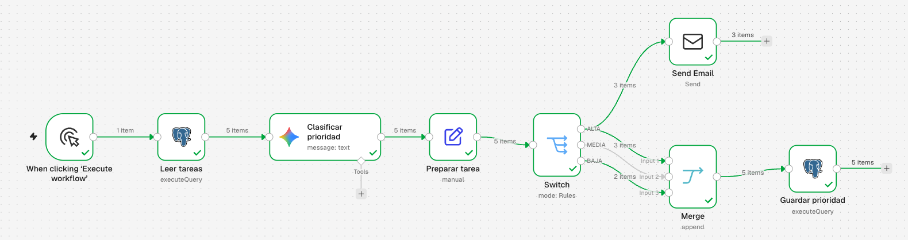

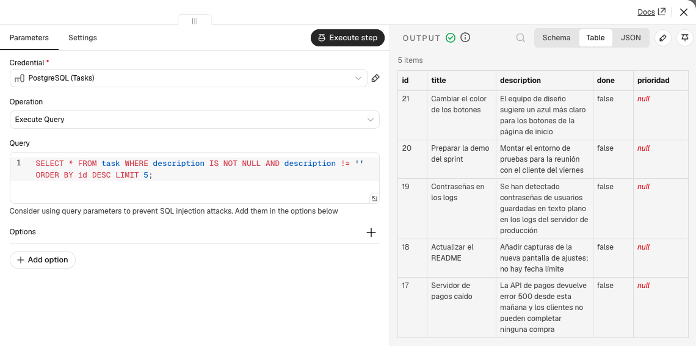

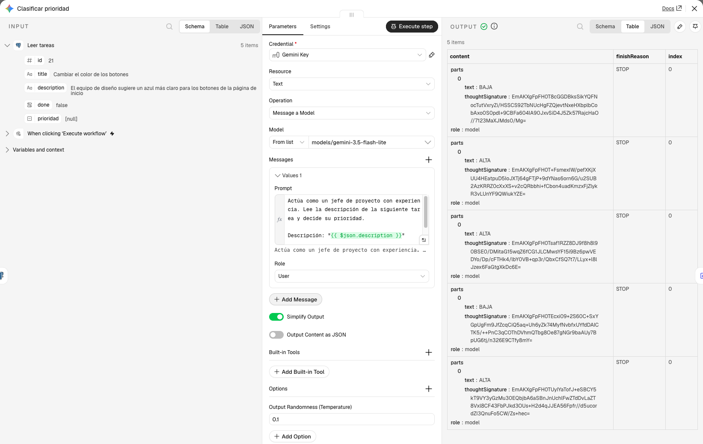

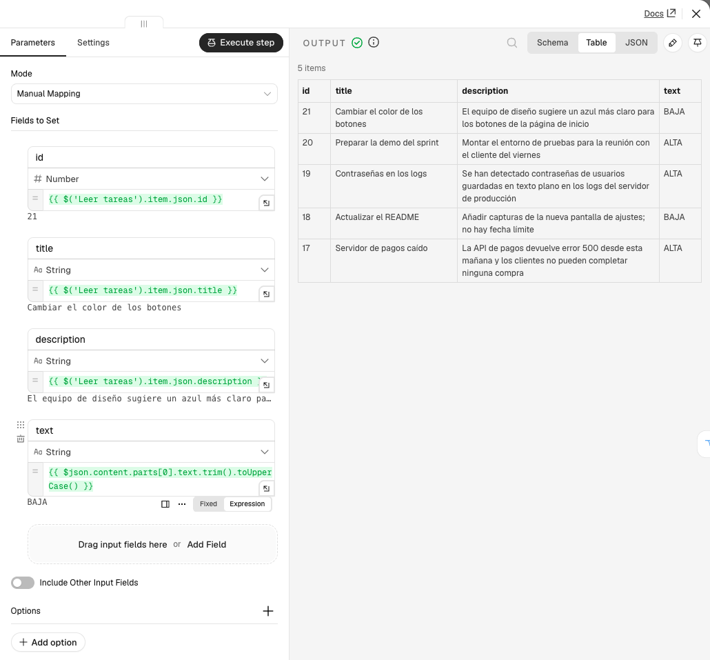

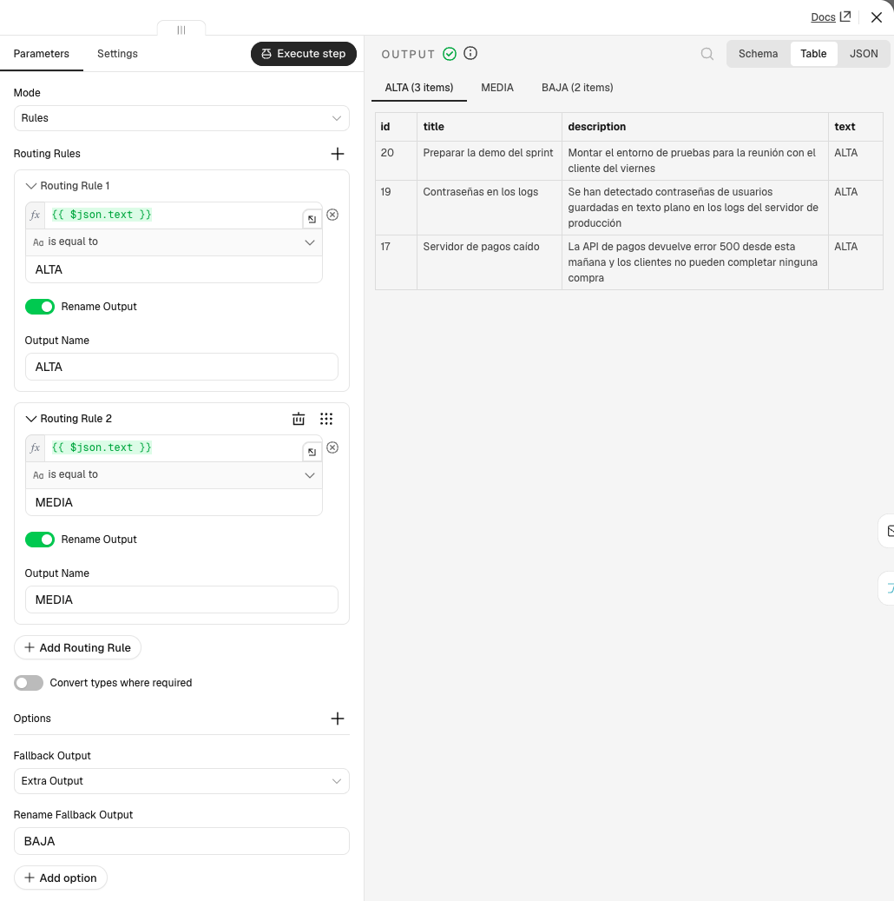

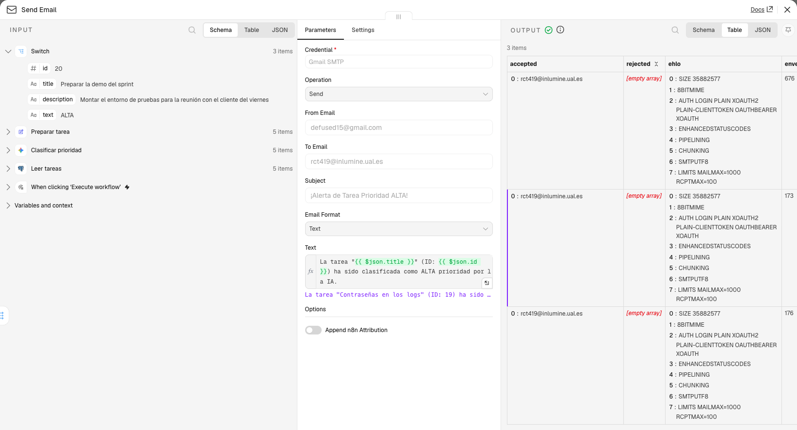

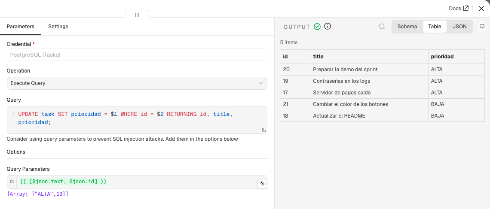

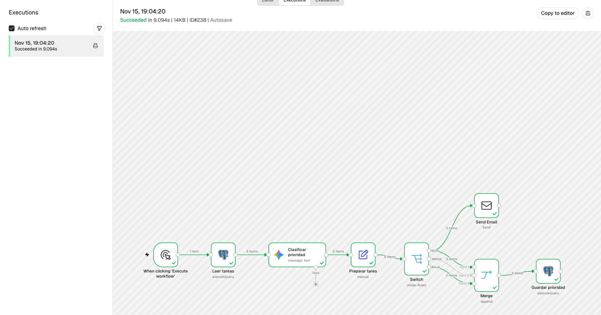

Resultado de la clasificación:

| id | title | prioridad |
|---|---|---|
| 17 | Servidor de pagos caído | ALTA |
| 18 | Actualizar el README | BAJA |
| 19 | Contraseñas en los logs | ALTA |
| 20 | Preparar la demo del sprint | ALTA |
| 21 | Cambiar el color de los botones | BAJA |

La salida `MEDIA` quedó vacía en esta ejecución: Gemini consideró urgente la demo del viernes porque hay un cliente y una fecha cercana. Es una decisión razonable, aunque se podría discutir si es MEDIA. Las otras cuatro coinciden con lo que se esperaba. Llegaron tres correos, uno por cada tarea de prioridad alta:

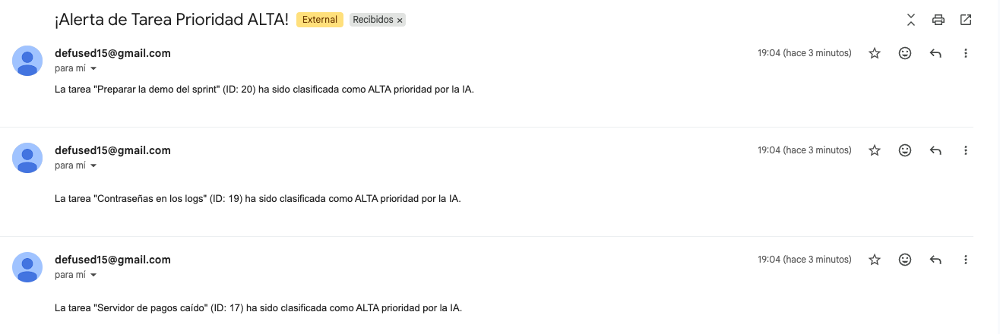

---

## 4. Ejercicios propuestos

### 4.1. Ejercicio 1: Generador de resúmenes

| # | Nodo | Configuración |
|---|---|---|
| 1 | Manual Trigger | — |
| 2 | Leer tareas | La misma consulta que en el flujo guiado |
| 3 | Resumir tarea | Google Gemini, `models/gemini-3.5-flash-lite`, **Temperature** = `0.3` |
| 4 | Edit Fields | `id` y `title` de `Leer tareas`, y `resumen` = `{{ $json.content.parts[0].text.trim() }}` |

Se eliminó el Switch del flujo guiado. Prompt:

```
Genera un resumen conciso de una sola frase (máximo 15 palabras) para la siguiente tarea: "{{ $json.description }}"

Responde solo con el resumen.
```

La última línea evita que el modelo añada frases como *"Aquí tienes el resumen:"*.

| id | title | resumen |
|---|---|---|
| 21 | Cambiar el color de los botones | Cambiar los botones de inicio a un azul más claro. |
| 20 | Preparar la demo del sprint | Preparar el entorno de pruebas para la reunión del viernes. |
| 19 | Contraseñas en los logs | Contraseñas de usuarios expuestas en texto plano en logs de producción. |
| 18 | Actualizar el README | Añadir capturas de la nueva pantalla de ajustes sin fecha límite. |
| 17 | Servidor de pagos caído | Error 500 en la API de pagos impide las compras de los clientes. |

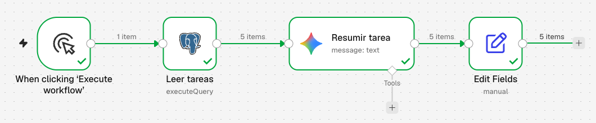

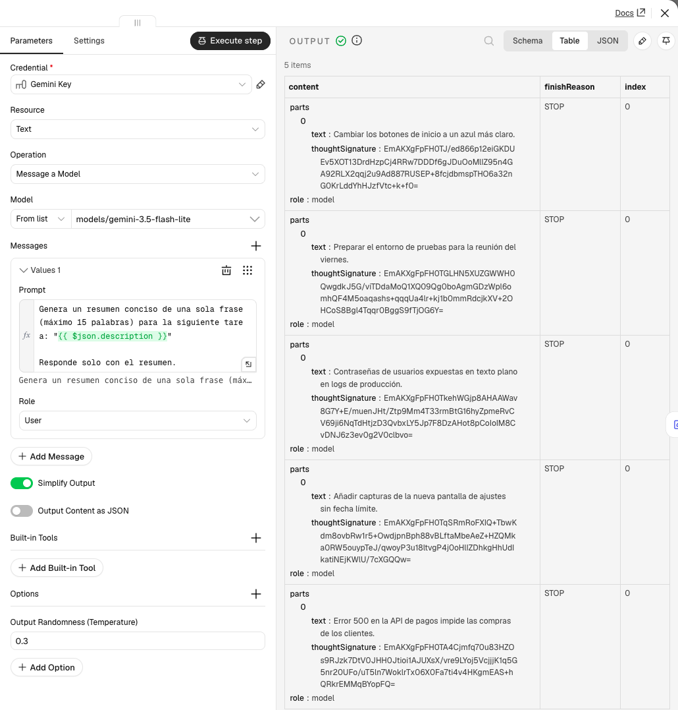

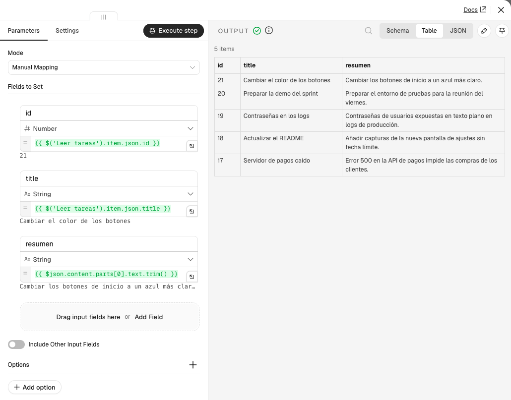

### 4.2. Ejercicio 2: Extracción de entidades con salida JSON

| # | Nodo | Configuración |
|---|---|---|
| 1 | Webhook | **HTTP Method** = `POST`, **Path** = `extraer-entidades`, **Respond** = `Using 'Respond to Webhook' Node` |
| 2 | Extraer entidades | Google Gemini, **Temperature** = `0.1`, **Output Content as JSON** activado |
| 3 | Edit Fields | `email`, `incidencia` y `tipo_problema` con `JSON.parse` |
| 4 | Switch | `{{ $json.email }}` **contains** `@ual.es` → salida `UAL`; **Fallback Output** renombrada `Externo` |
| 5 | Responder cliente UAL | Respond to Webhook: los campos extraídos más `origen` = `UAL` y `cola` = `soporte-interno` |
| 6 | Responder cliente externo | Respond to Webhook: los campos extraídos más `origen` = `Externo` y `cola` = `soporte-general` |

Prompt, siguiendo el patrón de *prompt fuerte* del enunciado:

```
Extrae del siguiente texto el email del cliente, el tipo de problema y el ID de la incidencia.
Responde ÚNICAMENTE con un JSON válido con las claves "email_cliente", "tipo_problema" (por ejemplo "error" o "consulta") e "id_incidencia". Si no encuentras algún valor, usa "null".

Texto: "{{ $json.body.texto }}"
```

El Webhook guarda el cuerpo de la petición en `body`, así que el texto se lee con `{{ $json.body.texto }}`. Además del prompt, se activó la opción **Output Content as JSON** del nodo, que pide a la API la respuesta con tipo `application/json`. Así el modelo no envuelve el JSON en un bloque de código Markdown (```` ```json ````), que haría fallar el `JSON.parse`.

Campos de `Edit Fields`:

| Campo | Valor |
|---|---|
| `email` | `{{ JSON.parse($json.content.parts[0].text).email_cliente }}` |
| `incidencia` | `{{ JSON.parse($json.content.parts[0].text).id_incidencia }}` |
| `tipo_problema` | `{{ JSON.parse($json.content.parts[0].text).tipo_problema }}` |

`tipo_problema` no lo pide el enunciado en el Edit Fields, pero se añadió para devolverlo también en la respuesta. En este workflow no se envía ningún correo: el email extraído solo sirve para decidir la rama del Switch.

Se publicó el workflow y se enviaron dos textos, el del enunciado y una consulta de un cliente externo:

```
$ curl -X POST localhost:5678/webhook/extraer-entidades -H 'Content-Type: application/json' -d @peticiones/incidencia-ual.json
{"email":"manel.mena@ual.es","incidencia":"500","tipo_problema":"error","origen":"UAL","cola":"soporte-interno"}
HTTP 200

$ curl -X POST localhost:5678/webhook/extraer-entidades -H 'Content-Type: application/json' -d @peticiones/consulta-externa.json
{"email":"laura.gomez@gmail.com","incidencia":"742","tipo_problema":"consulta","origen":"Externo","cola":"soporte-general"}
HTTP 200
```

| Petición | `texto` |
|---|---|
| [`incidencia-ual.json`](peticiones/incidencia-ual.json) | El cliente manel.mena@ual.es informa de un error grave (ID: 500) en la página de login. |
| [`consulta-externa.json`](peticiones/consulta-externa.json) | Hola, soy laura.gomez@gmail.com y quería saber si la incidencia 742 sobre la facturación ya está resuelta. |

Gemini extrajo bien los tres datos en los dos casos. En el segundo, el número de la incidencia no aparece como `ID:`, sino dentro de la frase (*"la incidencia 742"*), y el tipo de problema lo dedujo del texto (*"quería saber si…"* es una consulta).

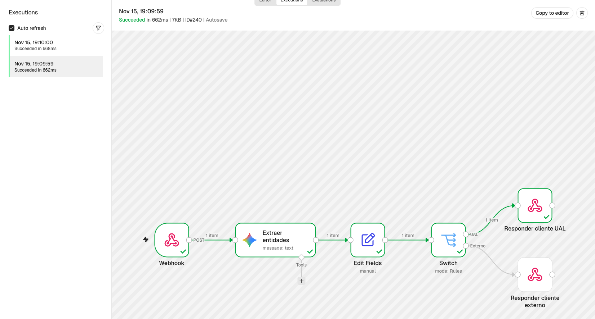

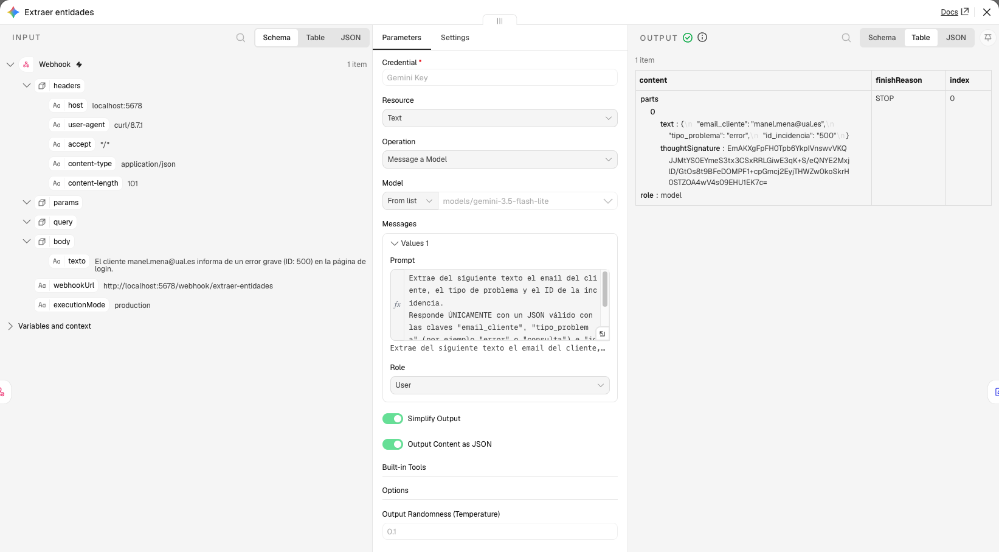

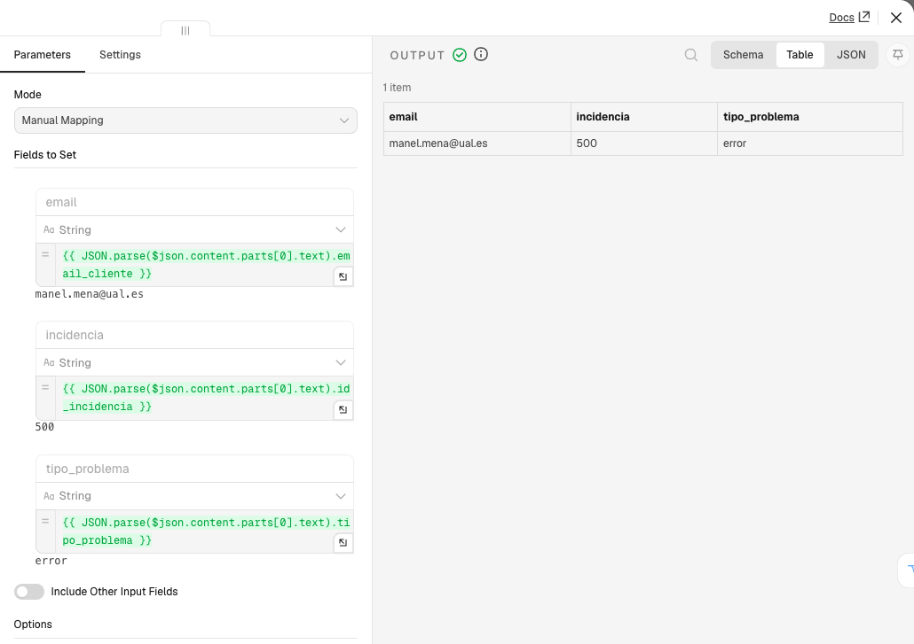

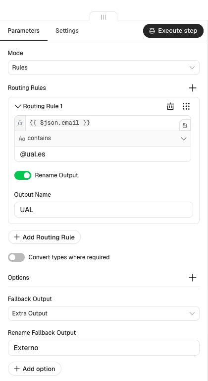

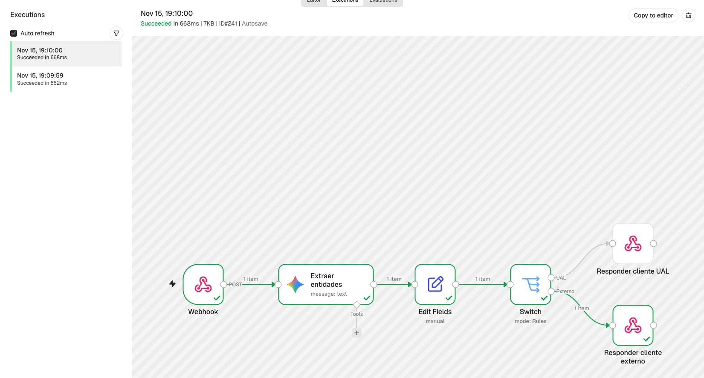

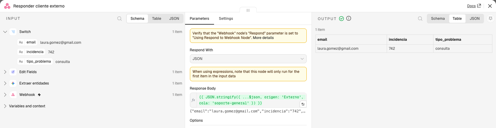

Al terminar se despublicó el workflow.

### 4.3. Ejercicio 3: Cadena de IA

| # | Nodo | Configuración |
|---|---|---|
| 1 | Manual Trigger | — |
| 2 | Tema | Edit Fields: `tema` = `Integración de RabbitMQ en n8n` |
| 3 | Generar títulos | Google Gemini, **Temperature** = `0.9` |
| 4 | Separar títulos | Edit Fields: `titulos` (Array) = `{{ $json.content.parts[0].text.split('\|').map(t => t.trim()).filter(t => t) }}` |
| 5 | Split Out | **Fields To Split Out** = `titulos` |
| 6 | Escribir introducción | Google Gemini, **Temperature** = `0.9` |
| 7 | Merge | **Mode** = `Combine`, **Combine By** = `Position`; entrada 1 desde `Split Out`, entrada 2 desde `Escribir introducción` |
| 8 | Artículo | Edit Fields: `titulo` = `{{ $json.titulos }}`, `introduccion` = `{{ $json.content.parts[0].text.trim() }}` |

Prompts (temperatura `0.9`, porque aquí interesa que el texto sea más creativo que en una clasificación):

```
Genera 3 ideas para un título de un artículo de blog sobre el tema: "{{ $json.tema }}". Responde solo con una lista separada por el carácter "|".
```

```
Escribe un párrafo de introducción (3-4 frases) para un artículo de blog con el siguiente título: "{{ $json.titulos }}"

Responde solo con el párrafo.
```

Sobre la pista del enunciado (`{{ $json.text.split('|') }}`) hay dos cambios. El primero es que se añadió `.map(t => t.trim())`, para quitar los espacios alrededor de cada `|`, y `.filter(t => t)`, para descartar elementos vacíos si el modelo termina la lista con un `|`. El segundo es que, al dividir un campo de tipo array con Split Out, cada elemento sale con el nombre del campo (`titulos`) y no como `value`. Por eso el segundo prompt usa `{{ $json.titulos }}`.

El Merge por posición empareja cada título que sale del Split Out con la introducción que Gemini ha escrito para él, porque los dos llevan los elementos en el mismo orden. Así cada artículo final tiene su título y su párrafo.

Títulos que generó Gemini:

1. Guía paso a paso: Cómo integrar RabbitMQ en tus flujos de trabajo de n8n
2. Automatización avanzada: Conectando RabbitMQ y n8n para optimizar procesos
3. Supera los límites de tus automatizaciones: Integración de RabbitMQ con n8n

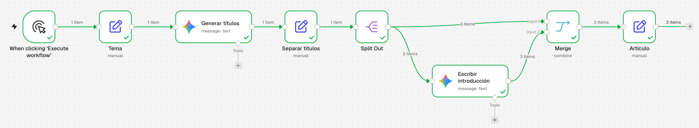

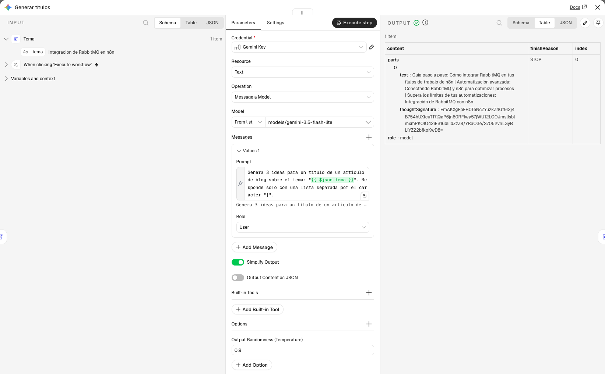

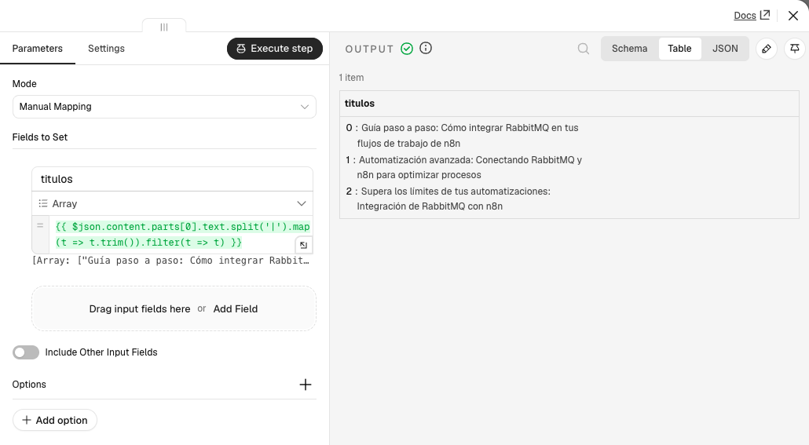

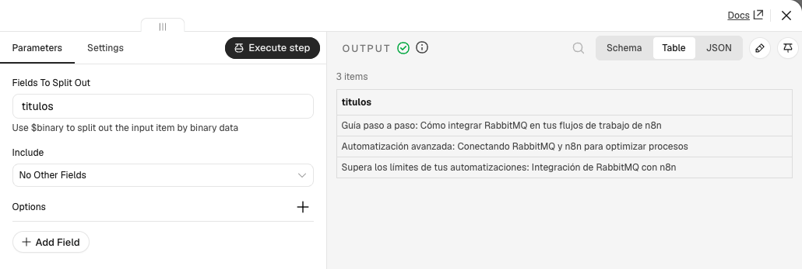

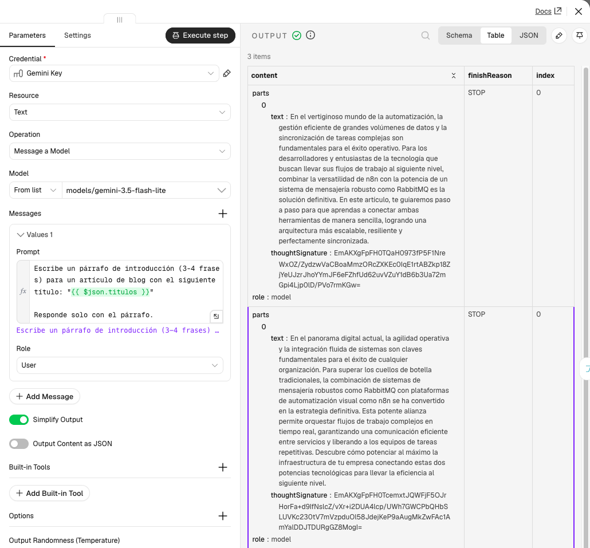

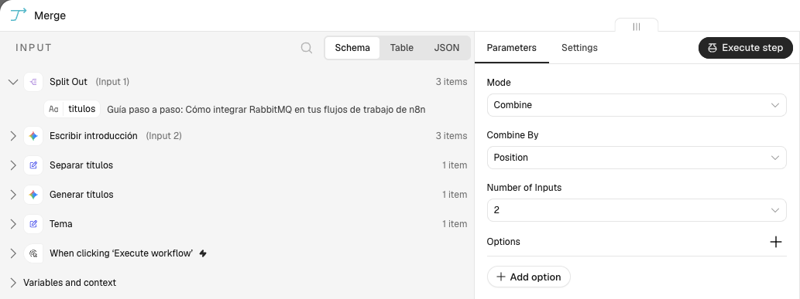

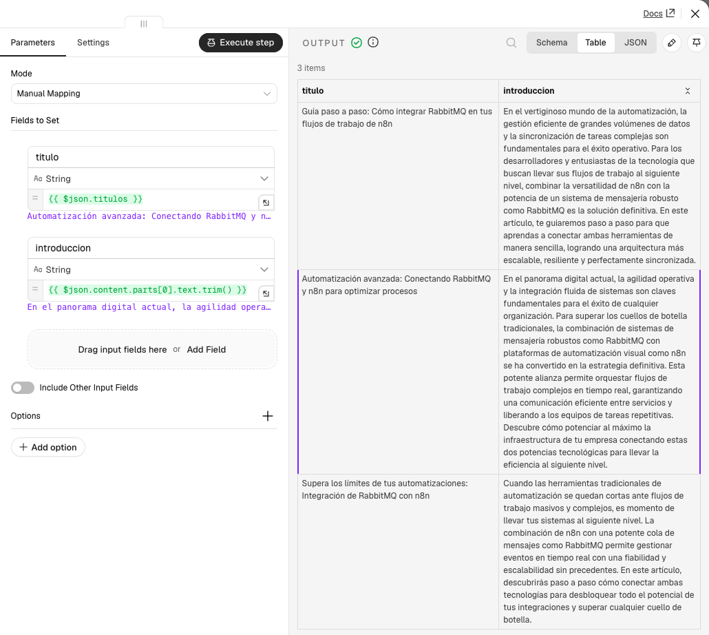
